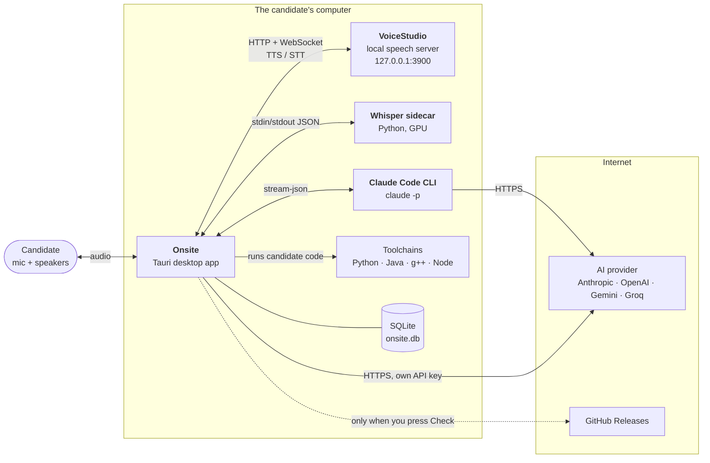
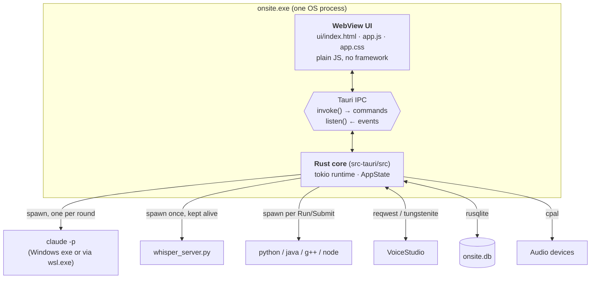
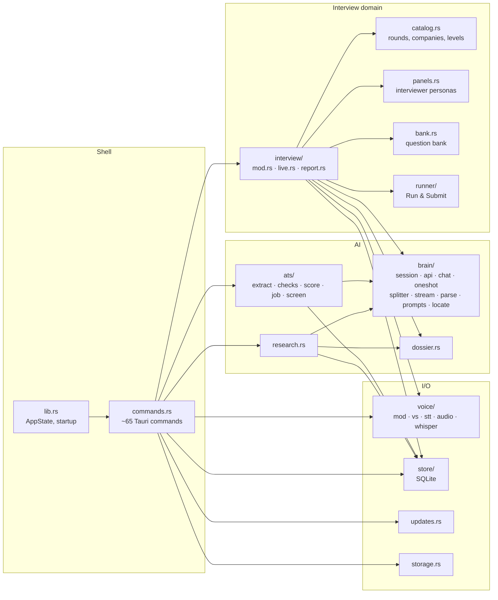
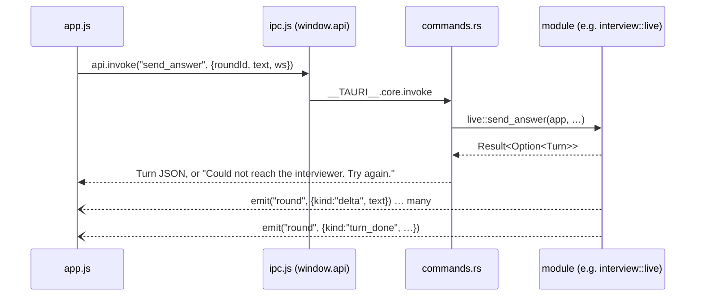
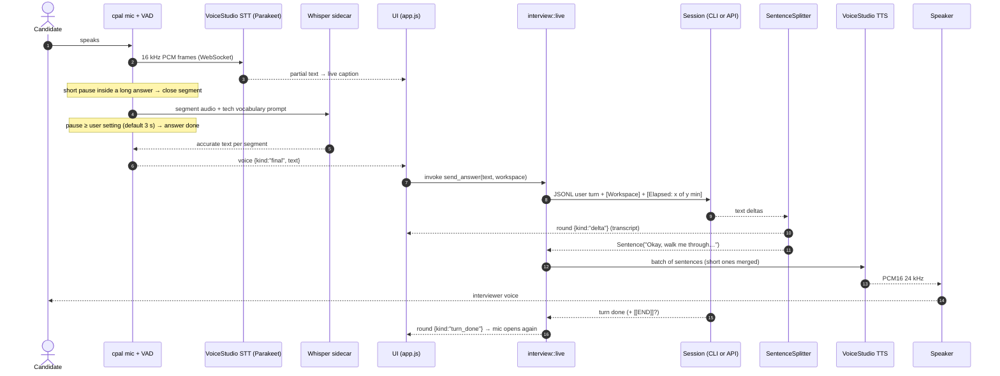
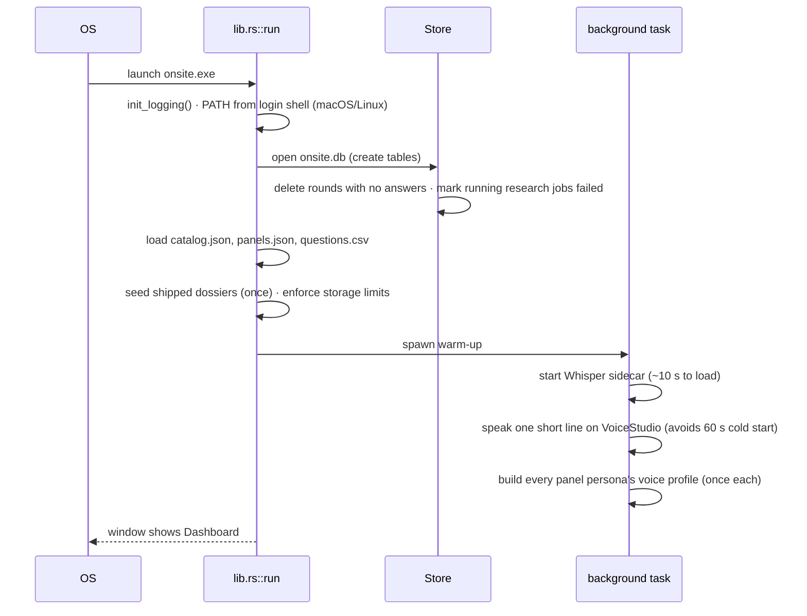
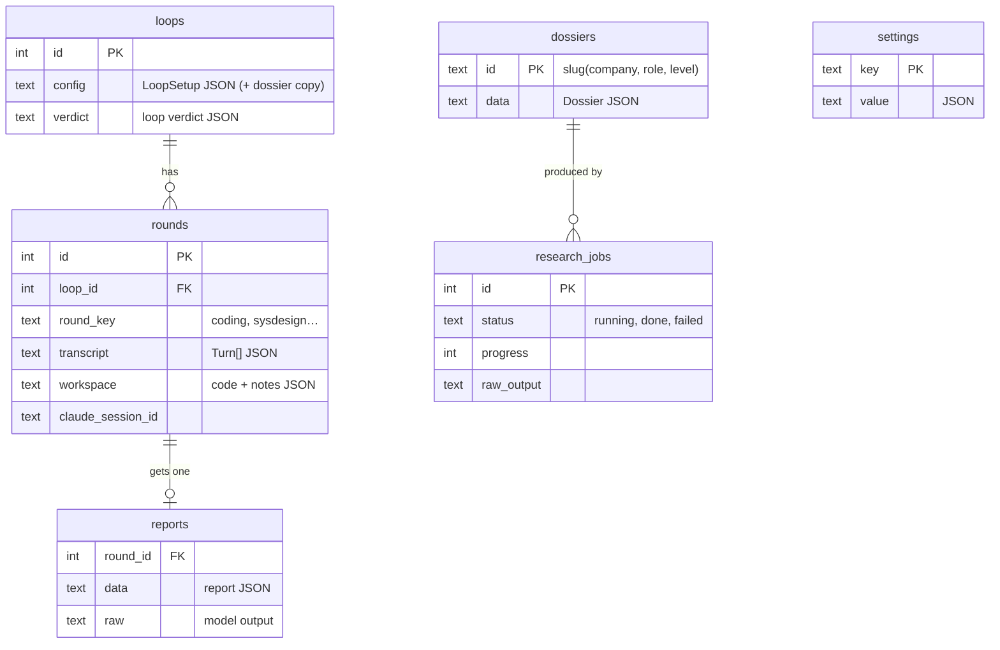

# Onsite architecture

> **Status:** Current (v0.1.2) · **Updated:** 2026-10-30 · **Read next:** [DD-02 Interview engine](DD-02-interview-engine.md)

Onsite is a desktop app that runs spoken mock interviews for software engineers. An AI plays the
interviewer. Speech runs on the user's own machine. Feedback comes at the end of each round and each loop.

This document is the map. It shows the processes, the modules, how data moves, and where to look in the
code. Each subsystem has its own design doc (DD) with the details.

## 1. The big picture



Three things leave the machine:

1. **Model calls** go to the one AI provider picked in Settings. They go either through the Claude Code CLI
   (the user's Claude login) or straight to a provider API with the user's own key.
2. **Research jobs** use that provider's web search to read public candidate reports.
3. **Update checks** call GitHub, and only when the user presses *Check*.

Audio never leaves the machine. VoiceStudio and Whisper both run locally.

## 2. Processes and containers



| Container | Tech | Lives in | Notes |
|---|---|---|---|
| UI | HTML/CSS/JS in the system WebView | `ui/` | No build step. Vendored editor and whiteboard in `ui/vendor/`. |
| Core | Rust, Tauri 2, tokio | `src-tauri/src/` | All logic, all I/O. The UI never talks to the network. |
| Interviewer process | `claude -p --input-format stream-json …` | spawned | Only when the provider is Claude Code. One per round, in an empty temp dir, no tools. |
| Whisper sidecar | Python + faster-whisper | `sidecar/whisper_server.py` | Uses VoiceStudio's bundled Python and model cache. |
| VoiceStudio | separate desktop app | not in this repo | TTS and live STT. Onsite never installs or updates it. |
| Code runner | the candidate's toolchains | spawned | Generated driver + candidate code, in a temp dir, with time limits. |
| Store | SQLite (bundled rusqlite) | `<app data>/onsite.db` | Settings, loops, rounds, reports, dossiers, research jobs. |

The UI's content security policy only allows `self` and the Tauri IPC channel
(`src-tauri/tauri.conf.json`), so the UI cannot fetch from the network even by mistake.

## 3. Module map



| Module | One-line job | Design doc |
|---|---|---|
| `lib.rs` | Builds `AppState`, runs startup tasks, registers commands. | this doc |
| `commands.rs` | Thin `#[tauri::command]` wrappers. Parse args, call a module, return JSON or a plain error. | this doc |
| `interview/` | Plans a loop, builds the interviewer prompt, runs a live round, writes reports and the verdict. | [DD-02](DD-02-interview-engine.md) |
| `brain/` | Talks to the AI: a live `Session` per round and `run_once` for one-shot jobs, on five providers. | [DD-01](DD-01-ai-brain.md) |
| `voice/` | Mic and speaker, VoiceStudio TTS/STT, the Whisper sidecar, turn-taking. | [DD-03](DD-03-voice-pipeline.md) |
| `research.rs`, `dossier.rs` | Background research jobs that produce company dossiers. | [DD-04](DD-04-research-dossiers.md) |
| `ats/` | Resume check: reads the file like an ATS, scores it, runs the AI screen. | [DD-05](DD-05-resume-check.md) |
| `bank.rs`, `runner/` | The coding question bank and the multi-language code runner. | [DD-06](DD-06-question-bank-runner.md) |
| `store/`, `storage.rs` | SQLite access; disk usage, limits and cleanup. | [DD-07](DD-07-storage-data.md) |
| `updates.rs` | Checks GitHub releases and installs an update. | [DD-08](DD-08-release-updates.md) |
| `catalog.rs`, `panels.rs` | Load `prompts/catalog.json` and `prompts/panels.json`. | [DD-02](DD-02-interview-engine.md) |

### AppState: the one shared object

Every command gets `State<AppState>` (`src-tauri/src/lib.rs`). It is the main hub in the code graph:
almost every subsystem reads from it.

```rust
pub struct AppState {
    pub store: Arc<Mutex<Store>>,                       // SQLite, std mutex (short, sync calls)
    pub catalog: Catalog,                               // prompts/catalog.json, read-only
    pub panels: panels::Panels,                         // prompts/panels.json, read-only
    pub prompts_dir: PathBuf,                           // repo prompts/ in dev, bundled in release
    pub data_dir: PathBuf,                              // app data folder
    pub research: Mutex<HashMap<i64, research::Running>>,                // live research jobs
    pub rounds: tokio::sync::Mutex<HashMap<i64, interview::live::ActiveRound>>, // live rounds
    pub bank: bank::Bank,                               // prompts/questions.csv, read-only
    pub voice: voice::Voice,                            // the speaker + the current round's voice loop
    pub prep_gen: AtomicU64,                            // cancels a stale "Getting the room ready"
}
```

Read-only data (catalog, panels, bank) is loaded once at startup. Mutable state sits behind a lock:
a std mutex for quick SQLite calls, a tokio mutex for live rounds (held across `.await`).

## 4. How the UI and the core talk

The UI calls **commands** with `api.invoke(name, args)` and gets a JSON value back, or an error string.
The core pushes **events** with `app.emit(name, payload)`. The UI subscribes with `api.listen(name, cb)`.
`ui/ipc.js` wraps both and logs failures to the app log.



### Events (core → UI)

| Event | Payload `kind`s / fields | Sent by | Used for |
|---|---|---|---|
| `round` | `started`, `delta`, `sentence`, `code`, `turn_done`, `error`, `exited` | `interview/live.rs` (from `brain::SessionEvent`) | Streaming interviewer text, code to the workspace, end of turn. |
| `voice` | `speaking`, `listening`, `speech_start`, `partial`, `final`, `latency`, `level`, `error`, `held` | `voice/mod.rs`, `voice/stt.rs` | The orb, live caption, waveform, the spoken answer. |
| `prep` | `{step, state, detail}` | `interview/live.rs` | The "Getting the room ready" checklist. |
| `research` | `{job, live}` | `research.rs` | The research progress card. |
| `dossiers_changed` | none | `research.rs` | Reload the dossier list. |
| `loop_feedback` | `{loop_id, done, total, stage}` | `interview/live.rs` | Progress while writing all reports for a loop. |
| `mic_level` | `{mic}` | `commands.rs` | The meter on the Get ready screen. |
| `voice_test` | voice event | `commands.rs` | Mic test on Get ready. |
| `update_progress` | `{tag, received, total}` | `updates.rs` | Download bar for an update. |

### Commands (UI → core), by area

| Area | Commands |
|---|---|
| Catalog and settings | `get_catalog`, `get_panels`, `get_settings`, `save_settings`, `set_provider`, `ai_keys`, `set_api_key`, `list_models`, `detect_claude`, `health_check`, `ui_log` |
| Loops and rounds | `create_loop`, `start_round`, `cancel_start`, `send_answer`, `end_round`, `run_code`, `set_round_lang`, `get_round`, `delete_round`, `history` |
| Feedback | `generate_report`, `get_report`, `loop_verdict`, `loop_feedback`, `get_loop_feedback`, `get_goal`, `set_goal` |
| Voice | `voice_status`, `voice_launch`, `voice_test_speak`, `voice_test_listen`, `voice_finish`, `voice_mute`, `voice_cancel_listen`, `voice_interrupt`, `voice_set_devices`, `audio_devices`, `mic_monitor_start`, `mic_monitor_stop`, `voice_persona_preview` |
| Research and dossiers | `research_start`, `research_cancel`, `research_retry`, `research_dismiss`, `research_jobs`, `list_dossiers`, `delete_dossier`, `import_dossier`, `export_dossier` |
| Resume check | `read_document`, `ats_check`, `ats_screen`, `ats_last` |
| App | `app_version`, `check_updates`, `install_update`, `voicestudio_version`, `storage_info`, `set_storage_limits`, `clear_log`, `clear_temp`, `vacuum_db`, `open_folder`, `get_backdrop`, `set_backdrop`, `clear_backdrop` |

The full list is registered in `tauri::generate_handler!` in `src-tauri/src/lib.rs`.

## 5. Life of a spoken turn

This is the hot path. The goal: the first interviewer audio arrives less than 2.5 s after the candidate stops
talking (milestone M3).



Key ideas:

- **Text streams.** Sentences go to TTS the moment they are complete, so speech starts before the reply is done.
- **Code never goes to TTS.** Fenced code blocks go to the workspace tab "From interviewer" instead.
- **Two STT passes.** Parakeet gives a fast live caption. Whisper large-v3 on the GPU gives the text that gets sent.
  If Whisper is missing, Parakeet's text is used.
- **The workspace rides along.** Only the parts of the editor or whiteboard that changed since the last turn are attached.

Details: [DD-02](DD-02-interview-engine.md) for the turn, [DD-03](DD-03-voice-pipeline.md) for audio,
[DD-01](DD-01-ai-brain.md) for the model call.

## 6. Startup



The warm-up only runs when voice is turned on. The UI is usable at once; nothing waits on it.

## 7. Concurrency model

Everything async runs on Tauri's tokio runtime. Long work is a spawned task, never a blocked command.

| Task | Started by | Lifetime | Cancelled by |
|---|---|---|---|
| Session reader (`brain::session::read_loop` or the API stream) | `Session::start` | one round | `end_round`, crash |
| Round event forwarder (`spawn_session`) | `start_round` | one round | channel closes |
| Voice loop (`Voice::begin`) | `start_round` | one round | `Voice::end()` aborts it |
| Speaker meter | `Voice::begin` | one round | weak sender dropped |
| Research job | `research_start` | one job, max 45 min | `research_cancel` (abort) |
| Whisper sidecar | startup / round start | app lifetime | app exit |
| Warm-up | startup | ~1–2 min | finishes |

Rules the code follows:

- **One round at a time.** `start_round` closes any round left open (`close_other_rounds`), so no stray Claude process lives on.
- **One reply at a time.** `send_answer` refuses while the interviewer is still replying (`busy`), unless the
  reply is older than 120 s (`REPLY_STALE`). Turns never pile up.
- **The loader can be cancelled.** `prep_gen` is bumped by every start and by `cancel_start`. A start whose
  number is out of date gives up.
- **Audio devices open on one thread.** Opening WASAPI devices from tokio workers failed after a device change
  ("Cannot change thread mode after it is set"), because another library had set that worker's COM mode.
  `voice/audio.rs` runs every cpal call on one long-lived `onsite-audio` thread (`on_audio_thread`).

## 8. Data at rest



Most columns hold JSON. The schema is small on purpose: the shape lives in Rust types (`LoopSetup`, `Turn`,
`Dossier`, the report JSON), and SQLite just keeps it. See [DD-07](DD-07-storage-data.md) for every
settings key and every file on disk.

## 9. Configuration and content

The interview *content* is data, not code:

| File | What it holds | Loaded by |
|---|---|---|
| `prompts/catalog.json` | 9 round types (guide, rubric, minutes, openers), 14 company styles, 5 levels with the bar, 3 temperaments | `catalog.rs` |
| `prompts/panels.json` | 2 panels × 5 interviewers: traits, strictness, backstory, voice design, rounds they own | `panels.rs` |
| `prompts/questions.csv` | 81 coding problems with typed tests and reference solutions | `bank.rs` |
| `prompts/*.md` | Prompt templates with `{{placeholders}}`: interviewer, persona block, dossier block, report, verdict, research, ATS job, ATS screen | `brain/prompts.rs` |
| `dossiers/*.json` | Shipped company dossiers, imported once | `research::seed` |

In a dev build these are read from the repo, so a prompt edit needs no rebuild. A release build reads the
copies bundled as Tauri resources (`resource()` in `lib.rs`).

## 10. Errors

All fallible code returns `error::Result<T>`. `AppError` serializes to **its message only**, so the UI can show it
as is. Messages are written for the user: short and plain, with the fix when there is one.

```rust
#[error("Claude Code not found. Install it or set its path in Settings.")] ClaudeNotFound,
#[error("{0}")] Ai(String),       // "Add your Gemini key in Settings first."
#[error("{0}")] Voice(String),    // "The microphone changed. Tap the mic to listen again."
#[error("{0}")] Invalid(String),  // "The interviewer is still talking. Send again when they finish."
```

Logs go to `%LOCALAPPDATA%\Onsite\onsite.log` on Windows, `~/Library/Logs/Onsite` on macOS and
`~/.local/state/Onsite` on Linux. UI errors reach the same log through the `ui_log` command.

## 11. Security model in one table

| Threat | Defence | Where |
|---|---|---|
| The interviewer model does something on the machine | No tools on every provider. CLI: `--tools ""`, `--strict-mcp-config`, `--disable-slash-commands`, `--setting-sources ""`, empty temp dir. | `brain/locate.rs::isolation_args` |
| A candidate types "/doctor" or similar | Slash commands and skills are off. | same |
| Model output or a dossier contains instructions | Treated as data. Parsed as JSON or shown as text. Never executed. | `brain/parse.rs`, `dossier.rs` |
| Candidate code harms the machine | It is the candidate's own code on their own machine. Runs in a temp dir with time limits and a process-tree kill. | `runner/mod.rs` |
| API keys leak | Stored only in local SQLite (`api_keys`), never sent to the UI, never logged. | `lib.rs`, `commands::ai_keys` |
| A fake update | Downloads only from `github.com` release URLs of the Onsite repo. | `updates.rs` |
| The UI is tricked into fetching | The CSP allows no network. | `tauri.conf.json` |

## 12. Repository layout

```text
onsite/
├── src-tauri/            Rust core (Tauri 2)
│   ├── src/              modules listed in section 3
│   ├── examples/         api_e2e.rs (live provider check), ats_check.rs (offline resume check)
│   ├── tests/            ats_files.rs + fixtures
│   └── tauri.conf.json   window, CSP, bundle, resources
├── ui/                   the whole UI: index.html, app.js, app.css, themes.css, ipc.js, theme-boot.js
│   ├── vendor/           built editor (CodeMirror 6) and whiteboard (Excalidraw)
│   └── assets/           logo, twilight backdrop
├── ui-vendor/            npm project that builds ui/vendor/
├── prompts/              catalog, panels, question bank, prompt templates
├── dossiers/             shipped dossiers
├── sidecar/              whisper_server.py
├── docs/                 research notes, dossier schema, these docs
└── .github/              release workflow, issue forms
```

## 13. Platforms

| Platform | Status | Notes |
|---|---|---|
| Windows 11 | Main platform, used daily | NSIS installer. Claude Code on Windows PATH or in WSL. |
| macOS | Built in CI, not yet tested by a person | Universal dmg, ad-hoc signed, not notarized. PATH taken from the login shell. |
| Linux | Built in CI, not yet tested by a person | AppImage (self-updating) and .deb. |

VoiceStudio is Windows-first. Without it, the app falls back to typed rounds.
