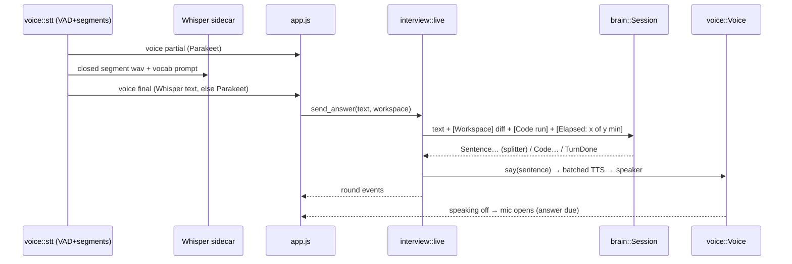

# ARCHITECTURE

Onsite: Tauri 2 desktop app. Rust core (`src-tauri/src`) + plain-JS UI (`ui/`) in the system WebView. Runs spoken
mock interviews; AI = one user-chosen provider; speech = local VoiceStudio + Whisper sidecar.

## Processes

| Process | Spawned by | Lifetime | Talks via |
|---|---|---|---|
| `onsite.exe` (UI + core) | user | app | Tauri IPC (commands + events) |
| `claude -p` (interviewer) | `brain::session::ClaudeSession::start` | one round; empty temp cwd `onsite-round-*` | stream-json over stdin/stdout |
| `claude -p` (one-shot job) | `brain::oneshot::run_cli` | one job; temp cwd `onsite-job-*` | prompt on stdin, stream-json out |
| `wsl.exe -e bash -lc "cd … && exec claude …"` | same, when Claude Code is only in WSL | same | same |
| `sidecar/whisper_server.py` | `voice::whisper::start` | app (restarted at round start if dead) | JSON lines stdin/stdout |
| python/node/java/main.exe | `runner::run` | one Run/Submit | `\x1e`-prefixed JSON lines |
| VoiceStudio | user (or `voice_launch`) | external | HTTP + WS on `127.0.0.1:3900` |

Network leaves the machine only for: model calls (provider), research web search (provider-side tools), update
checks (GitHub, on user click). UI CSP allows only `self` + IPC → the UI cannot fetch.

## Module map (`src/`)

| Module | Responsibility | Doc |
|---|---|---|
| `lib.rs` | `Settings`, `AppState`, `backend()`, `claude_location()`, startup (`run`), command registration | here |
| `commands.rs` | thin `#[tauri::command]` wrappers (~65); no logic beyond arg shaping | here |
| `error.rs` | `AppError` → serializes as message string | here |
| `interview/{mod,live,report}.rs` | loop setup, prompt assembly, live rounds, reports, verdict | INTERVIEW.md |
| `catalog.rs`, `panels.rs` | `prompts/catalog.json`, `prompts/panels.json` | INTERVIEW.md |
| `brain/*` | providers, sessions, one-shot jobs, splitter, stream parsing, JSON extraction, prompt render, CLI location | AI.md |
| `voice/*` | audio devices, VAD, STT, TTS, Whisper sidecar, round voice loop | VOICE.md |
| `research.rs`, `dossier.rs` | research jobs, dossier validation/storage | RESEARCH.md |
| `ats/*` | resume check | RESUME-CHECK.md |
| `bank.rs`, `runner/*` | question bank, code runner | CODING.md |
| `store/*`, `storage.rs` | SQLite; disk usage/limits/cleanup/backdrop | STORAGE.md |
| `updates.rs` | GitHub releases, install | RELEASE.md |

## AppState (`lib.rs`)

```rust
store: Arc<std::sync::Mutex<Store>>            // short sync calls; never held across .await
catalog: Catalog; panels: Panels; bank: Bank   // read-only, loaded at startup
prompts_dir: PathBuf; data_dir: PathBuf        // dev: repo prompts/; release: bundled resources
research: Mutex<HashMap<i64, research::Running>>               // live jobs: counters + AbortHandle
rounds: tokio::sync::Mutex<HashMap<i64, interview::live::ActiveRound>>  // held across .await
voice: voice::Voice                            // speaker + current round voice loop
prep_gen: AtomicU64                            // loader cancellation generation
```

`AppState::backend()` → `Backend::Cli(ClaudeLocation)` if provider = claude_code, else `Backend::Api(ApiClient)` with key
from settings `api_keys`, else `AppError::Ai("Add your <P> key in Settings first.")`.

## Invariants (do not break)

1. Interviewer/report/verdict/ATS calls send **no tools** on every provider. Only research gets web search/fetch. (PRODUCT N4)
2. Model output and dossiers are data: parsed to JSON/text, rendered escaped (`esc()`), never executed. (N5)
3. At most one live round: `start_round` calls `close_other_rounds` first.
4. One pending interviewer reply per round: `send_answer` rejects while `session.busy(120 s)`.
5. API keys never reach the UI (`ai_keys` returns presence only) and are never logged.
6. Every turn is persisted immediately (`RoundLog::persist`); rounds with no candidate answer are deleted.
7. No provider SDKs; `reqwest` only. No keys from env/files.
8. Prompt text lives in `prompts/*.md` + `catalog.json`, never in JS.
9. UI colours via CSS tokens only (UI.md).

## IPC

Commands (registered in `lib.rs::run`, `generate_handler!`):

| Area | Commands |
|---|---|
| catalog/settings | `get_catalog get_panels get_settings save_settings set_provider ai_keys set_api_key list_models detect_claude health_check ui_log` |
| rounds | `create_loop start_round cancel_start send_answer end_round run_code set_round_lang get_round delete_round history` |
| feedback | `generate_report get_report loop_verdict loop_feedback get_loop_feedback get_goal set_goal` |
| voice | `voice_status voice_launch voice_test_speak voice_test_listen voice_finish voice_mute voice_cancel_listen voice_interrupt voice_set_devices audio_devices mic_monitor_start mic_monitor_stop voice_persona_preview` |
| research | `research_start research_cancel research_retry research_dismiss research_jobs list_dossiers delete_dossier import_dossier export_dossier` |
| resume | `read_document ats_check ats_screen ats_last` |
| app | `app_version check_updates install_update voicestudio_version storage_info set_storage_limits clear_log clear_temp vacuum_db open_folder get_backdrop set_backdrop clear_backdrop` |

Events (core → UI):

| Event | Payload | Source |
|---|---|---|
| `round` | `SessionEvent` tagged `kind`: `started{session_id,model} delta{text} sentence{text} code{lang,code} turn_done{text,ttft_ms,total_ms,ended} error{message,recoverable} exited` (all carry `round_id`) | `interview::live::spawn_session` |
| `voice` | `VoiceEvent` tagged `kind`: `speaking{active} listening{active} speech_start partial{text} final{text,stt_ms} latency{ms} level{mic,out} error{message} held{text}` | `voice/mod.rs`, `voice/stt.rs` |
| `prep` | `{step,state,detail}`; state ∈ run/ok/warn/fail/off | `interview::live::prep` |
| `research` | `{job: JobRow, live: Live}` | `research::emit` |
| `dossiers_changed` | `()` | `research::run` |
| `loop_feedback` | `{loop_id,done,total,stage}` | `interview::live::loop_feedback` |
| `mic_level` / `voice_test` | `{mic}` / VoiceEvent | `commands.rs` |
| `update_progress` | `{tag,received,total}` | `updates::download` |

## Hot path: one spoken turn



## Startup (`lib.rs::run`)

`init_logging` → (unix) `path_from_login_shell` → open `onsite.db` → `delete_unanswered_rounds` → `fail_running_jobs` →
load catalog/panels/bank → `manage(AppState)` → `research::seed` (once) → `storage::enforce` → spawn warm-up (if voice
enabled: `whisper::start`, `commands::warm_voice`, prebuild every persona voice profile).

## Concurrency

All async on Tauri's tokio runtime. Spawned tasks: session reader, round event forwarder, voice loop (aborted by
`Voice::end`), speaker meter (weak sender), research job (AbortHandle), warm-up. cpal calls run on a single
`onsite-audio` thread (`voice::audio::on_audio_thread`; WASAPI COM mode clashed on tokio workers).

## Errors

`AppError {ClaudeNotFound, Claude, Ai, Voice, NotFound, Invalid, Io, Json, Db}`; `Serialize` = message only. Messages
are user-facing: short, plain, include the fix. UI shows them via `errText(e)` + `toast`. Logs: Windows
`%LOCALAPPDATA%\Onsite\onsite.log`, macOS `~/Library/Logs/Onsite`, Linux `$XDG_STATE_HOME/Onsite` or
`~/.local/state/Onsite`. UI errors reach it via `ui_log`.

## Content files (data, not code)

`prompts/catalog.json` (ROUNDS, COMPANIES, LEVELS, LEVEL_BAR, NAMES, TEMPER) · `prompts/panels.json` · `prompts/questions.csv` ·
`prompts/{interviewer,persona_block,dossier_block,report,verdict,research,ats_job,ats_screen}.md` · `dossiers/*.json`.
Dev builds read the repo copies (edit → next round uses it, no rebuild); release reads Tauri resources
(`prompts/`, `dossiers/`, `sidecar/`).

## Repo layout

`src-tauri/` (core, `examples/api_e2e.rs`, `examples/ats_check.rs`, `tests/ats_files.rs`) · `ui/` (+ `vendor/` built by
`ui-vendor/`) · `prompts/` · `dossiers/` · `sidecar/` · `docs/` · `.github/workflows/release.yml`.

## Platforms

Windows 11: primary, daily use. macOS (universal dmg, ad-hoc signed) and Linux (AppImage, deb): CI-built, not run by a
person yet (2026-10-29). VoiceStudio is Windows-first; without it rounds are typed.
