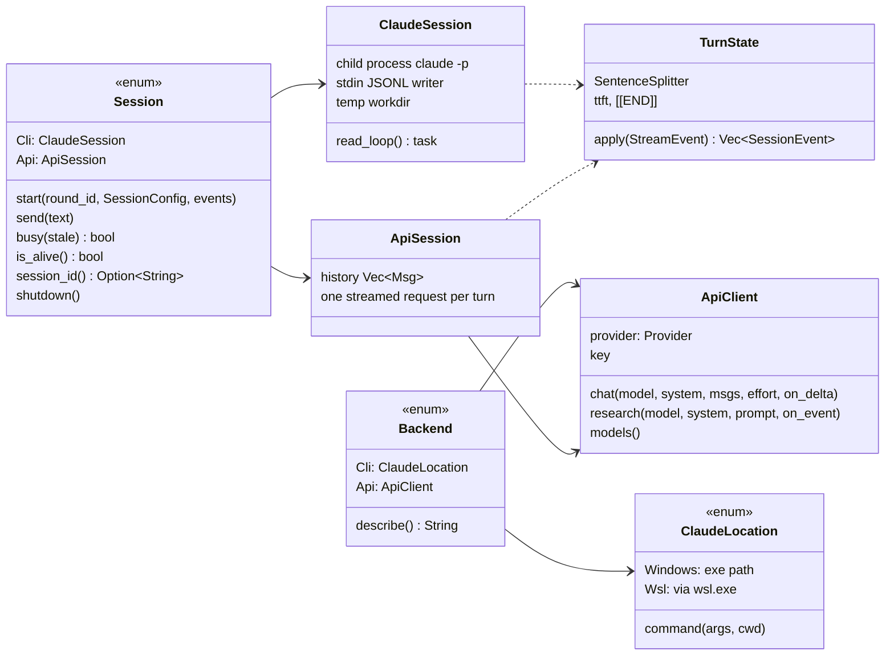
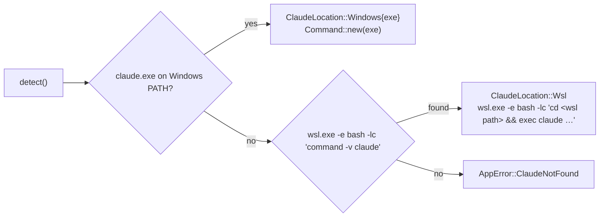
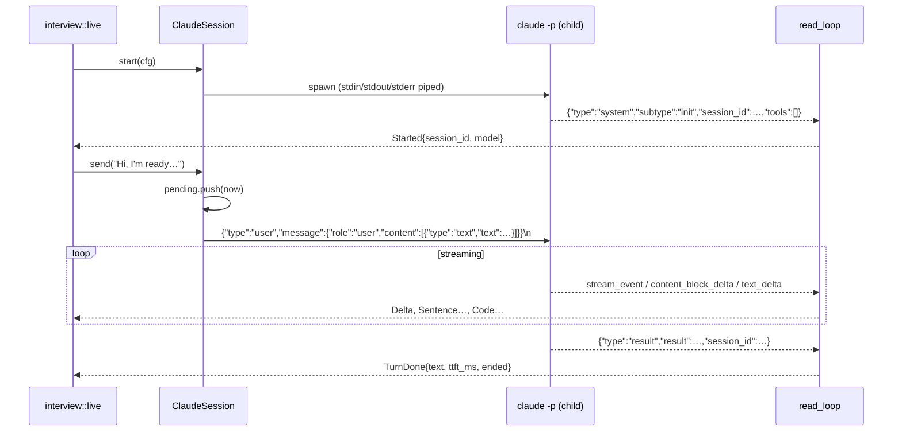
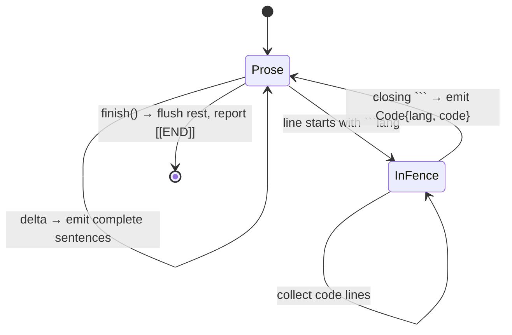

# DD-01 · The AI brain: sessions, one-shot jobs and five providers

> **Status:** Current (v0.1.2) · **Updated:** 2026-10-30 · **Code:** `src-tauri/src/brain/` · **Product:** [PRD-07](PRD-07-settings-privacy-updates.md), [PRD-02](PRD-02-interview-loops.md)

## 1. Purpose

`brain/` hides *which* AI is used. The rest of the app asks for one of two things:

1. **A live `Session`** for a round: send a candidate turn, get a stream of events back (text, sentences, code, turn done).
2. **A one-shot job** (`run_once`): one prompt in, one answer out, optionally parsed as JSON. Used for reports, the
   verdict, research, the ATS keyword read and the AI screen.

Both work on the Claude Code CLI and on four HTTP APIs. No provider SDKs: plain `reqwest` with the system TLS.

## 2. Shape



| File | Job |
|---|---|
| `chat.rs` | `Backend`, `Session` (the enum the rest of the app uses), `ApiSession`, `api_once`. |
| `session.rs` | `ClaudeSession`: the long-lived CLI process, `read_loop`, `TurnState`, crash messages. |
| `api.rs` | `Provider`, `ApiClient`: Claude Messages, OpenAI Responses, Gemini, Groq. SSE parser, retries, rate-limit waits. |
| `oneshot.rs` | `run_once` / `run_once_with_timeout` on either backend. |
| `stream.rs` | Parses Claude Code's `stream-json` lines into `StreamEvent`s. |
| `splitter.rs` | `SentenceSplitter`: streaming text → speakable sentences + code blocks; strips `[[END]]`. |
| `parse.rs` | `extract_json`: tolerant JSON extraction from model text. |
| `prompts.rs` | Loads `prompts/*.md` (drops the `<!-- … -->` header) and renders `{{placeholders}}`. |
| `locate.rs` | Finds `claude` (Windows PATH or WSL), builds the command line, `isolation_args`. |

`AppState::backend()` (in `lib.rs`) decides per call: Claude Code → `Backend::Cli(location)`, otherwise
`Backend::Api(ApiClient::new(provider, key))`, or an error asking for the key.

## 3. The events a session emits

```rust
pub enum SessionEvent {            // sent to the UI as the `round` event, tagged by `kind`
    Started  { round_id, session_id, model },
    Delta    { round_id, text },                 // raw text, for the transcript
    Sentence { round_id, text },                 // one speakable sentence, for TTS
    Code     { round_id, lang, code },           // a fenced block, for the workspace
    TurnDone { round_id, text, ttft_ms, total_ms, ended },  // ended = saw [[END]]
    Error    { round_id, message, recoverable },
    Exited   { round_id },
}
```

`TurnState` turns raw stream events into these, for both backends, so the UI cannot tell them apart.

## 4. Claude Code CLI backend

### Command line

```text
claude -p
  --tools ""                      # no built-in tools at all (init event shows "tools": [])
  --setting-sources ""            # no user/project settings, no CLAUDE.md
  --strict-mcp-config            # no MCP servers
  --disable-slash-commands       # no slash commands or skills ("/doctor" can't reach anything)
  --model <interviewer model>
  --system-prompt-file <tmp>/.system-prompt.md   # full replace of Claude Code's coding-agent prompt
  --input-format stream-json --output-format stream-json --verbose --include-partial-messages
  [--resume <session id>]        # only to reconnect after a crash
```

Research jobs use the same isolation flags with `--tools "WebSearch,WebFetch"`.

Why each choice (verified live on Claude Code 2.1.310, see `CLAUDE.md`):

- **`--tools ""`, not `--allowedTools`.** Allow/deny lists are permission rules; they do not remove tools.
- **Full system-prompt replace.** With `--append-system-prompt` the coding-agent prompt stays and the model quotes its
  environment rules back. With a replace it only sees the interviewer prompt. The prompt is passed as a **file**
  so long prompts don't hit command-line limits (Windows and the WSL bridge).
- **No `--bare`.** It ignores the OAuth login and wants `ANTHROPIC_API_KEY`.
- **Empty temp dir as cwd** (`onsite-round-*`). Nothing from a repo can leak in.

### Windows vs WSL



Paths are translated for WSL (`to_wsl_path`: `C:\Users\…` → `/mnt/c/Users/…`) and every argument is shell-quoted.
The detected location is saved in settings; if a saved `.exe` disappears it is detected again.

### One process, many turns



- **Busy:** a turn is pending from `send` until its `result`. `send_answer` refuses a new turn while busy, unless the
  pending turn is older than 120 s.
- **stderr** is logged and the last 20 lines are kept for a short crash message.
- **Shutdown** closes stdin (claude exits cleanly), kills after 5 s.
- **Crash recovery:** if `send` fails, `interview::live` starts a new session with `resume: Some(session_id)` and
  re-sends the turn once.

## 5. API backends

`ApiSession` keeps the conversation in memory and makes one streamed request per turn (`Effort::Low`).
One-shot jobs call `ApiClient::chat` with `Effort::Medium`, or `research` with web tools.

| | Claude API | OpenAI | Gemini | Groq |
|---|---|---|---|---|
| Endpoint | `POST /v1/messages` (SSE) | `POST /v1/responses` | `models/{m}:streamGenerateContent?alt=sse` | `api.groq.com/openai/v1/chat/completions` |
| Auth | `x-api-key` | Bearer | `x-goog-api-key` | Bearer |
| Effort | `low` live, `medium` jobs (Claude 5 / 4.6+) | `reasoning.effort` on gpt-5/6/o* | — | `reasoning_effort` + `include_reasoning:false` on gpt-oss |
| Extras | `fallbacks:"default"` + beta header on current models; resend without on a 400 naming fallbacks | `store:false` | `thought` parts skipped | `stop` on `[Elapsed:`, `[Workspace]`, `[The candidate` |
| Research tool | `web_search`/`web_fetch` (`_20260209` on 4.6+, else older versions); `pause_turn` → resend up to 8× | `web_search` | `google_search` grounding; searches counted from `groundingMetadata` | `browser_search`, `tool_choice:"auto"`, not streamed, up to 3 tries on flaky errors |
| Live tools | none | none | none | none |

### Why Groq has stop sequences

On Groq's free tier, gpt-oss-120b as interviewer sometimes kept writing past its turn, inventing the candidate's next
message (`…index type?[Elapsed: 1 of 10 min]`), and the report then credited that made-up answer. Stop sequences on the
markers the app adds to candidate turns cut that off. Qwen did not do this and asked better follow-ups, so it is the
Groq interviewer default.

### Rate limits and timeouts

| Constant | Value | Where |
|---|---|---|
| Max wait per 429 | 60 s (uses `retry-after`) | `api.rs` |
| Max total rate wait | 90 s (`MAX_RATE_WAIT`) | `api.rs` |
| Chat request timeout | 5 min | `api.rs` |
| API research timeout | 25 min | `api.rs` |
| One-shot job timeout | 10 min | `oneshot.rs` |
| Research job limit | 45 min | `research.rs` |
| Stale reply | 120 s | `interview/live.rs` |

## 6. The sentence splitter

The splitter is what makes voice feel fast: TTS can start on sentence one while the model writes sentence three.



Rules (`splitter.rs`):

- A sentence ends at `.`, `!` or `?` followed by space or end, but **not** after `e.g`, `i.e`, `vs`, `etc`, `Mr`, `Mrs`,
  `Ms`, `Dr` (case-sensitive, so "1.5 ms." still ends a sentence while "Ms." does not).
- Code fences go to `Piece::Code`, never to speech.
- `[[END]]` is removed from the text and reported once, at `finish()`.

Example:

```text
deltas:  "Okay. Let's look at e.g. the retry path." | " Here's a snippet:\n```java\nretry();\n```\nWhat breaks?\n[[END]]"
pieces:  Sentence("Okay.")
         Sentence("Let's look at e.g. the retry path.")
         Sentence("Here's a snippet:")
         Code{lang:"java", code:"retry();\n"}
         Sentence("What breaks?")
finish:  ended = true
```

## 7. One-shot jobs and tolerant JSON

`run_once(backend, prompt, tools, model, on_event)` returns `OneShot { text, json, duration_ms, model }`.
On the CLI it runs `claude -p` once in an empty `onsite-job-*` temp dir with `--output-format stream-json`
(so research progress can be read live). The prompt goes over **stdin**: transcripts are far longer than a Windows
command line allows.
On an API it uses a fixed short system prompt ("…When asked for JSON, reply with only that JSON").

`extract_json` tries, in order:

1. the whole text as JSON;
2. the body of a fenced code block (a fenced block beats braces in surrounding prose);
3. from the first `{` to the last `}`.

Garbage → `None`, and the caller shows a plain error and keeps the raw text.

| Job | Prompt | Tools | Model setting | Caller |
|---|---|---|---|---|
| Round report | `report.md` | none | report model | `interview/live.rs::generate_report` |
| Loop verdict | `verdict.md` | none | report model | `loop_verdict` |
| Research | `research.md` | web | report model | `research.rs` |
| ATS job keywords | `ats_job.md` | none | interviewer model | `ats/job.rs` |
| AI screen | `ats_screen.md` | none | report model | `ats/screen.rs` |

## 8. Prompts

Templates live in `prompts/*.md`. Each starts with an HTML comment listing its placeholders, which `prompts::load`
strips. `render` replaces `{{name}}` with values and leaves unknown placeholders alone (tested:
`renders_and_ignores_unknown`). Prompt text is never hard-coded in JS.

## 9. Health check

Settings → *Run health check* sends `Reply with OK` through the current backend and shows the reply, latency and
`Backend::describe()` (e.g. `WSL: claude` or `Groq API`).

## 10. Testing

- Unit tests: splitter, stream parsing, JSON extraction, SSE parser, provider quirks, crash messages.
- Live check without the UI: `echo <key> | cargo run --example api_e2e -- groq [iv model] [report model]`
  (`--skip-research`, `--research-only`). The key is read from stdin only.

## 11. Known gaps

- Claude API, OpenAI and Gemini have not run against a live key yet.
- CLI round trips are ~6 s on a warm process, which makes the 2.5 s voice budget hard on Claude Code.
- No temperature control on the CLI; variety is handled in prompts ([DD-02](DD-02-interview-engine.md)).
