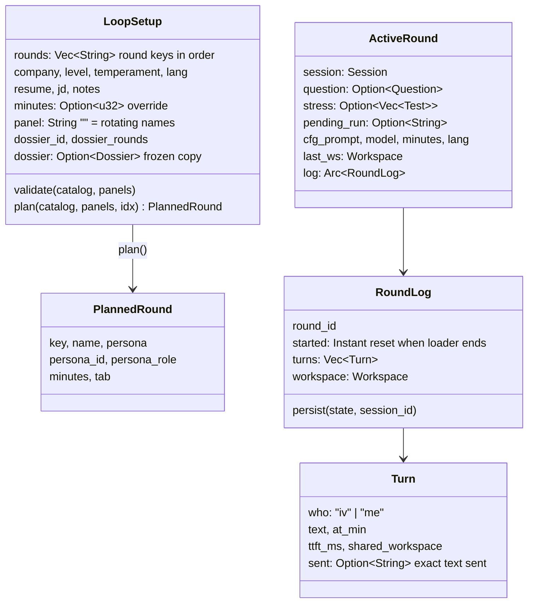
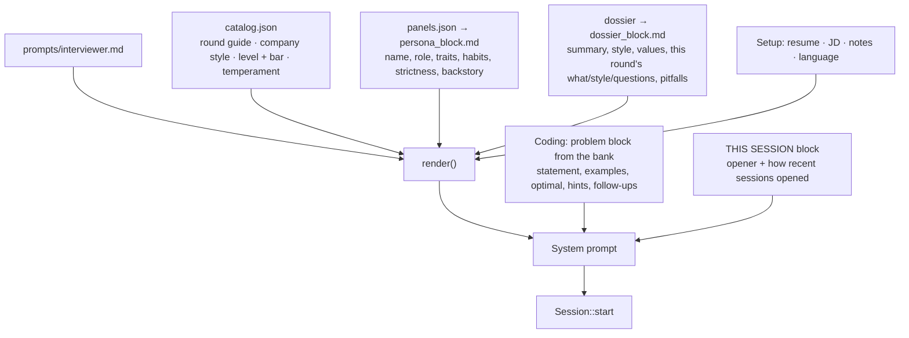
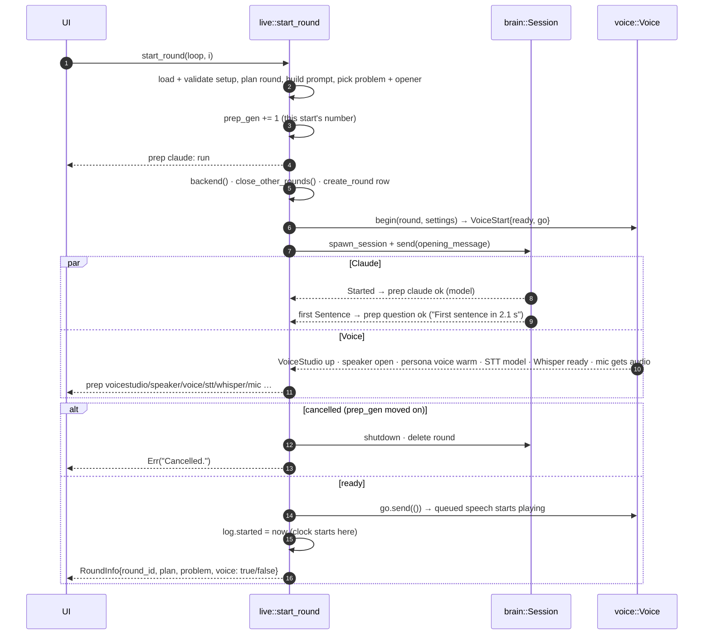
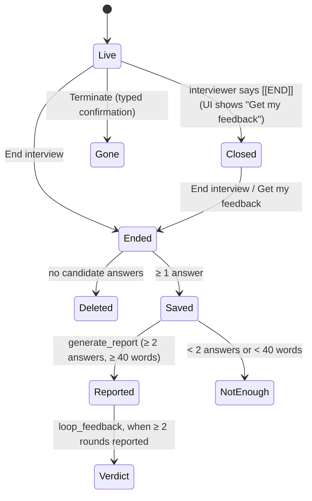

# DD-02 · Interview engine: loops, rounds, reports

> **Status:** Current (v0.1.2) · **Updated:** 2026-10-30 · **Code:** `src-tauri/src/interview/`, `catalog.rs`, `panels.rs` · **Product:** [PRD-02](PRD-02-interview-loops.md)

## 1. Purpose

The interview engine turns a setup ("SDE-2, Google style, coding + system design, my resume") into live rounds,
keeps every turn saved, and writes the feedback. It is the module that ties the others together.

| File | Job |
|---|---|
| `interview/mod.rs` | `LoopSetup` (validate, `plan`), interviewer prompt assembly, opener rotation, `Workspace`, `candidate_message`. |
| `interview/live.rs` | Running rounds: `create_loop`, `start_round` (the loader), `send_answer`, `run_code`, `end_round`, `generate_report`, `loop_verdict`, `loop_feedback`. |
| `interview/report.rs` | Review threshold, metrics, transcript text, report and verdict prompts. |
| `catalog.rs` | `prompts/catalog.json`: rounds, company styles, levels and their bar, temperaments, fallback names. |
| `panels.rs` | `prompts/panels.json`: panels, personas, persona prompt variables, voice designs. |

## 2. Data model



`LoopSetup` is saved as JSON in `loops.config`. In company mode, `create_loop` stores a **copy** of the dossier with only
the chosen rounds, so editing or deleting the dossier later never changes a past loop.

## 3. Building the interviewer prompt



Placeholders in `interviewer.md`: `persona`, `persona_role`, `persona_block`, `company_line`, `round_name`, `round_minutes`,
`round_index`, `round_count`, `round_guide`, `company_style`, `level_name`, `level_bar`, `temperament`, `lang`,
`dossier_block`, `resume`, `jd`, `candidate_notes`. Resume and JD are clipped to a maximum length, with a sensible
default text when empty ("not provided — ask them to walk you through their background").

### Variety without temperature

Claude Code has no temperature flag, so the same prompt opened the same way every time. Two fixes, both appended as a
private `THIS SESSION` block:

1. **Openers.** Each round type has 7–19 starting points in `catalog.json`. `pick_opener` skips those used recently;
   the recent list is kept in settings under `openers:<round_key>` and holds half the list.
2. **Do-not-reuse list.** The first two interviewer turns of the last 4 rounds of the same type, code cut short
   (`opening_excerpt`). Coding rounds skip this: the bank already picks a fresh problem.

```text
THIS SESSION (private notes; never mention them):
- Starting point for today: a payment that was charged twice. Build the round around it. …
- Earlier sessions of this round opened like this. Do not reuse their questions, scenarios, code or wording:
  1. Hi, I'm Arjun… Tell me about a system you owned end to end …
  2. …
- Word your greeting and first question freshly. A real interviewer never sounds recited.
```

## 4. Starting a round: the loader

`start_round(loop_id, index)` returns only when the room is ready. Meanwhile it emits `prep` events for the checklist.



Prep steps and their states:

| Step | ok when | Typical warn/fail |
|---|---|---|
| `claude` | `Started` arrives with the model name | "Add your … key in Settings first." |
| `question` | First sentence of the first reply | the interviewer stopped before its first reply |
| `voicestudio` | `/health` answers | "Not running. This round will be typed." |
| `speaker` | Output device opens | device error → voice steps turned off |
| `voice` | Persona profile resolved and warm-up spoken | cold engine: "Up to a minute when VoiceStudio is cold." |
| `stt` | Parakeet TDT v2 (English) chosen | "… for now. The English model is downloading." |
| `whisper` | Sidecar ready (waits up to 60 s) | "Off (reason). Parakeet's text is used." |
| `mic` | 3 s of real audio | mic error → UI offers *Start typed* |

If voice fails but Claude is fine, the round still starts with `voice: false` and the UI runs it typed.

## 5. A candidate turn

`send_answer(round_id, text, ws, force)`:

1. Refuse if the session is busy (`BUSY`: "The interviewer is still talking. Send again when they finish.").
2. Save the workspace on the round log.
3. Build the message with `candidate_message`: attach the editor and whiteboard **only if changed** since the last turn
   (or `force` = "Share now"), add `[Code run] …` if a run happened, and always end with `[Elapsed: X of Y min]`.
4. Send. If the session is dead or the pipe broke, start a new session with `resume` and send once more.
5. If still failing, restore the "last sent workspace" (so it is attached next time) and return
   "Could not reach the interviewer. Try again."
6. Push the `Turn` (with the exact text `sent`), persist, tell the voice loop an answer went out.

Example of what the interviewer receives:

````text
I'd keep a map from value to index and check the complement as I go.

[Workspace]
Editor (Java):
```
class Solution {
    public int[] twoSum(int[] nums, int target) {
        Map<Integer,Integer> seen = new HashMap<>();
        …
```
[Code run] Run in Java: 2/3 tests passed. First failure (example): input [3,3], 6 → expected [0,1], got []
[Elapsed: 14 of 45 min]
````

Interviewer turns are recorded by the event forwarder (`spawn_session`) on `TurnDone`, with `ttft_ms`, and persisted
after every turn. A crash or power cut loses at most the turn in flight.

## 6. Ending, reports and the verdict



- **`end_round`** stops voice, persists, shuts the session down, marks the round finished, and deletes it if the
  candidate never answered.
- **`generate_report`** computes metrics (answers, average and longest answer in words, planned vs actual minutes,
  code shares), renders `report.md` with the rubric and the transcript, runs it on the report model with no tools,
  parses JSON, adds `metrics`, saves. A bad parse keeps the raw text but **never overwrites a good earlier report**.
- **`loop_feedback`** reviews every round that has enough to judge and no report yet, **3 at a time**, emitting
  `loop_feedback` progress. Once two or more rounds have reports, it writes the committee verdict (and rewrites it when
  a new report makes the old one stale).

## 7. Concurrency and failure handling

| Situation | Behaviour |
|---|---|
| Two rounds at once | Impossible: `start_round` saves and closes any other live round first. |
| Join pressed twice / Cancel during the loader | `prep_gen` changes; the older start gives up, deletes its round, shuts its session. |
| Interviewer hangs | After 120 s the turn no longer counts as busy; the next answer goes through. |
| Interviewer process dies | Next `send_answer` resumes the same conversation (CLI `--resume`; API keeps history in memory). |
| App closed mid-round | Turns are already saved. At next start, rounds with no answers are deleted. |
| Report JSON malformed | "The report came back in the wrong format. Try again." Raw text kept for debugging. |

## 8. Extending

**Add a round type**

1. Add an entry under `ROUNDS` in `prompts/catalog.json`: `name`, `min`, `tab`, `blurb`, `guide`, `rubric`, `openers`.
2. Add an icon in `ROUND_ICONS`, a plan in `PLANS` and tips in `TIPS` (all in `ui/app.js`).
3. If panel personas should own it, add it to their round lists in `panels.json`.
4. Map it in `dossier.rs::round_kind` if research should recognise it, and in `docs/dossier.schema.json`.

**Add a company style:** one entry under `COMPANIES` (`name`, `style`). No code change.

**Change interviewer behaviour:** edit `prompts/interviewer.md`. Dev builds read it from the repo, so the next round
uses it with no rebuild. Keep the placeholders listed in its header comment.
