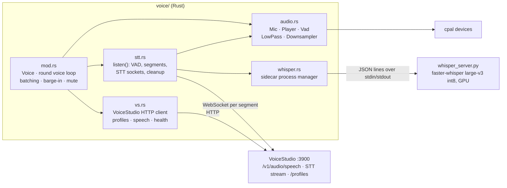
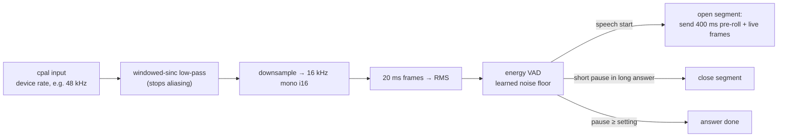
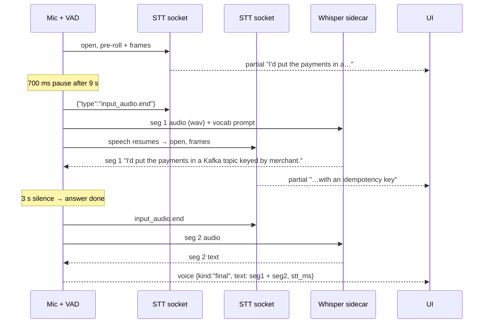
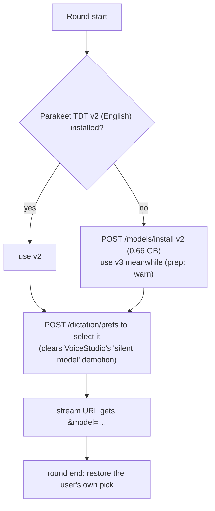
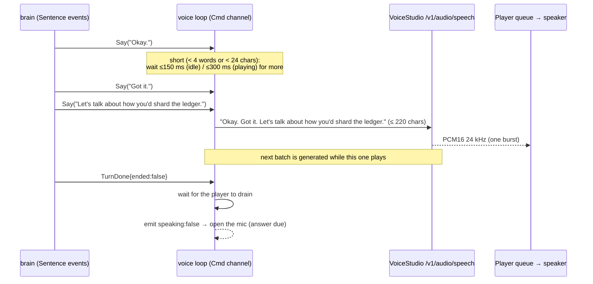
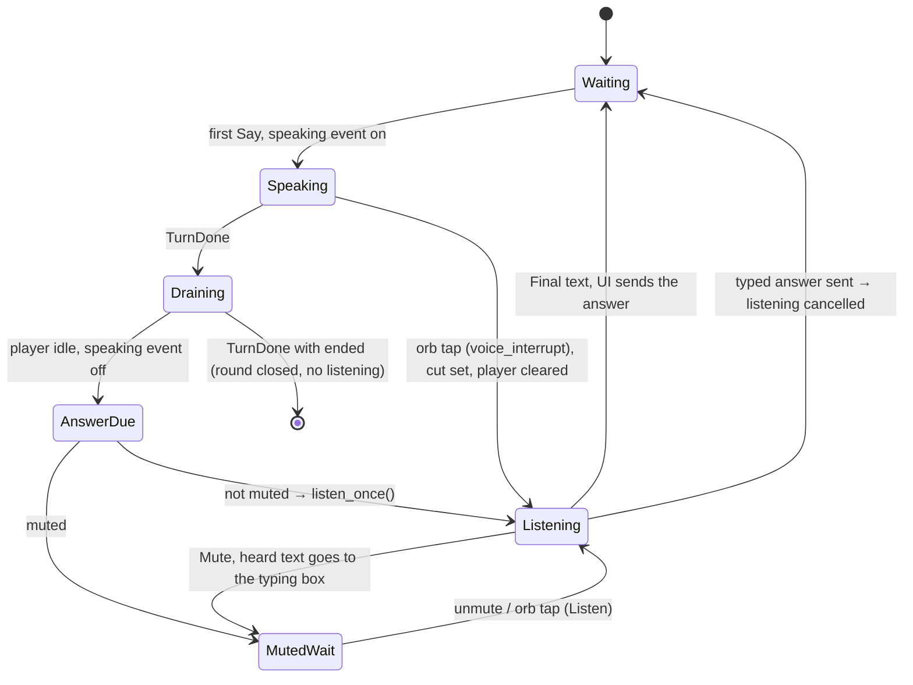

# DD-03 · Voice pipeline

> **Status:** Current (v0.1.2) · **Updated:** 2026-10-30 · **Code:** `src-tauri/src/voice/`, `sidecar/whisper_server.py` · **Product:** [PRD-03](PRD-03-voice.md)

## 1. Purpose and constraints

Make a spoken round feel like a call: the candidate talks, the app knows when they're done, the words come out right,
and the interviewer starts speaking fast in a stable voice. All speech is local.

Hard constraints learned in testing (details in `CLAUDE.md`, VoiceStudio 0.5.6, RTX 5050):

- VoiceStudio's TTS returns audio **in one burst after generation**, so latency = generation time (~1 s per short sentence at 8 steps).
- Its live STT runs the **dictation engine**. The default (whisper-tiny) drops audio after ~30 s and loops. Parakeet is
  better but mangles tech terms ("Postgres Creole", "reddish" for Redis).
- Its batch Whisper endpoint is accurate but reloads large-v3 every call (~8–38 s). Unusable live.
- `voice: "default"` picks a **new random speaker every call**. Only a profile id gives a stable voice.

## 2. Components



## 3. Listening: from mic to text

### Signal chain



**VAD** (`audio.rs::Vad`): before speech it learns the room's noise floor (slow moving average, capped). Speech starts
above 3× the floor and holds above 2× it, each with a minimum. Silence is counted in ms; when it reaches the user's
pause setting (1.8 / 3 / 5 s, or never) the answer ends.

**Pre-roll:** the last 400 ms before speech start is sent with the segment, so the first word isn't clipped.

### Segments

Long answers are cut into segments at short pauses, so decoding runs **while the candidate is still talking** and
only the last segment is waited for.

| Segment length so far | Pause that closes it |
|---|---|
| < 3 s | never (too short to cut) |
| 3–20 s | 700 ms |
| > 20 s | 300 ms |



Each segment's text = Whisper's text if it arrived, else Parakeet's `summary` final, else its finals and partial.

### Cleaning the transcript

`clean_transcript` runs on the joined text:

1. **Collapse repeats:** "for the MQ for the MQ" → "for the MQ".
2. **Fix vocabulary:** words close to a tech term (Levenshtein distance, allowed edits grow with length) are replaced
   with the term from `domain_vocab` (Kafka, Redis, PostgreSQL, idempotency, …).

The same vocabulary is the **Whisper prompt** ("Technical interview in English. Kafka, Redis, …", ≤ 600 chars).

### Choosing the STT model



Why: Parakeet v3 auto-detects 25 languages and turned accented English into Spanish. And VoiceStudio permanently
demotes a model after one silent session, then quietly serves whisper-tiny even when asked for Parakeet.

### The Whisper sidecar

- Started at app launch (~10 s to load) and restarted at round start if it died.
- Runs `sidecar/whisper_server.py` with **VoiceStudio's bundled Python** (has faster-whisper + CUDA) and the weights
  VoiceStudio already downloaded (`%LOCALAPPDATA%/OmniVoice/hf_cache`). Tries large-v3, then large-v3-turbo, then distil.
- Protocol: one JSON line per request on stdin `{"id", "wav", "prompt"}`; one JSON line per reply on stdout.
  The wav is a temp file in `%TEMP%/onsite-stt`, deleted after use.
- 12 s timeout per request. Not ready, missing, or out of GPU memory → fail fast; Parakeet's text is used.
- Measured: word-perfect on 8 accented tech answers at 1.1–1.5 s each (CPU int8 would be ~12 s).

## 4. Speaking: from text to sound



| Rule | Value | Why |
|---|---|---|
| Merge short sentences | < 4 words or < 24 chars | Fewer tiny calls = less voice drift, fewer gaps |
| Max batch | 220 chars | One call never gets slow |
| Wait for the next sentence | 150 ms when idle, 300 ms while audio plays | First audio stays fast; later waits hide behind playback |
| Steps | 8 (fast) / 16 / 32 | ~1.0 s vs ~1.6 s per short sentence |
| Language | always `English` | |

Request body (`vs.rs::speech_body`):

```json
{"model": "omnivoice", "input": "Okay. Got it. Let's talk about…", "voice": "<profile id>",
 "response_format": "pcm", "stream_format": "audio", "num_step": 8, "speed": 1.0, "language": "English"}
```

### Stable voices

- **Panel personas** each get a VoiceStudio *clone* profile named after them (`vs.rs::persona_voice`):
  1. Onsite renders a fixed sample line with the persona's voice instruction (`instruct`), trying a short list of
     seeds and step counts (`SAMPLE_TRIES`).
  2. Each take is scored (`score_sample`): share of voiced frames, zero-crossing rate (hiss), median pitch, and the
     noise floor in pauses. `sample_ok` checks the pitch against the instruction (a male voice shouldn't come out high).
  3. The first take that passes, or else the closest one (`sample_penalty`), becomes the clone sample.
  4. Every later call uses that profile id, so the voice never drifts.
- A profile whose tag no longer matches the persona's instruction is deleted and rebuilt. Profiles are never locked
  (unlocking deletes the seed).
- All persona voices are pre-built in the background at app start, so a round never waits for one.
- Rounds without a panel use the voice picked in Settings (a profile id; never `"default"`).

### Warm-up

VoiceStudio unloads after ~15 min idle (next call ~10 s) and `/model/status` can't be trusted. So at round start, if it
hasn't spoken in the last 5 minutes, it generates "Okay, let's begin." with the round's voice and throws the audio
away, while the model writes its first reply. Sentences queue meanwhile. App start does the same once.

## 5. Turn-taking, mute and barge-in



- The mic is **closed while the interviewer speaks**, which avoids echo without echo cancellation.
- **Barge-in** (`voice_interrupt`) sets `cut`: the TTS call in flight is abandoned, queued audio is cleared, the rest of
  that reply is dropped, and the mic opens. The transcript still shows the full reply text.
- **Mute** cancels listening and sends `held {text}` so what was heard lands in the typing box.
- **Each answer gets a fresh `ListenCtl`**, so a late finish/cancel can't end the next answer.
- `Voice::end()` aborts the loop task and stops audio already received from reaching the speaker, so nothing plays
  after hang-up.

## 6. Events to the UI (`voice`)

| `kind` | Fields | UI effect |
|---|---|---|
| `speaking` | `active` | Orb: speaking / back to rest |
| `listening` | `active` | Orb: listening |
| `speech_start` | — | Orb: "Hearing you…" |
| `partial` | `text` | Live caption |
| `final` | `text`, `stt_ms` | Send the answer |
| `latency` | `ms` | Logged: end of speech → first audio |
| `level` | `mic`, `out` | Waveforms (every 80 ms) |
| `held` | `text` | Muted mid-answer: text to the box |
| `error` | `message` | Toast; orb back to rest |

## 7. Devices

- Input and output are cpal device ids (`""` = system default), saved in settings and switchable on Get ready and in
  the room. The speaker switches on the next reply.
- All cpal calls run on one `onsite-audio` thread: opening WASAPI devices from tokio workers failed after a device change
  ("Cannot change thread mode after it is set").
- A dead mic stream (unplugged) is detected every 500 ms; listening ends with "The microphone changed. Tap the mic to
  listen again."

## 8. Failure matrix

| Fails | Detected | Result |
|---|---|---|
| VoiceStudio not running | `/health` at prep | Round typed; "Start VoiceStudio" in Settings |
| Persona voice can't be built | prep `voice` | Round typed or default voice |
| TTS call fails mid-round | `speak` error | Text still shows; `TurnDone` always sent so the UI never waits |
| STT socket fails | `SegMsg::Failed` | `voice {error}`; candidate can type |
| Whisper not ready / slow | status, 12 s timeout | Parakeet text used |
| Mic lost | health tick | Message; tap to listen again |

## 9. Open work

- Latency: the 2.5 s target is met only with fast API providers. Ideas: start TTS on the first clause, streaming TTS
  when VoiceStudio supports it, a smaller Whisper on the last segment only.
- Echo cancellation would allow listening while the interviewer speaks (true barge-in by voice).
- `ws://…/ws/tts` (streaming TTS) is not used; the HTTP endpoint is simpler and documented.
