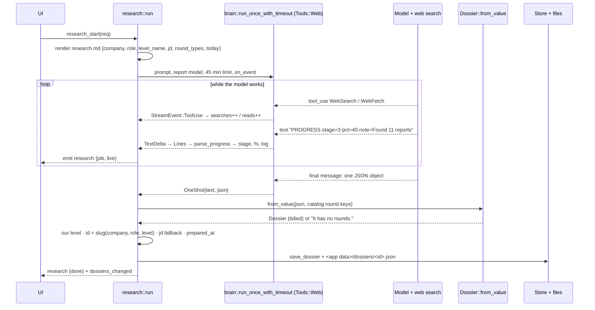
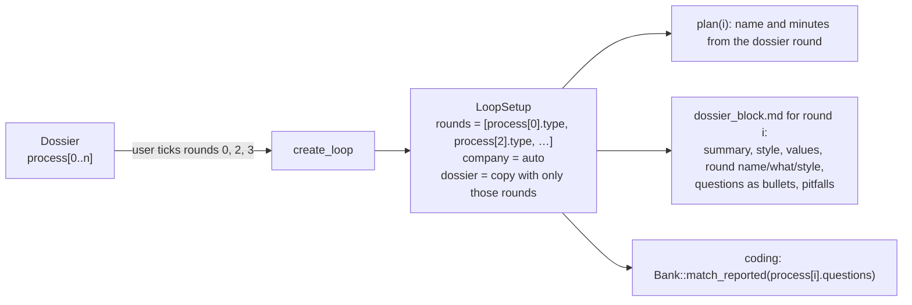

# DD-04 · Research jobs and dossiers

> **Status:** Current (v0.1.2) · **Updated:** 2026-10-30 · **Code:** `src-tauri/src/research.rs`, `dossier.rs`, `prompts/research.md`, `prompts/dossier_block.md` · **Product:** [PRD-04](PRD-04-company-research.md)

## 1. Purpose

Turn "Razorpay, SDE-2 backend" into a structured **dossier** of the real loop, from web research, without the user
opening a chat window. Then feed that dossier into company-specific loops.

## 2. Job lifecycle

```mermaid
stateDiagram-v2
    [*] --> running: research_start (validate → insert row → spawn task)
    running --> done: valid dossier saved
    running --> failed: model error · timeout (45 min) · bad JSON · incomplete dossier
    running --> failed: research_cancel (task aborted)
    running --> failed: app closed (marked at next startup)
    failed --> running: research_retry (new job, same request; old row deleted)
    done --> [*]: research_dismiss (job row deleted)
    failed --> [*]: research_dismiss (job row deleted)
```



| Piece | Kept where |
|---|---|
| Request (company, role, level, JD), status, %, log, raw output, dossier id | SQLite `research_jobs` (survives restarts) |
| Live counters: stage, searches, pages read, last note | Memory: `AppState.research[job_id]` (`Running { live, abort }`) |
| The tokio task | `AbortHandle` in the same map; cancel = abort |

Every change emits a `research` event with `{job, live}`, so the card updates in real time.

## 3. Running a job



### Progress, honestly

Two independent signals, neither faked:

1. **Tool calls** in the stream are counted as they happen: `WebSearch` → searches, `WebFetch` → pages read.
2. **PROGRESS lines** the prompt asks the model to print:
   `PROGRESS stage=<1-6> pct=<0-100> note=<one short sentence>`. Stage and % only ever go **up** (`max`), so a confused
   model can't move the bar backwards. Notes go to the log.

Stages: 1 reading request · 2 finding the current process · 3 collecting candidate experiences · 4 extracting questions
per round · 5 values and interviewer style · 6 building the dossier.

Groq research isn't streamed, so only the final result arrives; Gemini counts searches from `groundingMetadata`.

## 4. The dossier format

```json
{
  "id": "razorpay-sde-2-backend",
  "company": "Razorpay", "role": "SDE-2 Backend", "level": "sde2",
  "preparedAt": "2026-10-27T…Z",
  "jd": "…",
  "summary": "Typical loop: DSA, machine coding/LLD, system design, HM. …",
  "style": "Practical, payments-heavy follow-ups …",
  "values": "… (source: razorpay.com/jobs)",
  "pitfalls": ["Not handling idempotency in the payment flow", "…"],
  "process": [
    {"type": "coding", "name": "Problem solving (DSA)", "minutes": 45,
     "what": "…", "style": "…",
     "questions": ["Minimum number of meeting rooms for a list of intervals", "Implement an LRU cache; follow-up: LFU", "…"]}
  ],
  "sources": [{"title": "…", "url": "https://…"}]
}
```

The rules are in `docs/dossier.schema.json` (JSON Schema). `Dossier::from_value` applies them by hand, tolerantly:

| Input problem | Tidying |
|---|---|
| `type` isn't a known round key ("Machine coding round") | `round_kind` maps by keywords in type + name: machine coding/LLD → `lld`, system design/HLD → `sysdesign`, DSA/coding → `coding`, code review/debug → `comprehension`, behaviour/values/bar raiser → `behavioral`, resume/screen/recruiter → `resume`, project/deep dive → `project`, fundamentals/core CS → `fundamentals`, else `hm` |
| `minutes` is `"60 min"` or missing | First number parsed, clamped to 10–180; default 45 |
| Arrays given as strings, or strings as arrays | Normalised (`text`, `strings`) |
| Sources as plain URL strings | Turned into `{title:"", url}` |
| Missing company, role, summary, style or rounds | Rejected: "It has no summary, rounds." |

Model output is **data**: it is parsed into these fields and nothing else. No field is ever run.

## 5. Using a dossier in a loop



The dossier block tells the interviewer to use the reported questions as the pool, to run the round the way the
company does, and **never to mention having the dossier**.

## 6. Storage, import and export

- `save` writes the dossier to SQLite (`dossiers` table) and a pretty-printed copy to `<app data>/dossiers/<id>.json`.
- **Export** writes `<Downloads>/<id>.json`. **Import** reads any such file, validates it with the same
  `from_value`, and saves it ("That isn't an Onsite dossier. It has no rounds.").
- **Seed:** dossiers shipped in `dossiers/` are imported once, guarded by the `dossiers_seeded` setting.
- The slug drops the level when the role already says it: `Razorpay`, `SDE 2, backend`, `sde2` → `razorpay-sde-2-backend`.

## 7. Limits and ideas

| Limit | Idea |
|---|---|
| A job dies with the app | Resume from the saved log, or run research in a detached process |
| No freshness signal | Show `preparedAt` age; offer *Refresh* after 6 months |
| Reported questions are free text | Link them to bank ids at save time, not at round start |
| Quality depends on the provider's search | Show source count and dates on the dossier card |
