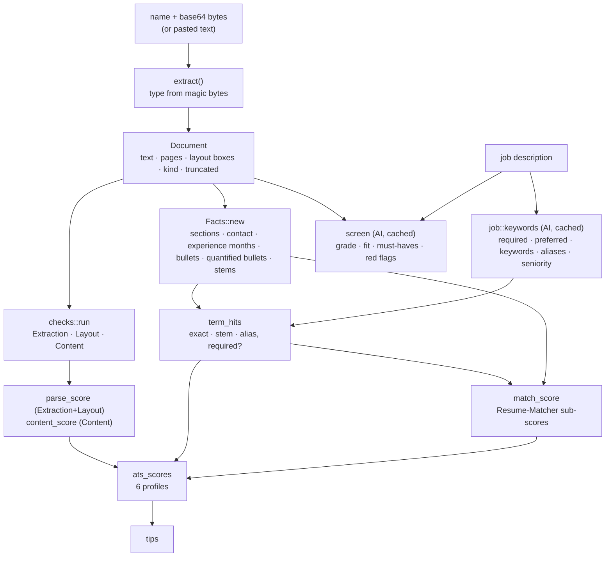

# DD-05 · Resume check (ATS simulation and AI screen)

> **Status:** Current (v0.1.2) · **Updated:** 2026-10-30 · **Code:** `src-tauri/src/ats/` · **Product:** [PRD-05](PRD-05-resume-check.md)

## 1. Purpose

Read a resume **the way an ATS parser does**, score it the way six common ATS products would, match it to a posting,
and optionally let an AI grade it like a "role fit" screener. Everything except two small AI calls is deterministic
and unit-tested.

| File | Job |
|---|---|
| `ats/extract.rs` | Bytes → `Document` (text, pages, layout boxes, kind, flags). PDF, DOCX, RTF, text, HTML. |
| `ats/text.rs` | Normalising, stemming, section detection, phone/email, dates, experience months. |
| `ats/checks.rs` | Format checks → `Check { id, category, severity, status, title, detail }`, category scores. |
| `ats/score.rs` | `Facts`, keyword hits, Resume-Matcher match score, six ATS profiles, tips. |
| `ats/job.rs` | AI reads the posting (never the resume) → `JobKeywords`; cached. |
| `ats/screen.rs` | AI screen on the extracted text → `AiScreen`; cached. |
| `ats/mod.rs` | `analyze` (pure), `run`, `run_screen`, `read_file`, last result. |

## 2. Pipeline



`analyze(name, doc, job, today)` is **pure**: no I/O, so the whole scoring is tested with fixtures in
`src-tauri/tests/fixtures/ats/` (clean and messy DOCX, one- and two-column and scanned PDFs, RTF, HTML sources).

## 3. Extraction

| Kind | How | Notes |
|---|---|---|
| PDF | `pdf-extract` / lopdf with a custom `OutputDev` (`Collector`) that records text boxes per page | Layout boxes feed the column, table and header/footer checks. Owner-only-locked PDFs open; password PDFs are refused. |
| DOCX | zip + quick-xml | Body text, tables, text boxes; `mc:Fallback` skipped (no duplicates); headers/footers kept apart, because some ATSs drop them. |
| RTF | own small parser (`rtf_to_text`) | cp1252 code page. |
| Text | UTF-8 / UTF-16 by BOM | |
| HTML | tags stripped | |
| Refused | old .doc, images, .odt/.pages, password PDFs | Plain message saying what to do. |

The type comes from the **bytes**, not the name (`file_type_comes_from_content` test).

## 4. Checks

| Category | Checks (ids) | Fail example |
|---|---|---|
| Extraction | `text_layer`, `garbled_glyphs`, `text_coverage` | Scanned image PDF: no text at all |
| Layout | `multi_column`, `tables`, `text_boxes`, `header_footer`, `images`, `page_count` | Two columns: reading order mixes lines |
| Content | `contact_info`, `section_headings`, `dates` | No email or phone in the body |

**Two-column detection** (`has_columns`): on each page, find vertical bands with no text (`free_bands`) between text
boxes. A wide gap with text on both sides = columns. A single column with right-aligned dates is **not** two columns
(`single_column_with_right_dates_is_not_two_columns` test).

**Extractability:** `none` if there's no text layer; `partial` if glyphs are garbled, coverage is low or the text was
truncated; else `full`. An empty read forces the parse score to 0.

## 5. Keywords and the match score

`JobKeywords` (from the AI, ≤ 20 terms of ≤ 60 chars each):

```json
{"company": "Acme Pay", "role": "Backend Engineer", "seniority": "SDE-2",
 "required_skills": ["Java", "Kafka", "PostgreSQL"], "preferred_skills": ["Kubernetes"],
 "keywords": ["payments", "microservices", "idempotency"],
 "aliases": {"postgresql": ["postgres", "psql"]}, "experience_years": 3}
```

Built-in aliases cover common spellings (postgres/psql, k8s, js, golang, aws, ci/cd, kafka/apache kafka, …); the AI adds
posting-specific ones. Each `TermHit` records whether the term was found **exactly**, by **stem**, or by **alias**, and
whether it is required.

The **match score** (ported from Resume-Matcher, `services/ats.py`) combines keyword coverage, required-skill coverage,
title match, section completeness and date consistency. Without a posting it covers sections and dates only.

## 6. The six ATS profiles

Each profile has a matching strategy, a strictness (how much layout problems hurt), six weights and a pass mark:

```text
weights = [parse, keywords, required skills, title, sections, dates]
parse'  = 100 − (100 − parse_score) × strictness
score   = weighted(parse', credit(all terms), credit(required), title, sections, dates) − profile-specific penalties
```

| Profile | Strategy | Credit for a term found by… | Strictness | Weights | Pass |
|---|---|---|---|---|---|
| Workday | Exact | exact only | 1.00 | .25 .30 .15 .10 .12 .08 | 70 |
| Taleo | Exact | exact only | 0.95 | .20 .30 .20 .10 .12 .08 | 65 |
| iCIMS | Semantic | exact 1.0, stem or alias 0.9 | 0.60 | .15 .35 .15 .15 .12 .08 | 60 |
| Greenhouse | Semantic | exact 1.0, stem or alias 0.9 | 0.60 | .20 .30 .15 .15 .12 .08 | 60 |
| Lever | Stem | exact or stem | 0.75 | .20 .35 .15 .10 .12 .08 | 60 |
| SuccessFactors | Taxonomy | exact or alias | 0.85 | .20 .30 .20 .10 .12 .08 | 65 |

Profile-specific issues subtract points and explain themselves, e.g. Workday: "3 pages: Workday may cut text after page 2.",
"Your contact details are only in the page header, which Workday drops."; Taleo: "Taleo often skips table cells."
Profiles follow **ats-screener** (MIT).

## 7. The AI calls

| Call | Input | Output | Model | Cache key | Time |
|---|---|---|---|---|---|
| `job::keywords` | posting only | `JobKeywords` | interviewer model | `ats_job:<sha256(CACHE_VERSION + JD)>` | ~4–7 s |
| `screen::screen` | **extracted** resume text + posting | `AiScreen` | report model | `ats_screen:<sha256(version + resume + JD)>` | ~15–22 s |

```json
{"grade": "B", "fit": 78, "advance": true, "level": "at", "level_note": "3 years matches SDE-2",
 "summary": "…",
 "must_haves": [{"skill": "Kafka", "verdict": "proven", "evidence": "Built the settlement pipeline on Kafka…"},
                {"skill": "Kubernetes", "verdict": "missing", "evidence": ""}],
 "strengths": ["…"], "red_flags": [], "recruiter_take": "…"}
```

Rules in `prompts/ats_screen.md`: grade A–D with fit tied to it (A 85+, B 70–84, C 50–69, D < 50); quote only the resume,
never invent; **never guess gender, age, nationality or other traits from the name** (an early run said "she").
Bump `CACHE_VERSION` in `ats/job.rs` when the posting prompt changes.

## 8. Where it runs

- **Resume check screen:** `ats_check` then `ats_screen` (the screen starts automatically after the rule-based check).
- **Loop start:** the check runs first; no resume or an unreadable file blocks the loop. The result shows on Get ready.
- The last result is kept under `ats_last` so the screen reopens with it.
- **Offline:** `cargo run --example ats_check -- resume.pdf [job.json] [--json]`. While the app is running,
  `onsite.exe` is locked: use `--target-dir target/ats-test`.
