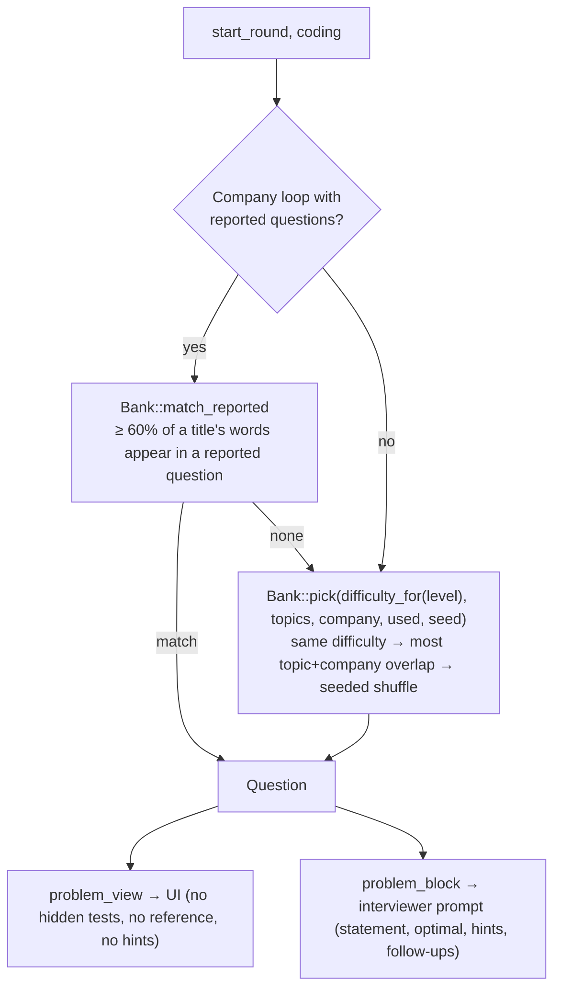
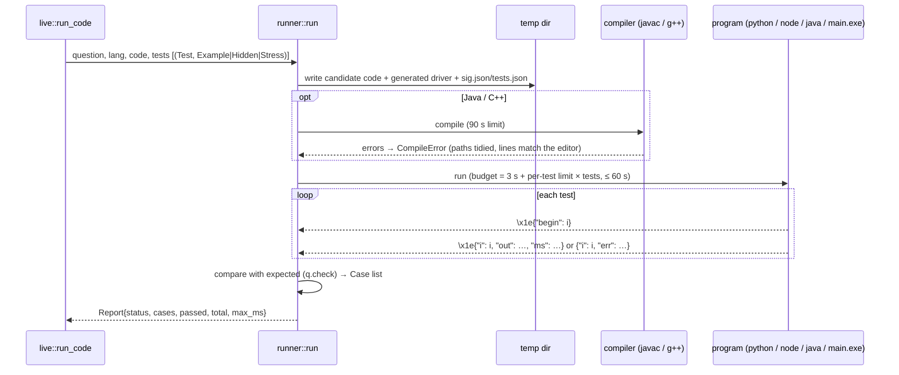

# DD-06 · Question bank and code runner

> **Status:** Current (v0.1.2) · **Updated:** 2026-10-30 · **Code:** `src-tauri/src/bank.rs`, `src-tauri/src/runner/` (`mod.rs`, `gen.rs`, `tests.rs`), `prompts/questions.csv` · **Product:** [PRD-06](PRD-06-coding-workspace.md)

## 1. Purpose

Make coding rounds real: a known problem with **expected answers as data** (the model never grades code), and the candidate's code run against those answers on their own machine, in four languages.

## 2. The bank: `prompts/questions.csv`

One problem per row. Columns:

| Column | Example (Two Sum) | Meaning |
|---|---|---|
| `id` | `two-sum` | Stable id |
| `title`, `difficulty` | Two Sum, Easy | |
| `levels`, `topics`, `companies` | `ng;sde1` · `array;hash-map` · `amazon;google;meta` | `;`-separated tags |
| `function` | `twoSum` | Method name on `Solution` |
| `params`, `returns` | `nums: int[]; target: int` · `int[]` | Typed signature |
| `compare` | `any_order` | How to compare output (exact, any order, float tolerance, …) |
| `statement`, `constraints` | Markdown | Shown to the candidate |
| `tests` | JSON list of `{args, expected, example?, explanation?}` | Examples are shown; the rest are hidden |
| `hints`, `follow_ups` | `|`-separated | For the interviewer only |
| `time`, `space` | `O(n)` | Optimal complexity, for the interviewer |
| `reference` | Python solution | Checks generated tests; never shown |
| `stress` | Python generator | Builds a full-constraint-size test for Submit |
| `kind`, `methods` | `design` + `insert(word: string) -> void` lines | Class-based problems |

> Edit the CSV in a text editor. Excel re-quotes the header and scrambles the id column.

### Types

`int, long, double, bool, string, char`, arrays `T[]`, lists `list<T>`, and:

| Type | Text form | Notes |
|---|---|---|
| `ListNode` | `[1,2,3]`, or `[[vals], pos]` for a cycle | Cycle position like LeetCode |
| `TreeNode` | level order with nulls `[3,9,20,null,null,15,7]` | |
| `Node` (graph) | adjacency list, node i+1 at index i | Clone Graph; returning an input node is an error |
| `void` | — | In-place: the result is the first argument after the call |

### Kinds

| Kind | Count | How it runs |
|---|---|---|
| (empty) | 76 | `Solution().<function>(args…)` |
| `design` | 3 | A class driven by LeetCode's operations list: `["LRUCache","put","get"]`, `[[2],[1,1],[1]]` |
| `roundtrip` | 2 | Codec: `decode(encode(x)) == x`, on two separate instances (JS: two top-level functions, as on LeetCode) |

`Bank::parse` never fails the whole file: a bad row is skipped and reported ("row 14: duplicate id 'two-sum'"), and the
errors are kept in `Bank.errors` (not shown in the UI yet).

## 3. Picking a problem



Title matching drops stop words and plural `s`, so "Implement an LRU cache; follow-up: LFU" → LRU Cache.
`used` is currently passed empty, so past rounds don't influence the pick yet.

## 4. Running code



### Per-language plan

| Lang | Files written | Compile | Run | Per-test limit |
|---|---|---|---|---|
| Python | `Solution.py`, `driver.py`, `sig.json` | — | `python -X utf8 driver.py Solution.py sig.json tests.json` | 6 s |
| JavaScript | `solution.js`, `driver.js`, `sig.json` | — | `node driver.js …` (worker with a 256 MB stack) | 3 s |
| Java | `Solution.java` (imports on line 1, `public` dropped from types), `Main.java` (generated per question) | `javac -encoding UTF-8 -d out …` | `java -Xss512m -XX:+UseSerialGC -cp out Main tests.json` | 2 s |
| C++ | `solution.cpp`, `main.cpp` (generated per question) | `g++ -std=c++17 -O2` (+ static, 256 MB stack on Windows) | `main.exe tests.json` | 2 s |

- Python and JS drivers are generic and read the signature from `sig.json`. Java and C++ drivers are **generated per
  question** with only the node classes that question uses.
- Output lines start with the `\x1e` record separator so the candidate's own `print`s can't be mistaken for results.
- On timeout the **whole process tree** is killed (`kill_tree`), after a 3 s grace.
- Python is found on PATH, else VoiceStudio's bundled Python; the Windows Store `WindowsApps` stub is skipped.
- A missing toolchain gives a plain message naming what to install.

### Statuses and the summary line

`Accepted · WrongAnswer · RuntimeError · TimeLimit · CompileError`. The interviewer gets one line with the next answer:

```text
Submit in Python: 14/15 tests passed. First failure (large test): input [10000 items…] → time limit exceeded
Run in Java: 3/3 tests passed. All accepted, slowest test 4 ms.
Run in C++: compile error:
solution.cpp:7: error: expected ';' before 'return'
```

### Submit's large test

`stress_tests(q, 1)` runs the question's Python `stress` generator with the `reference` solution to make a test at full
constraint size, keeps it only if the reference output passes `q.check`, and caches it on the round. It takes a few
seconds, so it's built outside the rounds lock, once.

## 5. Testing the bank

- `cargo test` covers parsing, types, comparisons, matching and the generators.
- `cargo test -- --ignored` runs **every reference solution and every starter in every language** against the tests
  (needs all four toolchains). Run it after editing the CSV.
- New rows were built by a script that checked each reference against LeetCode's example answers and brute force.

## 6. Adding a problem

1. Add a row to `prompts/questions.csv` (copy a similar row; keep the header untouched).
2. Fill `tests` with at least the examples (`"example": true`) and a few hidden cases.
3. Add a Python `reference`; add a `stress` generator if Submit should have a large test.
4. Run `cargo test -- --ignored` and fix until every language passes.
