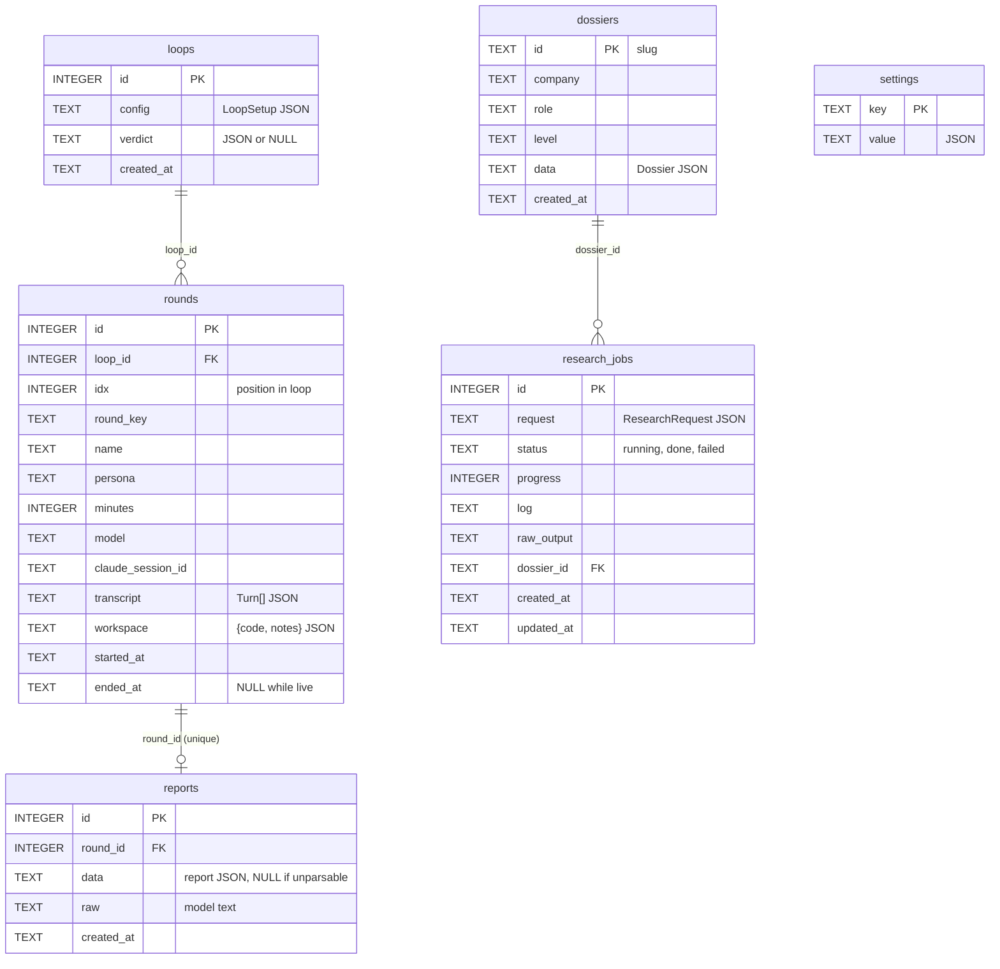
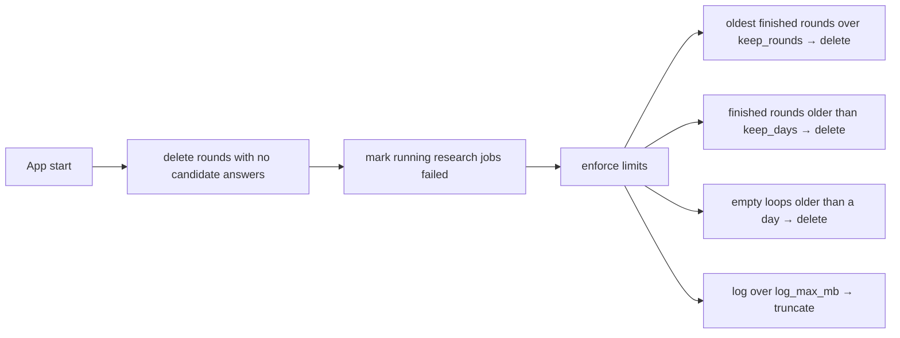

# DD-07 · Storage and data

> **Status:** Current (v0.1.2) · **Updated:** 2026-10-30 · **Code:** `src-tauri/src/store/`, `storage.rs` · **Product:** [PRD-07](PRD-07-settings-privacy-updates.md)

## 1. Principles

- **Everything local.** One SQLite file plus a few plain files in the app data folder.
- **JSON in columns, shape in Rust.** Tables are thin; `LoopSetup`, `Turn`, `Dossier` and report JSON carry the detail.
  New fields need no migration: types use `#[serde(default)]`.
- **Save as you go.** Every interviewer and candidate turn is written immediately.
- **User data survives updates**, including installing an older version (with a warning that it may not read newer data).

## 2. Where things live

| What | Windows | macOS / Linux |
|---|---|---|
| Database `onsite.db` | `%APPDATA%\dev.onsite.app\` (Tauri app data, identifier `dev.onsite.app`) | `~/Library/Application Support/dev.onsite.app/` · `~/.local/share/dev.onsite.app/` |
| Dossier copies `dossiers/<id>.json` | app data folder | same |
| Custom backdrop `backdrop.{jpg,png,webp}` | app data folder | same |
| Log `onsite.log` | `%LOCALAPPDATA%\Onsite\` | `~/Library/Logs/Onsite/` · `$XDG_STATE_HOME/Onsite/` or `~/.local/state/Onsite/` |
| Temp | `%TEMP%\onsite-round-*`, `onsite-job-*` (deleted after use), `onsite-stt\` (Whisper segments), `onsite-update\` (installers) | system temp |
| UI preferences | WebView localStorage | same |

## 3. Schema



- Opened with `journal_mode=WAL` and `foreign_keys=ON`.
- Versioned with `PRAGMA user_version` (now **1**). `schema.sql` uses `CREATE TABLE IF NOT EXISTS`. A future change that
  needs a real migration bumps `SCHEMA_VERSION` and adds a step in `Store::init`.
- Times are RFC 3339 strings (UTC).

### A transcript turn

```json
{"who": "me", "text": "I'd use a hash map…", "at_min": 6.4, "shared_workspace": true,
 "sent": "I'd use a hash map…\n\n[Workspace]\nEditor (Java):\n```…```\n[Elapsed: 6 of 45 min]"}
{"who": "iv", "text": "Okay. What's the complexity of that?", "at_min": 6.6, "ttft_ms": 1840}
```

`sent` keeps the exact message the model saw, so a report can always be traced back.

## 4. Settings keys

| Key | Type | Written by | Purpose |
|---|---|---|---|
| `app` | `Settings` | Settings screen | Provider, Claude location, interviewer and report models, voice settings |
| `api_keys` | `{provider: key}` | `set_api_key` | Never sent to the UI; `ai_keys` returns only which providers have one |
| `storage_limits` | `Limits` | Storage section | `keep_rounds` (0 = all), `keep_days` (0 = forever), `log_max_mb` (default 20) |
| `weekly_goal` | `{round_key: n}` | Dashboard | Default `{coding: 2, sysdesign: 1, behavioral: 1}` |
| `openers:<round_key>` | `[string]` | `start_round` | Recently used openers (half the list) |
| `ats_job:<hash>` | `JobKeywords` | `ats/job.rs` | Cache of the posting read |
| `ats_screen:<hash>` | `AiScreen` | `ats/screen.rs` | Cache of the AI screen |
| `ats_last` | report | `ats_check` | Last resume check, to reopen the screen |
| `dossiers_seeded` | bool | startup | Shipped dossiers imported once |

### UI-only preferences (localStorage)

| Key | Holds |
|---|---|
| `onsite.theme` | `{family, mode, image, plain, dim}` (read before paint by `theme-boot.js`) |
| `onsite.cfg` | Last setup choices (company, level, language, temperament, rounds, dossier) |
| `onsite.resumeFile` | The last resume file as base64 (name, data, size), for layout checks |
| `onsite.atsJd` | Last posting pasted on the Resume check screen |
| `onsite.setSec`, `onsite.rail`, `onsite.probShare`, `onsite.readyEvery` | Last settings section, context rail shown, problem/chat split, check before every round |

> **Note for the privacy text:** the resume file is also kept in WebView localStorage, not only in the database.
> The Privacy section says resumes are stored "in Onsite's database". Both are local, but the wording should cover both.

## 5. Lifecycle and retention



- **Deleting a round** removes its report too, and clears the loop's verdict (it would be stale).
- **Live rounds are never touched** by limits (`ended_at IS NULL`).
- **Clean up** actions: *Clear the log* (truncate in place; the writer keeps appending), *Delete temporary files*
  (`onsite-update`, `onsite-stt`; files in use are left), *Compact the database* (`VACUUM`).
- **Uninstall** leaves the data folder. The Storage section has *Open data folder* for a full wipe.

## 6. Backdrop images

The UI shrinks a chosen image to ≤ 2560×1600 JPEG in JS and sends it as base64. Rust checks the type **from the bytes**
(`image_ext`: JPEG, PNG or WebP only), writes `backdrop.<ext>` and removes any other. The UI reads it back as a data URL.

## 7. Concurrency

`Store` holds one `rusqlite::Connection` behind `Arc<std::sync::Mutex<_>>`. Calls are short and synchronous; the
lock is never held across an `.await`. Long work (reports, research) reads what it needs, drops the lock, calls the model,
then locks again to save.
