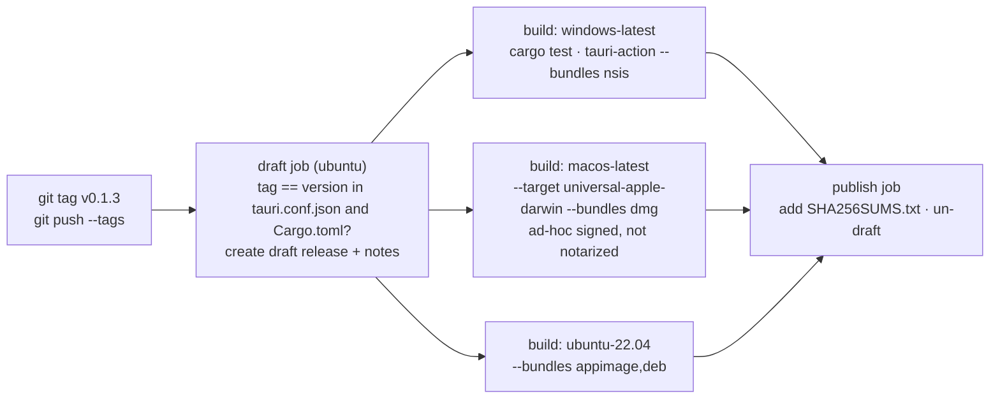
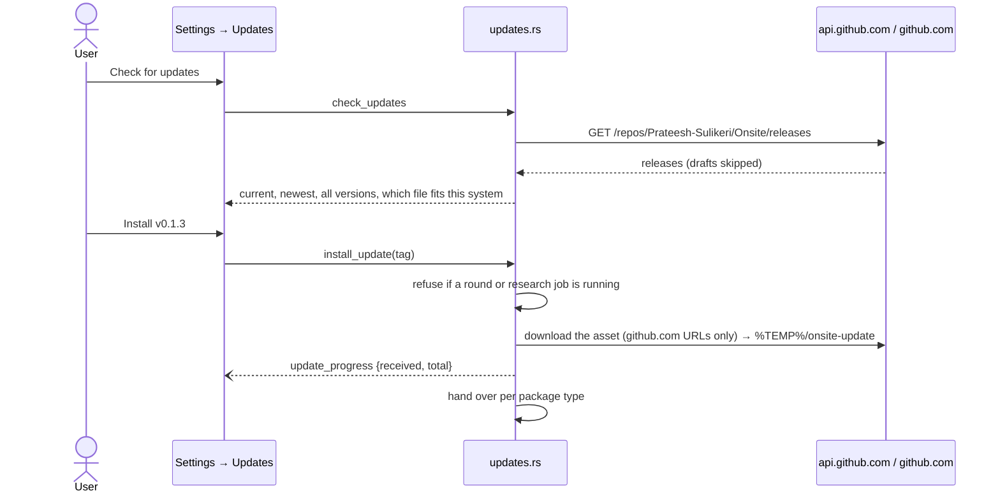

# DD-08 · Release pipeline and in-app updates

> **Status:** Current (v0.1.2) · **Updated:** 2026-10-30 · **Code:** `.github/workflows/release.yml`, `src-tauri/src/updates.rs`, `src-tauri/tauri.conf.json` · **Product:** [PRD-07](PRD-07-settings-privacy-updates.md)

## 1. Releasing

A release starts from a version tag. CI builds all three systems and publishes only when all three succeed.

| Step | Detail |
|---|---|
| Version check | The tag must equal the version in `tauri.conf.json` **and** `Cargo.toml`, or the run stops before building. |
| Draft | Created first; every build uploads into it. `updates.rs` ignores drafts, so users never see half a release. |
| Release notes | A download table with a direct link per system, and a table of the security warnings each system shows (unsigned builds) and how to get past them. |
| Tests | `cargo test` runs on each OS before bundling. |
| Publish | Runs only when all three builds uploaded. Adds `SHA256SUMS.txt` (the updater ignores it). |
| Manual run | `workflow_dispatch` = dry run: builds and keeps the files as workflow artifacts, publishes nothing. |

Bundled with the app (Tauri resources): `prompts/`, `dossiers/`, and the Whisper sidecar script.

### Code signing

| System | Today | Plan |
|---|---|---|
| Windows | **Unsigned.** SmartScreen warns on first run. | SignPath Foundation (free for open source). Application **pending** as of 2026-10-30. `CODE_SIGNING.md` is the policy page SignPath requires. When approved: add the signing step to `release.yml`, then update `SECURITY.md` and the release-notes warnings table. |
| macOS | Ad-hoc signed, not notarized. Gatekeeper needs right-click → Open. | Notarization needs a paid Apple developer account. |
| Linux | No signing needed for AppImage/.deb. | — |

Until signing is live, users verify downloads against `SHA256SUMS.txt` (`SECURITY.md`).

## 2. In-app updates

Updates are **pull only**: nothing contacts GitHub until the user presses *Check for updates*.

### Per package

| Package (`Package::current`) | Asset name | What install does |
|---|---|---|
| `Nsis` (Windows) | `Onsite_<v>_x64-setup.exe` | Runs the installer, then Onsite quits so it can replace files. |
| `Dmg` (macOS) | `Onsite_<v>_universal.dmg` | Opens the disk image; the user drags Onsite into Applications. |
| `AppImage` (Linux, `$APPIMAGE` set) | `Onsite_<v>_amd64.AppImage` | Swaps the file at `$APPIMAGE` and restarts. |
| `Deb` (Linux otherwise) | `Onsite_<v>_amd64.deb` | Saves to Downloads for the user to install. |

- **Any listed version can be installed**, including older ones (NSIS allows downgrades). The UI warns that an older
  version may not read data saved by a newer one.
- **Version compare:** `version_key` parses `vMAJOR.MINOR.PATCH[-pre]`; pre-releases sort below the release.
- **VoiceStudio:** the installed version comes from its `/health` `version`, else `resources/pyproject.toml` in its
  install folder; the newest from its GitHub releases. Onsite **never** updates VoiceStudio.

## 3. Platform notes

| Topic | Detail |
|---|---|
| PATH on macOS/Linux | Apps launched from the Dock or a desktop file get a bare PATH, so `claude`, `node`, `java`, `g++` aren't found. At startup Onsite asks the login shell for `$PATH` (3 s limit). |
| macOS microphone | Permission text in `src-tauri/Info.plist`. |
| Windows console | Child processes (claude, wsl, runners) start with `CREATE_NO_WINDOW`, so no console windows flash. |
| Icons | `build.rs` watches `icons/`; without it a new logo never reached the exe until a clean build. |
| Locked exe | While Onsite runs, `onsite.exe` is locked: use `--target-dir target/<other>` for test builds. |

## 4. Status

- Windows: built by CI and used daily by the owner.
- macOS and Linux: built by CI, **not yet run by a person** (2026-10-29). Treat bug reports from them as first contact.
