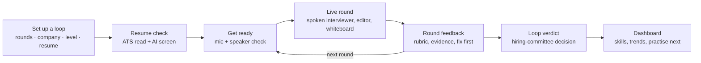
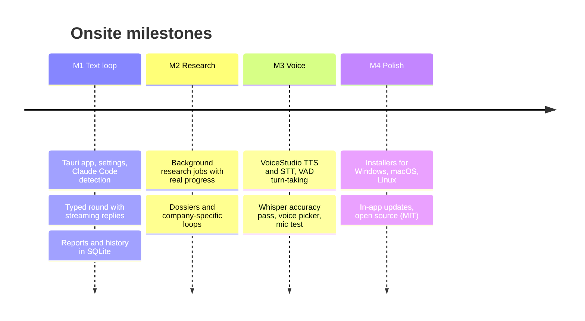

# PRD-01 · Onsite: the product

> **Status:** Current (v0.1.2) · **Updated:** 2026-10-30 · **Owner:** Prateesh Sulikeri · **Feature PRDs:** 02–07

## 1. The problem

Software engineers prepare for interview loops by reading, grinding problems and, if they are lucky,
doing a few mock interviews with friends. Real practice is hard to get:

- **Mock interviews with people are scarce.** They need a willing senior engineer, a time slot, and they rarely
  cover a whole loop.
- **Chat bots are not interviews.** Typing to a chat window does not train you to think out loud, take
  follow-ups, or manage the clock.
- **Generic practice misses the company.** Each company runs its own loop: different rounds, different bar,
  different style. That information is scattered across candidate reports.
- **Feedback is vague.** "Good job" does not tell you what a hiring committee would write.

Onsite started as a claude.ai artifact. It hit two walls: the sandbox blocks the microphone, and browser
text-to-speech sounds robotic. Onsite is the native rebuild.

## 2. What Onsite is

**A desktop app that runs realistic, spoken interview loops on your own computer, then tells you honestly how
you did.**

## 3. Who it is for

| Persona | Situation | What they need from Onsite |
|---|---|---|
| **The owner** (primary) | Backend engineer: Java, Kafka, PostgreSQL, Redis, payments. Windows 11 + WSL. Has Claude Pro. Preparing for SDE-2 / senior loops. | Spoken rounds that push on real backend depth. Company loops built from real reports. Honest scores. |
| **Friends** (secondary) | Engineers at various levels. Some have no Claude subscription. Mostly Windows, some macOS/Linux. | Install in minutes, bring any AI (free tiers count), and get the same experience. |
| **Contributors** (tertiary) | Developers who find the open-source repo. | Clear code, clear docs, a way to run it without the owner's setup. |

## 4. Goals and non-goals

### Goals

1. **Feel like a real interview.** A spoken conversation with a persona who follows up, pushes back, keeps time,
   and closes the round, at the level picked.
2. **Cover a whole loop.** Every common round type, run in order, with a verdict at the end.
3. **Company-true practice.** Research a company and role, then run *that* loop with its reported questions.
4. **Honest, actionable feedback.** Rubric scores with evidence from the transcript, the one thing to fix first,
   and what a strong answer would have said.
5. **Private and cheap.** Speech stays local. The user picks the AI and pays nothing extra to Onsite.

### Non-goals

- **Not a hosted service.** No accounts, no server, no telemetry.
- **Not a question grinder.** The coding bank exists to make coding rounds real, not to replace LeetCode.
- **Not a cheating tool.** Nothing in Onsite helps during a real interview.
- **Not multi-user.** One person per install.
- **Not multilingual (yet).** Interviews are English only, on purpose: the speech models are tuned for it.

## 5. The rules Onsite never breaks

These come from `CLAUDE.md` → *Non-negotiables*. Every feature must respect them.

| # | Rule | Why | What it means for a feature |
|---|---|---|---|
| N1 | **Bring your own AI.** Claude Code CLI, or the user's own key for Claude API, OpenAI, Gemini or Groq. Keys stay in local SQLite. No SDKs. | Friends may not have Claude Pro. Free tiers (Gemini, Groq) must work. | Every model call must work on all five providers. |
| N2 | **Runs natively on Windows**, owning the real mic and speakers. | The artifact sandbox blocked the mic. | No browser-only APIs for audio. |
| N3 | **Speech is local** (VoiceStudio), with fallbacks so the app never dead-ends. | Privacy, cost, latency. | Any voice failure must offer "Start typed". |
| N4 | **The interviewer never gets tools.** Only the research job may search the web. | A model with tools in a live chat is a risk and a distraction. | New model calls send no tools unless they are research. |
| N5 | **Model output and dossiers are data.** Never executed. | Prompt injection through a dossier or a reply. | Parse as JSON or show as text; nothing else. |

## 6. Features and status

| Area | Feature | Status | PRD |
|---|---|---|---|
| Loops | General loops: 9 round types, 14 company styles, 5 levels, 3 temperaments | Shipped | [PRD-02](PRD-02-interview-loops.md) |
| Loops | Interviewer panels: 2 panels × 5 personas with voices and backstories | Shipped | [PRD-02](PRD-02-interview-loops.md) |
| Loops | Round feedback report and loop verdict | Shipped | [PRD-02](PRD-02-interview-loops.md) |
| Loops | Dashboard: skills, trends, weekly goal, practise next | Shipped | [PRD-02](PRD-02-interview-loops.md) |
| Loops | Code comprehension round redesign | Planned (research in `docs/comprehension-round-research.md`) | [PRD-02](PRD-02-interview-loops.md) |
| Voice | Spoken rounds via VoiceStudio, Whisper accuracy pass, mute, barge-in | Shipped | [PRD-03](PRD-03-voice.md) |
| Voice | Typed rounds (fallback and by choice) | Shipped | [PRD-03](PRD-03-voice.md) |
| Research | Company research jobs → dossiers; company-specific loops | Shipped | [PRD-04](PRD-04-company-research.md) |
| Research | Dossier import/export | Shipped | [PRD-04](PRD-04-company-research.md) |
| Resume | ATS parse check, six ATS profiles, keyword match | Shipped | [PRD-05](PRD-05-resume-check.md) |
| Resume | AI screen (A–D grade against a posting) | Shipped | [PRD-05](PRD-05-resume-check.md) |
| Coding | Editor with 6 languages; Run/Submit in Java, Python, C++, JS | Shipped | [PRD-06](PRD-06-coding-workspace.md) |
| Coding | Whiteboard (Excalidraw) described to the interviewer as text | Shipped | [PRD-06](PRD-06-coding-workspace.md) |
| App | Five AI providers, live model lists, health check | Shipped (Claude API, OpenAI and Gemini not yet run against a live key) | [PRD-07](PRD-07-settings-privacy-updates.md) |
| App | Themes: Onsite, Nord, Rosé Pine, Gruvbox; light/dark; custom backdrop | Shipped | [UI design](UI-DESIGN.md) |
| App | In-app updates from GitHub releases | Shipped | [PRD-07](PRD-07-settings-privacy-updates.md) |
| App | Storage limits and cleanup | Shipped | [PRD-07](PRD-07-settings-privacy-updates.md) |
| App | Code-signed Windows installer (SignPath) | Pending: application submitted | [DD-08](DD-08-release-updates.md) |
| App | MCP server for Claude Code in a terminal | Planned (phase 3) | — |

## 7. Milestones

Each milestone had to be usable on its own.

| Milestone | Acceptance test | Result |
|---|---|---|
| M1 | A 10-minute typed DSA round completes end to end and the report renders. | Met |
| M2 | A new company dossier is produced without touching a chat window. | Met |
| M3 | A full spoken round with no typing; first audio < 2.5 s after the user stops talking. | Spoken round met. Latency: last-segment STT ~3.4 s on CPU Parakeet; Whisper on GPU 1.1–1.5 s per answer. The 2.5 s budget is tight and still being tuned. |
| M4 | Installers built by CI on tag push; README screenshots. | Installers met. macOS/Linux builds not yet run by a person. |

## 8. How we know it works

There is no telemetry, so success is measured by the owner and by friends' reports.

| Signal | Target | How it is measured |
|---|---|---|
| Time to first interviewer audio | < 2.5 s after the candidate stops | `voice {kind:"latency"}` events, logged per turn |
| Time to first token (typed) | < 2 s on API providers | `ttft_ms` on every interviewer turn, saved in the transcript |
| Rounds that end cleanly | Interviewer closes with `[[END]]`, report renders | History; "not enough to review" rate |
| Transcript accuracy | Tech terms right (Redis, idempotency, Postgres) | Spot checks; Whisper vs Parakeet comparisons |
| Friends can install | From download to first round in < 15 min | Friends' reports |

## 9. Constraints

- **Claude Code has no temperature flag.** Variety comes from rotating "openers" and showing the model how recent
  rounds began (see [DD-02](DD-02-interview-engine.md)).
- **Free tiers are rate-limited.** Groq gives about 8K tokens/minute. A coding turn sends about 5.4K. Every provider
  waits out a 429 (up to 60 s per wait, 90 s total).
- **VoiceStudio is a separate app.** Onsite can launch it and check its version, but never installs or updates it.
- **The owner's GPU** (RTX 5050) keeps Whisper large-v3 loaded. Machines without a GPU fall back to Parakeet text.

## 10. Open questions

- How should the comprehension round work? (Research done: real repos vs curated small repos vs bug datasets.)
- Should rounds support languages other than English when better speech models arrive?
- Should there be an "AI assistant" switch so the candidate can practise rounds that allow AI help?
- Which parts should the planned MCP server expose, beyond read-only dossiers and reports?
