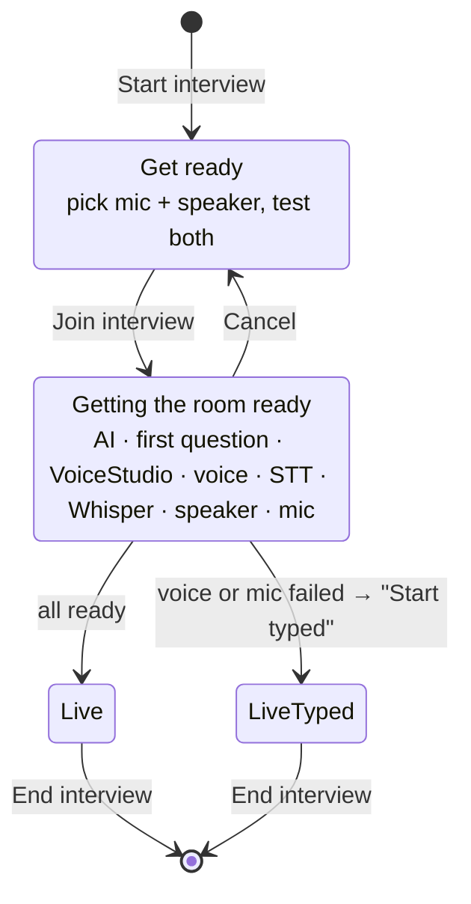
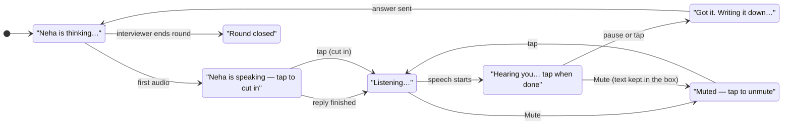
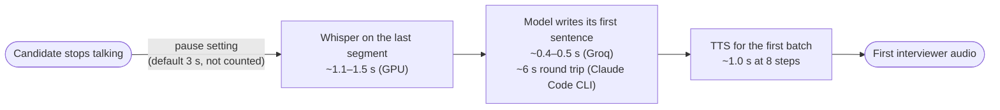

# PRD-03 · Spoken interviews

> **Status:** Shipped (v0.1.2) · **Updated:** 2026-10-30 · **Design:** [DD-03 Voice pipeline](DD-03-voice-pipeline.md)

## 1. Summary

Real interviews are spoken. Onsite lets the candidate talk to the interviewer and hear it talk back, with all
speech processed **on their own computer** by VoiceStudio (a separate local app) and a Whisper sidecar.
Typing is always available, as a choice or as a fallback.

## 2. Why it matters

- Thinking out loud is the skill being tested. Typing hides rambling, filler and long silences.
- Interviewers interrupt and follow up mid-thought. Text chat can't train that.
- The first version (a browser artifact) could not use the microphone, and browser text-to-speech sounded robotic.

## 3. User stories

| Id | As a candidate I want to… | So that… |
|---|---|---|
| VOICE-S1 | answer out loud and have the app notice when I'm done | I never press a button between turns |
| VOICE-S2 | hear the interviewer start talking quickly after I stop | it feels like a conversation |
| VOICE-S3 | have my technical words transcribed right (Redis, Kafka, idempotency key) | the interviewer judges what I said, not what the recogniser heard |
| VOICE-S4 | cut the interviewer off mid-sentence | I can correct course like in a real call |
| VOICE-S5 | mute without losing what I'd said so far | I can fix it by typing |
| VOICE-S6 | check my mic and speaker before joining | I don't find out mid-round that the mic is wrong |
| VOICE-S7 | each interviewer to keep the same voice all round | personas feel like people |
| VOICE-S8 | carry on typed if voice breaks | a round never dead-ends |

## 4. The experience

### Get ready → room ready → live

The **room ready** checklist shows each step as *running*, *ok*, *warning*, *failed* or *off*. The round clock
only starts when the room is ready, so loading time never counts against the candidate.

### The orb: what the candidate sees during a turn

The microphone orb in the middle of the room is the one control that matters. Its label always says what is
happening:

- **Pause to finish:** 1.8 s, 3 s (default), 5 s, or "Never — I tap the mic".
- **Live caption** shows the words as they are heard.
- **Waveforms** on both sides of the orb move with the mic or the interviewer's voice.

## 5. Requirements

| Id | Requirement | Status |
|---|---|---|
| VOICE-R1 | Speech in both directions uses VoiceStudio on `127.0.0.1:3900`. No audio leaves the machine. | Shipped |
| VOICE-R2 | The answer ends after the chosen pause of silence, or on tap. | Shipped |
| VOICE-R3 | Long answers are cut into segments at short pauses so transcription runs while the candidate talks. | Shipped |
| VOICE-R4 | Each segment is re-transcribed by Whisper large-v3 on the GPU with a tech vocabulary prompt. Whisper's text is what's sent; Parakeet's is the fallback. | Shipped |
| VOICE-R5 | Repeated phrases ("for the MQ for the MQ") are collapsed and common tech terms are fixed. | Shipped |
| VOICE-R6 | Interviewer text is spoken sentence by sentence as it streams. Short sentences are merged (max 220 chars per call). | Shipped |
| VOICE-R7 | Code blocks are never read aloud. | Shipped |
| VOICE-R8 | Tapping the orb while the interviewer speaks stops the audio and opens the mic (barge-in). | Shipped |
| VOICE-R9 | Mute cancels listening and puts what was heard so far in the typing box. | Shipped |
| VOICE-R10 | Each panel persona has a fixed VoiceStudio voice profile, built once and reused. | Shipped |
| VOICE-R11 | If VoiceStudio, the voice or the mic fails at start, the candidate can start the round typed. | Shipped |
| VOICE-R12 | Mic or speaker can be switched in the room. An unplugged mic ends listening with a clear message. | Shipped |
| VOICE-R13 | English only: the STT model is English-only Parakeet v2 (installed on demand); TTS always gets `language: English`. | Shipped |
| VOICE-R14 | First interviewer audio < 2.5 s after the candidate stops talking. | Partial: being tuned (see below) |

## 6. Latency budget

The pause setting itself (default 3 s) comes first and is not counted. Measured numbers live in `CLAUDE.md`:
Whisper 1.1–1.5 s per answer on the GPU, TTS ~1.0 s for a short sentence at 8 steps, Groq TTFT ~0.4–0.5 s,
Claude Code CLI ~6 s round trip on a warm process. With the CLI, the budget is not met yet; API providers come close.

## 7. Settings (VoiceStudio section)

| Setting | Default | Notes |
|---|---|---|
| Spoken interviews on/off | On | Off = every round is typed. |
| VoiceStudio address | `http://127.0.0.1:3900` | |
| Voice | first profile | Used when the round has no panel persona. VoiceStudio's random "default" voice is never used. |
| Quality (steps) | 8 = fast | 16 balanced, 32 best. |
| Speed | 1.0 | Multiplied by the persona's own speed factor. |
| Pause that ends an answer | 3 s | 1.8 s / 3 s / 5 s / never. |
| Microphone, speaker | system default | Also switchable on Get ready and in the room. |

## 8. Dependencies and risks

| Risk | Effect | Mitigation |
|---|---|---|
| VoiceStudio cold start (~70 s to start, ~60 s first speech) | First round waits | Warm-up at app launch and at round start. |
| VoiceStudio unloads after ~15 min idle | Next call ~10 s | Warm-up line at round start when it hasn't spoken in 5 min. |
| VoiceStudio demotes a dictation model after one silent session | STT silently falls back to whisper-tiny | Onsite re-selects the model at round start and restores the user's pick. |
| No GPU | No Whisper pass | Parakeet text is used. |
| Echo from speakers into the mic | Interviewer hears itself | The mic is closed while the interviewer speaks, unless the candidate cuts in. |
