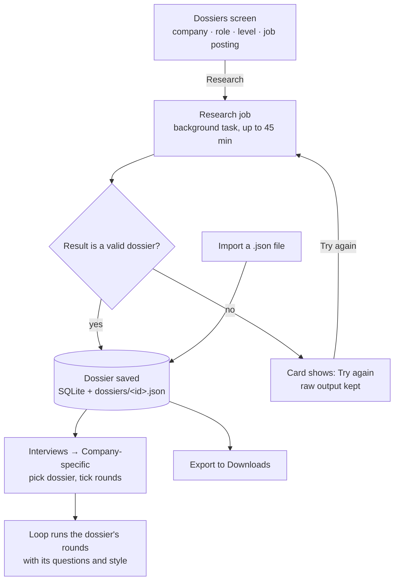

# PRD-04 · Company research and company-specific loops

> **Status:** Shipped (v0.1.2) · **Updated:** 2026-10-30 · **Design:** [DD-04 Research and dossiers](DD-04-research-dossiers.md)

## 1. Summary

Every company runs its own loop. Onsite can **research** a company and role on the web, from recent candidate
reports, and save the result as a **dossier**. A **company-specific loop** then runs that company's rounds, in that
order, with that company's reported questions and interviewer style.

## 2. User stories

| Id | As a candidate I want to… | So that… |
|---|---|---|
| RES-S1 | type a company, role and level (and paste the posting) and get a dossier | I don't spend an evening reading interview reports |
| RES-S2 | watch real progress while the research runs | I know it's working and roughly how long it will take |
| RES-S3 | read the dossier: rounds, questions, values, pitfalls, sources | I can prepare on my own too |
| RES-S4 | start a loop from the dossier and pick which rounds to run | practice matches the real loop |
| RES-S5 | be asked a coding problem that candidates actually reported | the coding round is company-true |
| RES-S6 | export a dossier and import one a friend made | research is shareable |
| RES-S7 | retry a failed job without losing what was found | a flaky run isn't wasted |

## 3. Flow



## 4. The progress card

A research job is slow (minutes), so the card shows real, not fake, progress:

```text
┌────────────────────────────────────────────────────────────┐
│ ◌ Razorpay · SDE-2 Backend                         62%     │
│ ████████████████████████░░░░░░░░░░░░░░░                    │
│ ✓ Reading your request                                     │
│ ✓ Finding the current process                              │
│ ✓ Collecting candidate experiences                         │
│ ◌ Extracting questions per round                           │
│ ○ Values and interviewer style                             │
│ ○ Building the dossier                                     │
│ 14 searches · 9 pages read                     [ Cancel ]  │
│ > Found 11 first-hand reports from 2025–2026               │
└────────────────────────────────────────────────────────────┘
```

- **Stage and %** come from `PROGRESS stage=… pct=… note=…` lines the model prints as it works.
- **Searches and pages read** are counted from the real tool calls in the stream.
- Groq does not stream research, so its card jumps from start to done.

## 5. What a dossier contains

| Field | Example (Razorpay SDE-2 Backend, shipped) |
|---|---|
| `summary` | Typical round order, strictness, where people fail, recent changes. |
| `style` | How interviewers behave across the loop. |
| `values` | The company's stated values, with source. |
| `pitfalls` | Common reasons candidates fail. |
| `process[]` | One entry per round: `type` (one of the 9 round keys), `name` as the company calls it, `minutes`, `what`, `style`, `questions[]` (4–10 reported questions, paraphrased). |
| `sources[]` | Title + URL of every report used. |

## 6. Requirements

| Id | Requirement | Status |
|---|---|---|
| RES-R1 | Research uses web search + web fetch **only**. No other tools, on every provider. | Shipped |
| RES-R2 | Only questions a source actually reported are included, paraphrased. If evidence is thin, the summary says so. | Shipped (prompt rule) |
| RES-R3 | Prefer reports from 2024 on, weight the last 12 months most, read at least 8 first-hand reports if they exist. | Shipped (prompt rule) |
| RES-R4 | The result is checked against `docs/dossier.schema.json` rules and tidied: round types mapped to known keys, minutes clamped 10–180. | Shipped |
| RES-R5 | Jobs survive navigation inside the app. Jobs still running when the app closes are marked failed on next start. | Shipped |
| RES-R6 | A failed job keeps the raw model output and offers *Try again*. | Shipped |
| RES-R7 | Company loop: the interviewer gets the dossier block (summary, style, values, this round's what/style/questions, pitfalls) and never mentions having it. | Shipped |
| RES-R8 | Company coding round: use a bank problem whose title matches a reported question, else the usual pick. | Shipped |
| RES-R9 | Dossier id = slug(company, role, level). Export writes `<Downloads>/<id>.json`; import takes any such file. | Shipped |
| RES-R10 | The shipped Razorpay dossier is imported once on first run. | Shipped |
| RES-R11 | Research runs in the background while the user does other things. Several jobs can run at once. | Shipped |

## 7. Out of scope / open

- Refreshing an old dossier automatically.
- Merging two dossiers for the same company.
- Surviving an app restart mid-research (today it is marked failed).
- Showing which dossier questions were already asked in past rounds.
