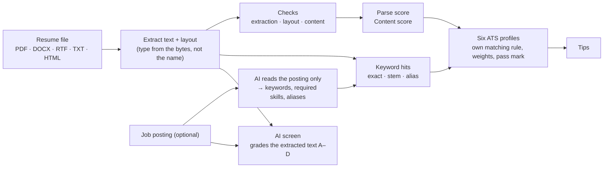

# PRD-05 · Resume check

> **Status:** Shipped (v0.1.2) · **Updated:** 2026-10-30 · **Design:** [DD-05 Resume check](DD-05-resume-check.md)

## 1. Summary

Before an interview there is a screen. Most companies run resumes through an **applicant tracking system (ATS)**
that parses the file and ranks it by keywords, and more and more add an **AI screen** that grades fit.
Onsite's *Resume check* shows the candidate what those systems see, and every loop starts with it.

## 2. User stories

| Id | As a candidate I want to… | So that… |
|---|---|---|
| ATS-S1 | see the text an ATS pulls out of my file | I spot scrambled columns or missing contact details |
| ATS-S2 | know if Workday, Taleo, iCIMS, Greenhouse, Lever or SuccessFactors would pass me | I fix the format before applying |
| ATS-S3 | see which posting keywords I hit and miss | I can tailor honestly |
| ATS-S4 | get an AI recruiter's grade with reasons | I know how a "role fit" model reads me |
| ATS-S5 | have the check run automatically when I start a loop | the interviewer works from the same text the ATS saw |

## 3. What the candidate sees

```text
┌─────────────────────────────── Resume check ───────────────────────────────┐
│  ( 86 )  Can an ATS read it?    ( 72 )  Content    ( 64 )  Match to posting │
│                                                                            │
│  ATS by ATS                                                                │
│  Workday        61  ✗  "Workday reads two columns as one, mixing lines."   │
│  Taleo          58  ✗  "Taleo often skips table cells."                    │
│  iCIMS          74  ✓                                                      │
│  Greenhouse     71  ✓                                                      │
│  Lever          66  ✓                                                      │
│  SuccessFactors 63  ✗                                                      │
│                                                                            │
│  Keywords  ✓ Java  ✓ Kafka  ✓ PostgreSQL  ✗ Kubernetes  ~ microservice     │
│  Checks    ✓ text layer  ✗ two columns  ✓ contact  ✓ dates  ! 3 pages      │
│  What the ATS sees  ▸ "PRATEESH SULIKERI  Backend Engineer  Java …"        │
│                                                                            │
│  AI screen   Grade B · fit 78                                              │
│   Must-haves: ✓ Java (proven) ✓ Kafka (proven) ~ AWS (claimed) ✗ K8s       │
│   Red flags: none · Level: matches SDE-2                                   │
└────────────────────────────────────────────────────────────────────────────┘
```

## 4. How the scores are built



- **Everything except the two AI steps is deterministic.** Same file, same posting → same scores.
- **The AI never sees the resume when reading the posting**, and the AI screen sees only the *extracted* text,
  exactly what an ATS would pass on. That is how it notices scrambled two-column reading order on its own.

### The six ATS profiles

| ATS | Vendor | Matching | Pass mark | Note shown |
|---|---|---|---|---|
| Workday | Workday | Exact words | 70 | Strict parser. Skips page headers and footers. |
| Taleo | Oracle | Exact words | 65 | Oldest and most literal. Boolean filters, knock-out questions. |
| iCIMS | iCIMS | By meaning | 60 | Most forgiving parser. |
| Greenhouse | Greenhouse | By meaning | 60 | Doesn't auto-reject; a person reviews. |
| Lever | Employ | Word forms | 60 | No ranking; recruiters search. |
| SuccessFactors | SAP | Skill taxonomy (aliases count) | 65 | Textkernel parser. |

Checks and the match score are ported from **Resume-Matcher** (Apache-2.0); the six profiles follow
**ats-screener** (MIT). See `THIRD_PARTY_NOTICES.md`.

## 5. Requirements

| Id | Requirement | Status |
|---|---|---|
| ATS-R1 | Accept PDF, .docx, .rtf, UTF-8/16 text and .html. Detect the type from the bytes. | Shipped |
| ATS-R2 | Refuse old .doc, images, .odt/.pages and password PDFs with a plain message. Owner-only-locked PDFs open. | Shipped |
| ATS-R3 | Show the extracted text preview: "what the ATS sees". | Shipped |
| ATS-R4 | Detect: no text layer, garbled glyphs, low text coverage, multiple columns, tables, text boxes, header/footer-only contact info, images, page count, contact details, section headings, date formats. | Shipped |
| ATS-R5 | Score six ATS profiles, each with its own matching strategy, weights and pass mark, plus specific issues ("Workday may cut text after page 2"). | Shipped |
| ATS-R6 | With a posting: keyword hits per term (exact / stem / alias), required vs preferred. | Shipped |
| ATS-R7 | AI screen: grade A–D, fit 0–100 tied to the grade, must-haves (proven / claimed / missing), level fit, red flags. | Shipped |
| ATS-R8 | The AI screen never guesses gender, age, nationality or other traits from the name. | Shipped (prompt rule) |
| ATS-R9 | AI results are cached per posting (keywords) and per resume + posting (screen). | Shipped |
| ATS-R10 | Starting a loop runs the check first. No resume, or an unreadable file, blocks the loop. The result shows on Get ready. | Shipped |
| ATS-R11 | Offline CLI for testing: `cargo run --example ats_check -- resume.pdf [job.json] [--json]`. | Shipped |

## 6. Honest limits

The six profiles are **simulations** built from public documentation and community testing, not the vendors' code.
They are good at catching format problems and keyword gaps. They are not a promise that a real system will pass or
reject a resume. The UI should never say otherwise.
