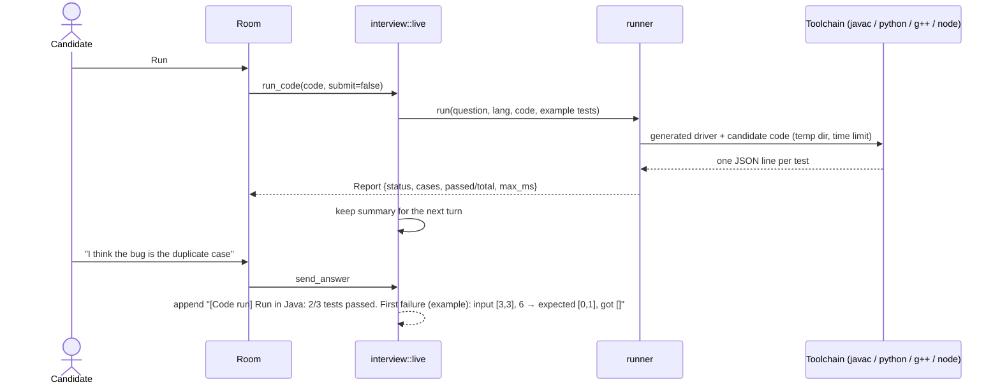

# PRD-06 · Coding workspace and question bank

> **Status:** Shipped (v0.1.2) · **Updated:** 2026-10-30 · **Design:** [DD-06 Question bank and runner](DD-06-question-bank-runner.md), [UI design](UI-DESIGN.md)

## 1. Summary

Interviews happen on a shared screen. In Onsite, the right side of the room is the **workspace**: a code editor,
a whiteboard, a notes pad, and a tab for code the interviewer shows. Whatever the candidate changes reaches the
interviewer with their next answer, so it can "watch their screen".

Coding rounds use a local **question bank** with real tests. The candidate can **Run** their code on the examples
or **Submit** it against hidden and full-size tests, on their own machine. The interviewer sees the result.

## 2. User stories

| Id | As a candidate I want to… | So that… |
|---|---|---|
| WS-S1 | read the problem on screen while we talk | I don't have to remember it from speech |
| WS-S2 | write code in my language with highlighting, bracket closing and completion | it feels like a real coding pad |
| WS-S3 | run my code on the examples and see what failed | I can debug like in a real round |
| WS-S4 | submit against hidden and large tests | I find out if my solution is correct and fast enough |
| WS-S5 | have the interviewer react to my code and my run results | the conversation follows my work |
| WS-S6 | draw boxes and arrows in a design round | I can design visually |
| WS-S7 | keep scratch notes (requirements, estimates) | I can structure a design answer |

## 3. Layout

```text
┌───────────── conversation ─────────────┬──────────── workspace ─────────────┬─ context ─┐
│ Two Sum  · Easy · array, hash-map      │ [Editor] [Whiteboard] [Notes] [⋯]  │ Round     │
│ Given an integer array nums…           │ Java ▾  The interviewer sees this…  │ context   │
│ Example 1: [2,7,11,15], 9 → [0,1]      │          [▶ Run] [Submit] [Share]  │           │
│════════════ drag to resize ════════════│ class Solution {                   │ Round plan│
│ Neha: Let's start. The problem is on   │   public int[] twoSum(int[] nums,  │ ▸ Code it │
│       your screen…                     │      int target) {                 │           │
│ You:  I'd use a hash map from value…   │     …                              │ Tips      │
│                                        │ ── Run: 2/3 passed ───────────────│           │
│  [ Type instead…                  ➤ ]  │ ✗ Example 3: [3,3], 6 → expected   │           │
│  (Mute)      ◉ Listening…   (End)      │   [0,1], got []                    │           │
└────────────────────────────────────────┴────────────────────────────────────┴───────────┘
```

## 4. Workspace tabs

| Tab | Tech | Sent to the interviewer as | Default in rounds |
|---|---|---|---|
| **Editor** | CodeMirror 6: Java, Python, C++, JavaScript, TypeScript, Go. Bracket closing, auto-indent, word + keyword completion, syntax-error lint. | `Editor (<lang>):` + the code in a fenced block | Coding |
| **Whiteboard** | Excalidraw 0.18, loaded the first time the tab opens. Can be maximised. | A text description: shapes, what's inside what, arrows with labels, loose text | Project, LLD, System design (offered) |
| **Notes** | Plain textarea, pre-filled with a template per round | `Whiteboard:` + the text | Most rounds |
| **From interviewer** | Read-only, with a picker when there are several snippets | (it came from the interviewer) | Comprehension |

The whiteboard description looks like this (example):

```text
Boxes: "API gateway", "Payments service" (inside "VPC"), "Postgres", "Kafka"
Arrows: "API gateway" → "Payments service" labelled "POST /pay"
        "Payments service" → "Kafka" labelled "payment.created"
Text: "idempotency key in header"
```

## 5. Run and Submit



| | Run | Submit |
|---|---|---|
| Tests | Examples only | Examples + hidden tests + one full-size generated test |
| Shown to candidate | Each example: input, expected, got, time | Pass count; first failure; slowest time |
| Statuses | Accepted · Wrong answer · Runtime error · Time limit exceeded · Compile error | same |
| Reaches interviewer | One summary line with the next answer | same |

Run and Submit work in **Java, Python, C++ and JavaScript**. TypeScript and Go can be written but not run
("Running Go isn't supported yet. Use Java, Python, C++ or JavaScript."). The language can change mid-round;
the editor then loads that language's starter code.

## 6. The question bank

- **81 problems:** 20 originals plus the rest of Blind 75. 20 Easy, 50 Medium, 11 Hard.
- **Kinds:** 76 plain `Solution.method`, 3 *design* problems (a class driven by an operations list, like LRU cache),
  2 *round-trip* problems (Codec: `decode(encode(x)) == x`).
- **Types:** int, long, double, bool, string, char, arrays, lists, `ListNode` (with cycles), `TreeNode`, graph `Node`, and
  in-place `void` methods.
- **Picking:** level → difficulty (New grad = Easy, Senior/Staff = Hard, else Medium). Problems tagged with the chosen
  company come first, then a time-seeded shuffle. Past rounds are **not** taken into account yet, so a problem can repeat.
  Company loops first try a problem whose title matches a reported question (≥ 60% of its title words).
- **What the interviewer gets:** statement, examples, constraints, optimal time/space, hints (one at a time, only if
  stuck), follow-ups. It is told the problem is already on screen and not to read it out.
- **What the candidate gets:** statement, examples, constraints, count of hidden tests, starter code. Never the
  reference, hints or hidden tests.

## 7. Requirements

| Id | Requirement | Status |
|---|---|---|
| WS-R1 | Only workspace parts that changed since the last turn are sent; "Share now" forces a send. | Shipped |
| WS-R2 | Editor content is clipped to a maximum size before sending; same for the whiteboard. | Shipped |
| WS-R3 | The problem panel and the conversation share the left column with a draggable divider. | Shipped |
| WS-R4 | Run/Submit results go into the next candidate message as `[Code run] …`. | Shipped |
| WS-R5 | Candidate code runs with a per-test time budget (≤ 60 s total) and the whole process tree is killed on timeout. | Shipped |
| WS-R6 | Missing toolchain → plain message naming what to install. Python falls back to VoiceStudio's bundled Python. | Shipped |
| WS-R7 | Every reference solution and every starter is tested in every language (`cargo test -- --ignored`). | Shipped |
| WS-R8 | Whiteboard theme follows the app (today it is compiled in as dark). | Planned |
