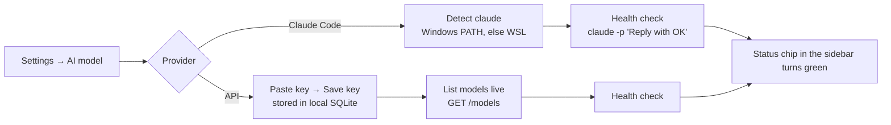
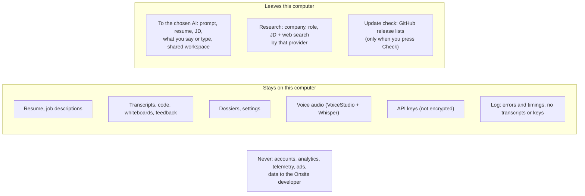

# PRD-07 · Settings, AI providers, privacy, storage and updates

> **Status:** Shipped (v0.1.2) · **Updated:** 2026-10-30 · **Design:** [DD-01 AI brain](DD-01-ai-brain.md), [DD-07 Storage](DD-07-storage-data.md), [DD-08 Release and updates](DD-08-release-updates.md)

## 1. Summary

Onsite is shared with friends who have different setups. Settings lets each person **bring their own AI**, tune
voice, pick a look, see exactly what happens to their data, control disk use, and update the app. Settings is one
screen with six sections: **Appearance · AI model · VoiceStudio · Updates · Privacy · Storage**.

## 2. Bring your own AI

| Provider | What the user needs | Cost | Default interviewer / feedback model |
|---|---|---|---|
| **Claude Code** | Claude Pro or Max, Claude Code installed (Windows or WSL) | Included in the subscription | `sonnet` / `opus` |
| **Claude API** | An Anthropic API key | Pay per use | claude-sonnet-5-5 / claude-opus-5-5 |
| **OpenAI** | An OpenAI API key | Pay per use (separate from ChatGPT Plus) | gpt-5.5 |
| **Gemini** | A free Google AI key | Free tier with daily limits (Flash models) | gemini-flash-latest |
| **Groq** | A free Groq key | Free tier, ~8K tokens/minute | qwen/qwen3.8-27b / openai/gpt-oss-120b |

Two model choices per provider: the **interviewer model** (fast, live) and the **feedback, verdict and research model**
(stronger, slower). Model lists are fetched live from each provider, because ids change fast.

### Requirements

| Id | Requirement | Status |
|---|---|---|
| SET-R1 | A provider without a key shows "Add your <provider> key in Settings first." on any AI action. | Shipped |
| SET-R2 | Keys are never sent back to the UI (the UI only learns *which* providers have a key) and never logged. | Shipped |
| SET-R3 | Claude Code path is auto-detected once and re-detected if the saved .exe disappears. A path can be set by hand. | Shipped |
| SET-R4 | The health check shows the result, the latency and which path or API was used. | Shipped |
| SET-R5 | Free-tier rate limits (HTTP 429) are waited out: up to 60 s per wait, 90 s in total. | Shipped |
| SET-R6 | Groq models that run tools on their own (`groq/compound*`) are hidden from the pickers. | Shipped |
| SET-R7 | Claude API, OpenAI and Gemini are verified against a live key with a short round per provider. | **Open:** only Claude Code and Groq have run live so far |

## 3. Appearance

| Setting | Options |
|---|---|
| Theme | Onsite (default), Nord, Rosé Pine, Gruvbox |
| Mode | System (follows the OS), Light, Dark |
| Background image | The theme's picture, your own image (shrunk to ≤ 2560×1600, saved locally), or none; optional dim |

The whiteboard stays dark in every theme. Details in [UI design](UI-DESIGN.md).

## 4. Privacy

The Privacy section states, in plain words, what Onsite does with data. The text lives in `ui/index.html` and must be
kept true whenever a data flow changes.

| Id | Requirement | Status |
|---|---|---|
| PRIV-R1 | No telemetry, analytics or accounts, ever. | Shipped |
| PRIV-R2 | The Privacy section lists every outbound flow. A new flow is not merged until this text and `PRIVACY.md` are updated. | Shipped (rule) |
| PRIV-R3 | The privacy text admits API keys are not encrypted and tells the user how to remove them. | Shipped |
| PRIV-R4 | Uninstalling leaves the data folder; Storage → Open data folder lets the user delete everything. | Shipped |

## 5. Storage

| Control | Options | Effect |
|---|---|---|
| Keep at most | All · 500 · 200 · 100 · 50 · 20 rounds | Oldest finished rounds deleted, with transcript and feedback |
| Delete rounds older than | Never · 1 year · 6 months · 3 months · 1 month | Same |
| Clear the log above | 5 · 20 · 50 · 100 MB | Log truncated at startup when over |
| Clean up | Clear the log · Delete temporary files · Compact the database | One-off actions |
| Open | Data folder · Log folder | Opens in the file manager |

Limits apply when saved and at every startup. Rounds still running are never touched.

## 6. Updates

| Id | Requirement | Status |
|---|---|---|
| UPD-R1 | Onsite checks GitHub releases **only when the user presses Check for updates**. | Shipped |
| UPD-R2 | "All versions" lists every release; any one can be installed, including older ones. An older version may not read newer data (warned). | Shipped |
| UPD-R3 | Windows: download the setup .exe, run it, quit. macOS: open the dmg. Linux AppImage: replace itself and restart. Linux .deb: save to Downloads. | Shipped |
| UPD-R4 | Installing is refused while a round or a research job is running. | Shipped |
| UPD-R5 | Downloads only from `github.com` URLs of the Onsite repo. Draft releases are skipped. | Shipped |
| UPD-R6 | VoiceStudio: show installed and newest version. Never update it. | Shipped |
| UPD-R7 | Signed Windows installer via SignPath Foundation. | **Pending:** application submitted 2026-10; releases are unsigned until approved |

## 7. Sidebar status chips

Two chips at the bottom of the sidebar show at a glance whether the app can run a round:

| Chip | Green when | Click goes to |
|---|---|---|
| AI model (shows the provider) | The provider is configured: Claude Code found, or a key saved | Settings → AI model |
| VoiceStudio | Running with its voice model loaded. Amber while loading, red when not running. | Settings → VoiceStudio |

The chips refresh every 15 s, except during a round.
