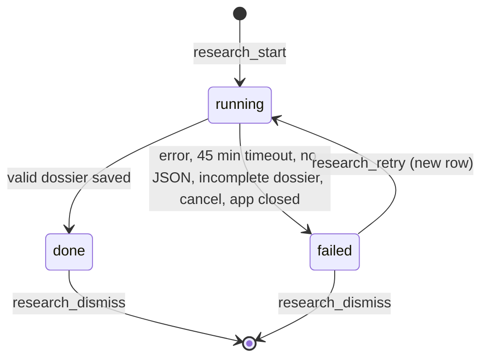

# RESEARCH — research jobs, dossiers, company loops

Code: `src/research.rs`, `src/dossier.rs`, `prompts/research.md`, `prompts/dossier_block.md`, `docs/dossier.schema.json`,
`dossiers/*.json`; UI: `ui/app.js` *dossiers and research*.

## Map

| Item | Where |
|---|---|
| `ResearchRequest {company, role, level, jd}`, `validate` (company+role non-empty, known level) | research.rs |
| `start` (insert `research_jobs` row status running, spawn task, keep `AbortHandle` in `AppState.research`), `cancel` (abort → failed), `retry` (new job, same request, old row deleted; refused while running), `jobs` | research.rs |
| `run` → `research` (render prompt, `run_once_with_timeout(Tools::Web, report model, 45 min)`), `Lines`, `parse_progress`, `emit`, `update` | research.rs |
| `save` (SQLite + `<app data>/dossiers/<id>.json`), `import`, `seed` (shipped dossiers once, key `dossiers_seeded`) | research.rs |
| `Dossier {id, company, role, level, jd, preparedAt, summary, style, values, pitfalls[], process[DossierRound], sources[Source]}`, `DossierRound {type→kind, name, minutes, what, style, questions[]}` | dossier.rs |
| `Dossier::from_value(json, round_keys)`, `round_kind`, `minutes`, `text`, `strings`, `slug`, `prompt_block`, `with_rounds`, `to_value` | dossier.rs |
| `research_dismiss` (delete row; refused while running) | commands.rs |

## Job flow

Progress, never faked: (1) `StreamEvent::ToolUse` `WebSearch` → searches++, `WebFetch` → reads++; (2) model prints
`PROGRESS stage=<1-6> pct=<0-100> note=<…>` lines; stage/% only increase (`max`); notes appended to log. Each change emits
`research {job, live}`. Groq research isn't streamed (no live progress); Gemini counts searches from grounding metadata.
On success: level = request level, `id = slug(company, role, level)` (level dropped if role contains it), jd fallback to
request, `preparedAt = now`, `save`, emit + `dossiers_changed`. Failure keeps `raw_output` (until retry deletes the row).

## `from_value` tidying (also used by import)

| Input | Result |
|---|---|
| missing company/role/summary/style/rounds | Err "It has no …" |
| `type` not a round key | `round_kind` keywords on type+name: machine coding/low level/lld/ood → lld; system design/hld/architecture → sysdesign; dsa/coding/algorithm/problem solving → coding; code review/debug/comprehension → comprehension; behaviour/culture/values/leadership principle/bar raiser → behavioral; resume/screen/recruiter/introduct → resume; project/deep dive → project; fundamental/core cs/technical round/java/database → fundamentals; else hm |
| minutes `"60 min"`/missing | first number, clamp 10–180, default 45 |
| string↔array mismatch | normalised |
| sources as URL strings | `{title:"", url}`; objects without url dropped |

## Company loop wiring

`create_loop` with `dossier_id` + `dossier_rounds` → `LoopSetup.dossier` = frozen copy (`with_rounds`), `rounds[i] =
process[i].kind`, `company = "auto"`. Per round: `plan` uses dossier name/minutes; `dossier.prompt_block(dossier_block.md, i)`
fills `summary style values round_name round_what round_style round_questions_bulleted pitfalls_joined`; block says use
reported questions (or close variants, not all), never mention the dossier. Coding: `Bank::match_reported(process[i].questions)`.

## Prompt rules (`research.md`)

Web search + fetch only · prefer 2024+, weight last 12 months · ≥ 8 first-hand reports if they exist · company values
from own site · note disagreements · only reported questions, paraphrased, 4–10 per round · thin evidence → say so in
summary · final message = one JSON object. Placeholders: `company role level_name jd round_types today`.

## Requirements

RES-R1 web tools only · R2 only reported questions · R3 recency/volume rules · R4 schema check + tidy · R5 jobs survive
navigation; running at startup → failed · R6 failed keeps raw + Try again · R7 dossier block, never mentioned · R8 reported
coding problem match · R9 slug id, export `<Downloads>/<id>.json`, import any · R10 seed once · R11 concurrent jobs allowed.

## Gaps / ideas

Job dies with the app · no staleness signal for old dossiers · reported questions linked to bank at round start, not at
save · no source dates on the card.
