# Onsite UI design

> **Status:** Current (v0.1.2) · **Updated:** 2026-10-30 · **Code:** `ui/` · **Screenshots:** sample data, retaken with `npm run shots` in `docs/engineering/tools`

This document covers three things:

1. **Where the UI is built:** files, structure, how it talks to Rust, and how to add a screen.
2. **The design language:** "night violet": colours, type, shape, motion, icons, copy, themes.
3. **The screens and features** as they are today, with screenshots.

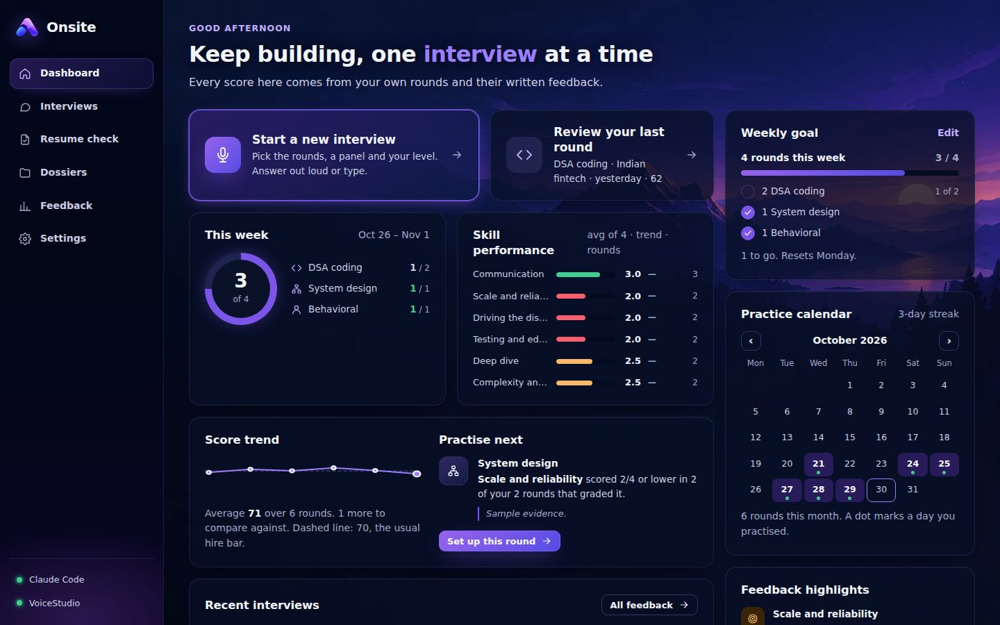

---

## Part 1 · Where the UI is built

### 1.1 No framework, no build step

The UI is plain HTML, CSS and JavaScript, served by Tauri from `ui/` into the system WebView. It was ported from the
original claude.ai artifact and kept framework-free on purpose: one person maintains it, it loads instantly, and there
is nothing to compile. The only built parts are the two third-party bundles in `ui/vendor/`.

| File | Lines | Role |
|---|---|---|
| `ui/index.html` | ~740 | Every view as a `<section class="view">`, the SVG icon sprite, dialogs. Views are hidden, not created. |
| `ui/app.js` | ~2,600 | All behaviour, in commented sections (below). Global functions, `$`/`$$` helpers. |
| `ui/app.css` | ~920 | The design: tokens on `:root` (Onsite dark), then primitives and one section per screen. |
| `ui/themes.css` | ~120 | The other themes: ~25 base tokens each; everything else derived with `color-mix`. |
| `ui/theme-boot.js` | small | Runs in `<head>` before paint: sets `data-theme` and `data-mode` from localStorage. (The CSP forbids inline script, so it's a file.) |
| `ui/ipc.js` | small | `window.api.invoke` / `api.listen` over Tauri's globals; logs failures to the app log. |
| `ui/vendor/editor.js` | built | CodeMirror 6: Java, Python, C++, JS, TS, Go; completion; syntax-error lint. Exposes `OnsiteEditor`. |
| `ui/vendor/whiteboard/` | built | Excalidraw 0.18 as split ES modules, `import()`ed the first time the Whiteboard tab opens. Exposes `OnsiteBoard.describe()`. |
| `ui/assets/` | | `logo.png`, `twilight.webp` (the backdrop). |
| `ui-vendor/` | | The npm project (esbuild) that builds `ui/vendor/`. Run `npm install && npm run build`, then commit `ui/vendor/`. |

`app.js` sections, in order: round guidance (`PLANS`, `TIPS`, `ROUND_ICONS`) · shell (navigation, dialogs, toasts, status
chips) · dashboard · setup · call room · preparing · coding problem + runner · rendering (transcript, markdown) · feedback +
report · interview feedback (whole loop) · resume check · dossiers and research · settings · audio devices · get ready · init.

### 1.2 How a screen works

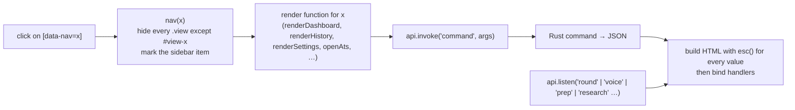

Rules the code follows:

- **Every value from Rust or the model goes through `esc()`** before it reaches `innerHTML`. Interviewer text is
  rendered by a tiny markdown subset (`md`, `inlineMd`) that escapes first.
- **One global state object per concern:** `CAT` (catalog), `PANELS`, `SETTINGS`, `AIKEYS`, `VS` (VoiceStudio status),
  `loop` (`{id, setup, count}`), `session` (the live round). No hidden stores.
- **Persist only UI preferences in localStorage** (`onsite.*` keys, see [DD-07](DD-07-storage-data.md)). Everything the
  user would miss lives in Rust/SQLite.
- **Errors show as plain text.** `errText(e)` turns a Rust error into its message; `toast(msg, "err")` shows it.

### 1.3 Adding a screen: a worked example

Say we add a **"Practice plan"** screen.

**1. Markup** in `index.html`, next to the other views:

```html
<section class="view" id="view-plan" hidden>
  <header class="page-head">
    <div>
      <div class="crumb">Practice plan</div>
      <h1>Your next <em class="hl">two weeks</em></h1>
      <p class="lede">Built from your weakest skills.</p>
    </div>
  </header>
  <div class="panel"><div id="planBody"></div></div>
</section>
```

**2. Navigation**: a sidebar button with an icon from the sprite:

```html
<button class="nav-item" data-nav="plan"><svg><use href="#i-target"/></svg><span>Plan</span></button>
```

**3. Behaviour** in `app.js`: a render function, called from `nav()`:

```js
/* ---------------- practice plan ---------------- */
async function renderPlan(){
  const h = await api.invoke("history").catch(e => (toast(errText(e), "err"), []));
  $("#planBody").innerHTML = h.length
    ? h.slice(0, 5).map(x => `<div class="row-item"><b>${esc(x.name)}</b><span class="muted">${esc(ago(x.started_at))}</span></div>`).join("")
    : `<p class="muted">No rounds yet. Your plan appears after your first feedback.</p>`;
}
// in nav(view):  if (view === "plan") renderPlan();
```

**4. Style** in `app.css` under its own `/* ---------- plan ---------- */` header, using **tokens only**
(`var(--surface)`, `var(--accent-line)`, `var(--muted)` …), never colour literals, so every theme works.

**5. Rust**: if it needs new data, add a `#[tauri::command]` in `commands.rs`, register it in `lib.rs`, and keep the logic
in a module (see [ARCHITECTURE](ARCHITECTURE.md)).

**6. Copy**: short, plain sentences. Write the empty state.

---

## Part 2 · The design language: "night violet"

### 2.1 Where it comes from

Every colour on `:root` in `app.css` is **sampled from the backdrop**, `assets/twilight.webp` (the owner's
"Twilight Mountains and Glowing Horizon"). The idea: a calm night scene, with violet light where you act, and a warm
horizon used only for emphasis.

| Role | Hue | Where it's used |
|---|---|---|
| Navy neutrals | 266 | Background, sidebar, surfaces, panels, lines |
| Violet accent | 290 | Primary buttons, selection, focus, live state (the orb, the timer, active nav) |
| `--warm` (sun peach) | 46 | Rare highlights, syntax function names |
| `--warm-2` (horizon magenta) | 337 | Tip cards, numbers in code |
| Status | green 160 · amber 70 · red 18 | ok / warn / bad only |

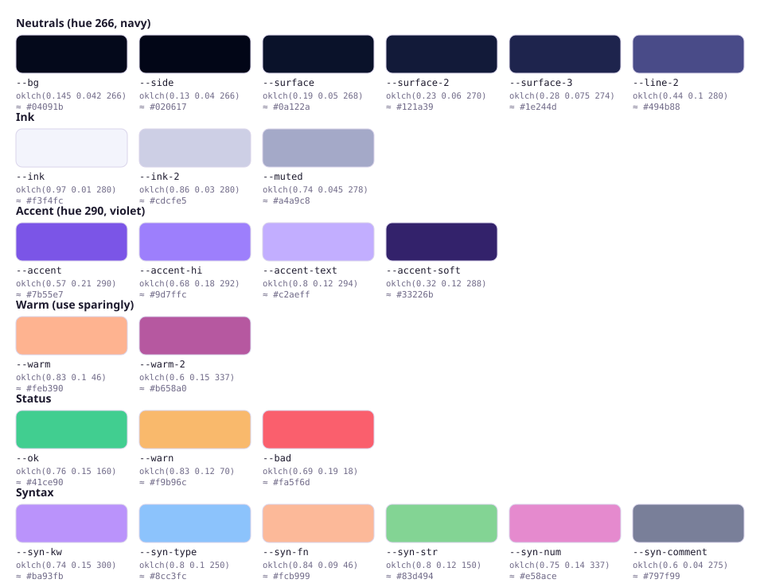

Colours are written in **OKLCH**, so lightness steps are even and a token can be shifted in hue without changing how
light it looks. The hex values above are approximate (sRGB).

### 2.2 Token layers

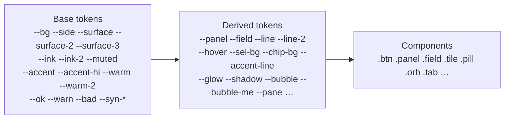

- **Onsite dark** hand-picks every token in `app.css :root`.
- **Every other theme** sets only the base tokens; the shared block in `themes.css` derives the rest with
  `color-mix(in srgb, var(--accent) 20%, transparent)` and similar. That is why a new rule must use tokens: a literal colour
  would not follow the theme.
- **Light mode** adds lighter shadows, scrims and panels under `[data-mode="light"]`.

The only colour literals left in `app.css` are status glows.

### 2.3 Type

| Token | Stack | Used for |
|---|---|---|
| `--font` | Segoe UI Variable Text, Segoe UI, system-ui | Body, controls |
| `--font-display` | Segoe UI Variable Display, Segoe UI, system-ui | Page titles, card titles |
| `--mono` | Cascadia Code, Cascadia Mono, Consolas, ui-monospace | Editor, code, run output |

Patterns: a small uppercase, letter-spaced **crumb** above each page title ("INTERVIEW PRACTICE"); a big **title with one
highlighted word** in accent (`<em class="hl">interview</em>`); a one-line **lede** under it.

### 2.4 Shape, depth and motion

| Token | Value | Use |
|---|---|---|
| `--r-sm` · `--r` · `--r-lg` · `--r-xl` | 9 · 12 · 16 · 20 px | fields · buttons, tiles · panels · hero cards |
| `--shadow` | inset top light + long soft drop | every panel |
| `--glow` / `--glow-sm` | violet glow | primary buttons, selected tiles, focus |
| `--ease` | `cubic-bezier(.22, 1, .36, 1)` | all transitions (fast start, soft stop) |
| Glass | `--panel` / `--glass` are translucent | panels sit over the backdrop |

- Focus: `:focus-visible` = 2 px `--accent-hi` outline, 2 px offset. Never removed without a replacement.
- `prefers-reduced-motion: reduce` stops spinners and the prep-list animation.
- On wide screens pages stop growing and sit centred; only the call room uses the full width.

### 2.5 Icons

One inline SVG sprite in `index.html`, used as `<svg><use href="#i-name"/></svg>`. Stroke icons, inheriting `currentColor`.

`mic mic-off home chat folder chart gear arrow back check upload user sparkle building phone-off send code pen bulb play
speaker clock key download refresh trash doc-check scale search layers network users wand hourglass shield expand shrink
panel target`

Round types map to icons in `ROUND_ICONS`: resume → doc-check, project → folder, fundamentals → gear, coding → code,
comprehension → search, lld → layers, sysdesign → network, behavioral → user, hm → chart.

### 2.6 Components

| Component | Class | Notes |
|---|---|---|
| Button | `.btn`, `.btn.primary`, `.btn.ghost`, `.btn.danger`; sizes `.sm` `.lg` `.xl`; `.icon-btn` | Primary = violet gradient + glow. One primary per area. |
| Panel | `.panel`, `.panel.tight`, `.panel-head` | Translucent surface, `--r-lg`, `--shadow`. |
| Numbered step | `.panel.step` + `.step-n` | Setup is a real sequence, so numbers carry order. |
| Field / select | `.field` > `span` label + `.sel` (leading icon + `<select>`) + `small.hint` | Hint under every non-obvious field. |
| Mode card | `.mode[role=radio]` | Big two-way choice with icon, title, one-line description, check. |
| Tile | `.tiles` > `.chip` | Round picker: icon, name, minutes, check. |
| Timeline | `ol.timeline` | The loop agenda: number, round, minutes, interviewer. |
| Pill / tag | `.pill`, `.tag` | Status words ("Checking…", "Easy"). |
| Status chip | `.sys` + `.dot` (`ok` / `warn` / `bad`) | Sidebar: AI model, VoiceStudio. |
| Toast | `#toasts` | Short, plain; `err` variant for errors. |
| Dialog | `<dialog class="dlg">` | `ask(title, body, ok, danger)` for confirms; typed confirmation for Terminate. |
| Orb | `.orb` + `.wave` | The call's main control; `data-state` drives colour and animation. |
| Bubble | transcript `.msg` | Interviewer: `--bubble`; candidate: `--bubble-me` (violet). |
| Tabs / panes | `.tabs` `[role=tab]` + `.pane[data-pane]` | Workspace: Editor, Whiteboard, Notes, From interviewer. |
| Rail | `aside.rail` | Room context, round plan, tips; can be hidden. |
| Ring / meter | `ring()` in app.js, `.meter` | Scores, mic level, research %. |

### 2.7 Writing in the UI

From `CLAUDE.md`: **short, plain sentences; don't water down technical content.** In practice:

| Do | Don't |
|---|---|
| "The interviewer is still talking. Send again when they finish." | "Error: request rejected (busy)." |
| "Add your Gemini key in Settings first." | "Missing credentials for provider." |
| "You didn't answer anything, so the round wasn't saved." | "Round discarded." |
| "Terminate" + typed confirmation for the destructive action | A one-click "Stop" next to "End" |
| Name the fix: "Tap the mic to listen again." | Leave the user guessing |

Every empty state says what will appear and how to get it. No fake numbers, ever: the dashboard shows nothing rather
than a placeholder score.

### 2.8 Themes

Four families × light/dark, chosen in **Settings → Appearance**. Saved as `onsite.theme` = `{family, mode, image, plain, dim}`.

| Family | Source | Character |
|---|---|---|
| **Onsite** (default) | the twilight backdrop | Dark: navy + violet over the mountains. Light: the same violet on lavender paper. |
| **Nord** | nordtheme.com | Polar Night / Snow Storm; cool blue-grey. Replaced Catppuccin (too close to Onsite). |
| **Rosé Pine** | rosepinetheme.com | Dawn (light) and main (dark); soft rose and pine. |
| **Gruvbox** | morhetz/gruvbox | Warm retro browns, orange accent. |

| Onsite light | Nord light |
|---|---|
| 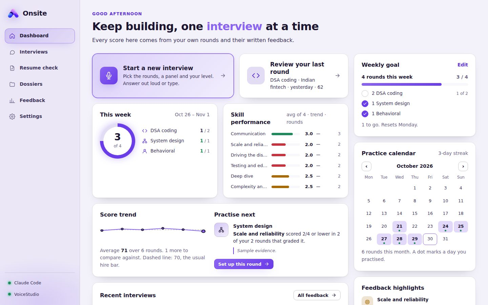 | 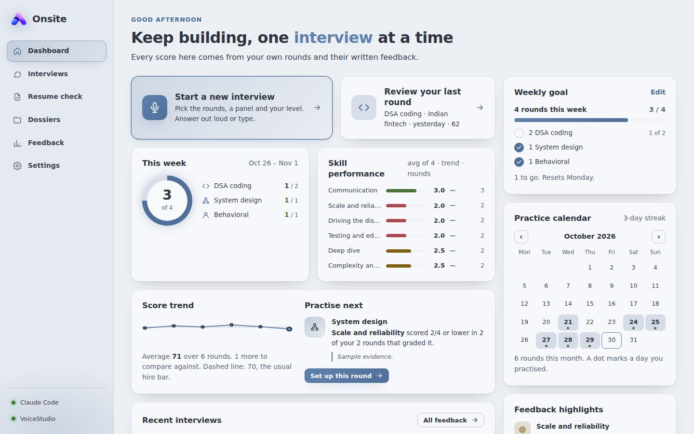 |
| **Rosé Pine light** | **Gruvbox dark** |
| 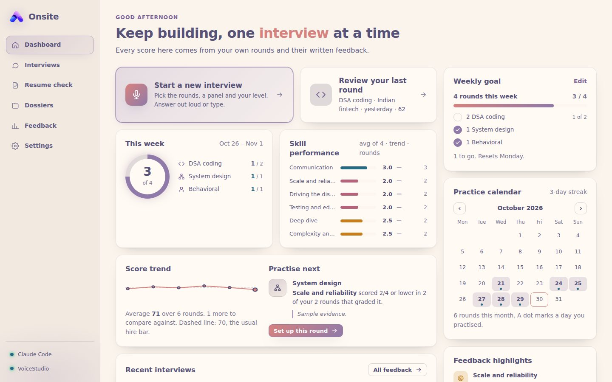 | 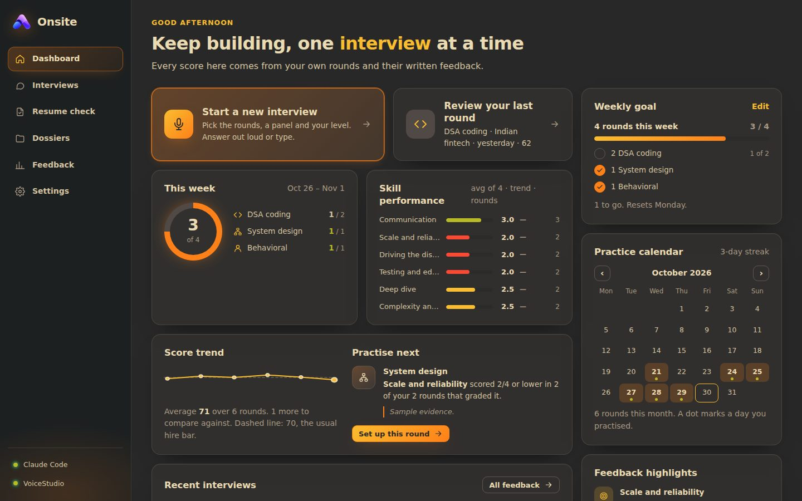 |

- `data-theme="<family>-<light|dark>"` and `data-mode` are set on `<html>` before first paint (`theme-boot.js`), so there is
  no flash. *System* follows the OS and updates live.
- **Backdrop:** the theme's picture, the user's own image (shrunk to ≤ 2560×1600 JPEG in JS, stored by Rust in the app data
  folder, type checked from bytes), or none (`plain`). A **dim** veil (0–85%, default 35%) keeps text readable. The call room
  never shows a picture.
- The **whiteboard stays dark** in every theme (Excalidraw's theme is compiled in). The editor follows the theme through
  the `--syn-*` tokens.

### 2.9 Accessibility

- Landmarks and roles in the markup: `role="radiogroup"` for mode cards, `role="tablist"`/`tab` for the workspace,
  `role="log"` for the transcript, `role="separator"` (focusable, keyboard-resizable) for the problem/chat split.
- Live regions: `#srLive` (`announce()`), `#toasts`, the orb label and the prep checklist are `aria-live="polite"`.
- Every icon-only button has an `aria-label` ("Send", "Microphone", "End interview").
- Colour is never the only signal: statuses also have words ("Ready", "Fallback", "Failed").
- Known gaps: no full keyboard pass on the whiteboard (Excalidraw's own), contrast of `--muted` on photos depends on the dim.

---

## Part 3 · Screens and features

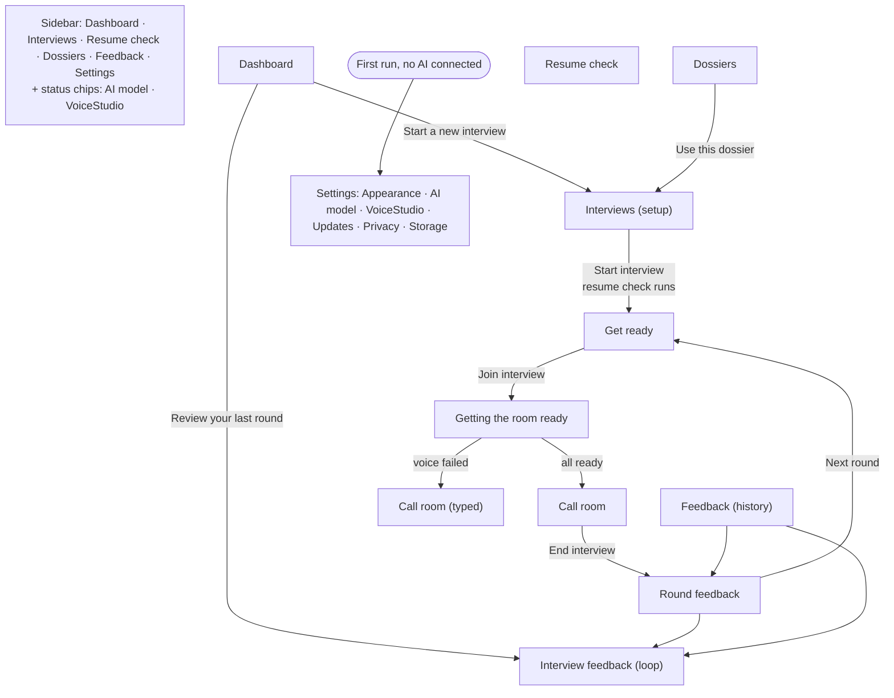

### 3.1 Dashboard


Purpose: where am I, and what should I do next. Everything is computed from saved rounds and their feedback; empty
history shows empty states, never sample numbers.

| Card | Shows |
|---|---|
| Start a new interview | Lead action → Interviews |
| Review your last round | Last round, company, when, score → its feedback |
| Weekly goal | Rounds this week vs goal per round type; editable |
| This week | Ring of rounds done vs goal, per type |
| Skill performance | Average 1–4 per rubric dimension, colour by band, trend, number of rounds |
| Score trend | Overall score per reviewed round, hire-bar line at 70 |
| Practise next | A skill low (≤ 2/4) in 2+ rounds, with evidence and *Set up this round* |
| Practice calendar | Days practised, streak |
| Feedback highlights | Skills high in 2+ rounds |
| Recent interviews | Last rounds → feedback |

### 3.2 Interviews (setup)

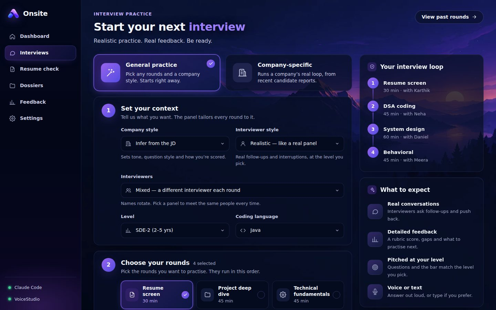

The five numbered steps (context, rounds, resume, details, settings) plus **mode cards** (General vs Company-specific) and
the **loop timeline** on the right, which updates live with each round's interviewer and minutes. Company-specific mode
swaps "Company style" for a dossier picker and lists the dossier's rounds as tiles. Details in [PRD-02](PRD-02-interview-loops.md).

### 3.3 Get ready and Getting the room ready

- **Get ready:** mic and speaker pickers, a live mic meter ("Say something. The bar should move."), *Test speaker*,
  *Test mic*, the resume-check result, and the round card with *Join interview*. "Check before every round" makes it
  appear each time; otherwise later rounds skip straight to the loader.
- **Getting the room ready:** the checklist of real checks (AI model · First question · VoiceStudio · Interviewer's voice ·
  Live captions · Accurate transcript · Speaker · Microphone), each Waiting / Ready / Fallback / Failed / Off, with a
  detail line. Failures offer *Start typed*; *Cancel* goes back. See [DD-02 §4](DD-02-interview-engine.md).

### 3.4 Call room

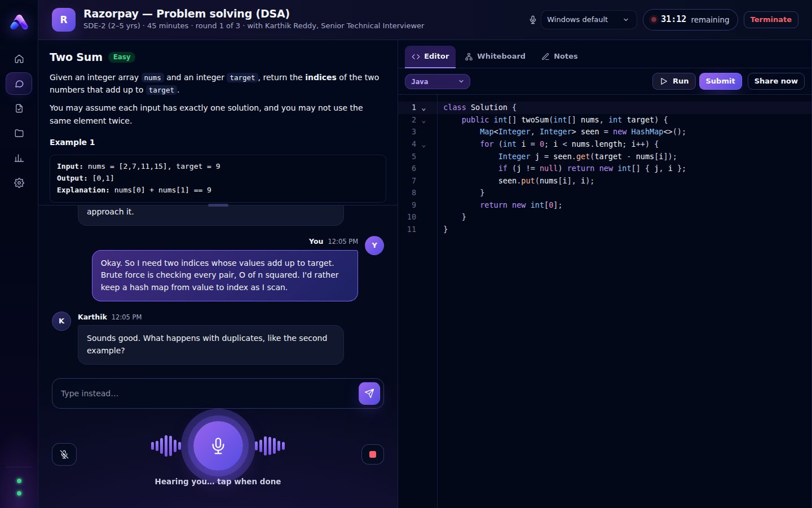

| Area | Contents |
|---|---|
| Header | Company initial, round name, level · minutes · round x of n · interviewer name and role; mic picker; **timer** (counts down, "remaining"); Context toggle; **Terminate** |
| Left column | Problem panel (coding rounds) above the transcript, with a draggable split; transcript bubbles with names and times; "The interviewer has closed the round" banner; *Type instead…* composer |
| Controls | Mute · **orb** with waveforms and a status label · End interview |
| Right column | Workspace tabs: Editor (language picker, Run, Submit, Share now, run output), Whiteboard (Maximise), Notes, From interviewer |
| Rail | Round context (company, round, chips: language, interviewer style, level), round plan with the current phase, tips |

The **orb** is the heart of the room. Its label always says what's happening: "Karthik is thinking…", "…is speaking —
tap to cut in", "Listening…", "Hearing you… tap when done", "Got it. Writing it down…", "Muted — tap to unmute",
"Round closed". In a typed round the orb and mic controls disappear, leaving the status line and End.

### 3.5 Feedback, round report and interview feedback

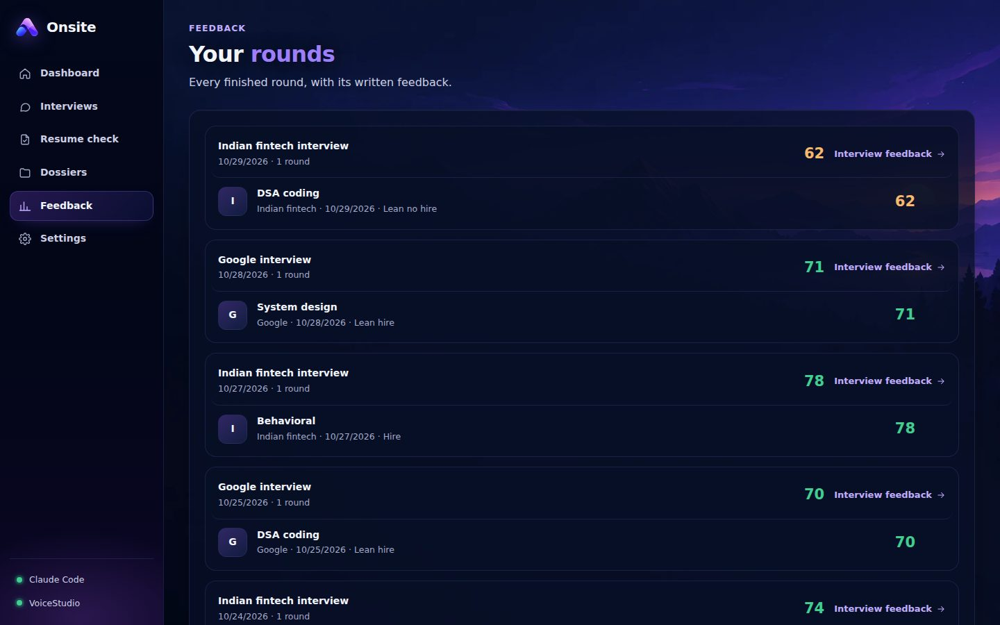

- **Feedback** lists every loop, newest first, with its rounds, scores (coloured by band) and decisions. Rounds can be deleted.
- **Round report:** overall score ring, decision, level signal, headline; rubric dimensions with 1–4 bars and evidence;
  went well / held back; **fix this first**; key moments ("you said" vs "a strong answer"); practise next; the full
  transcript (expandable). "Not enough to review yet" when the round was too short.
- **Interview feedback** (whole loop): the committee verdict (decision, rationale, strongest signal, biggest risk, plan)
  above each round's report, with progress while reports are written.

### 3.6 Resume check

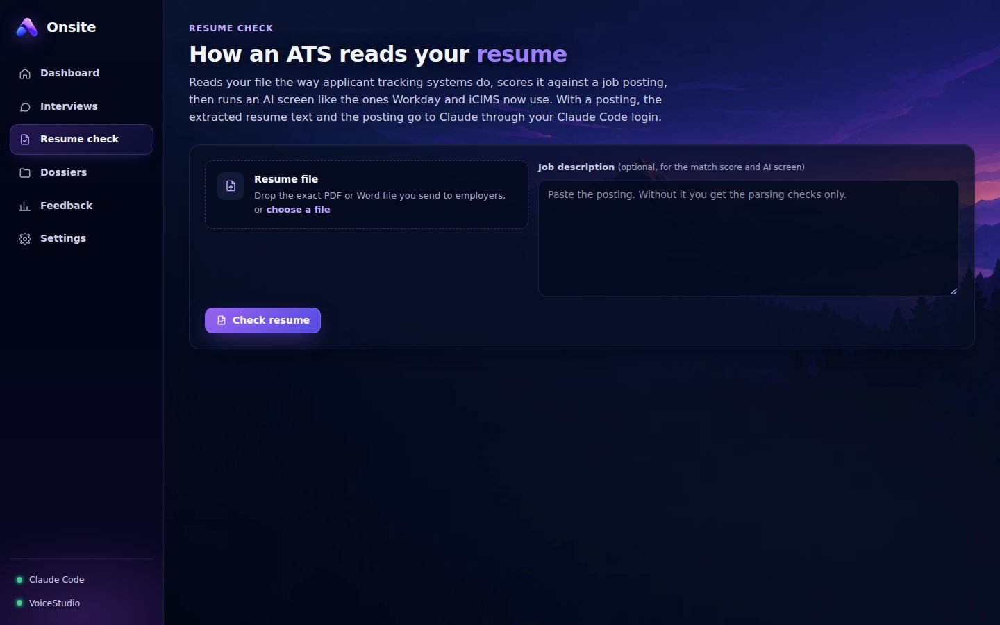

A file drop and a posting box. After *Check resume*: three score rings (parse, content, match), the six ATS rows with pass/fail
and reasons, keyword chips (hit / stem / missing), the checks list, "What the ATS sees" (the extracted text), tips, and the
**AI screen** card (grade, fit, must-haves proven / claimed / missing, red flags, recruiter's take). See [PRD-05](PRD-05-resume-check.md).

### 3.7 Dossiers

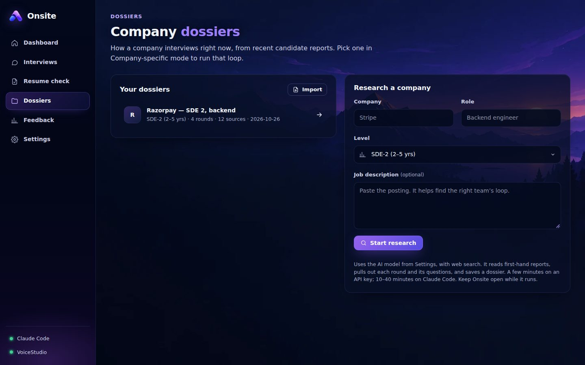

Left: your dossiers (company, role, level, rounds, sources, date) and *Import*. Right: *Research a company* (company, role,
level, optional posting). Running jobs appear as progress cards with the 6-step checklist, % bar, live log and counts of
searches and pages read. Opening a dossier shows its summary, style, values, pitfalls, rounds with reported questions,
sources, and *Use this dossier* / *Export* / *Delete*.

### 3.8 Settings

| Appearance | AI model |
|---|---|
| 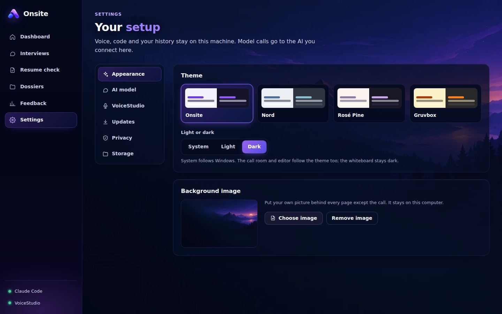 | 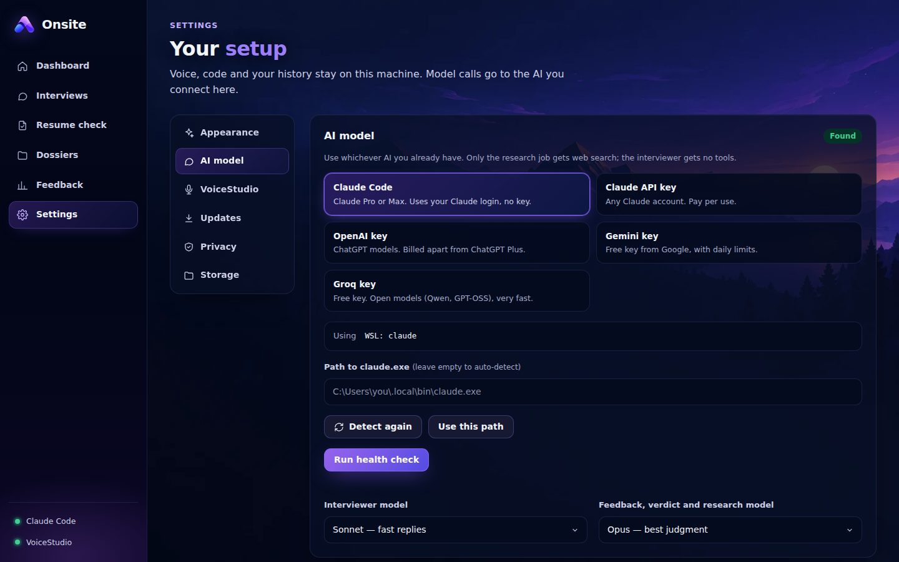 |
| **VoiceStudio** | **Privacy** |
| 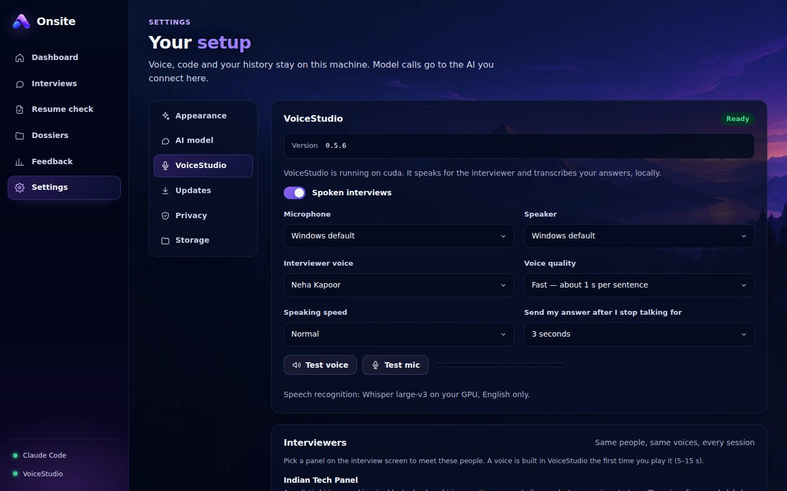 | 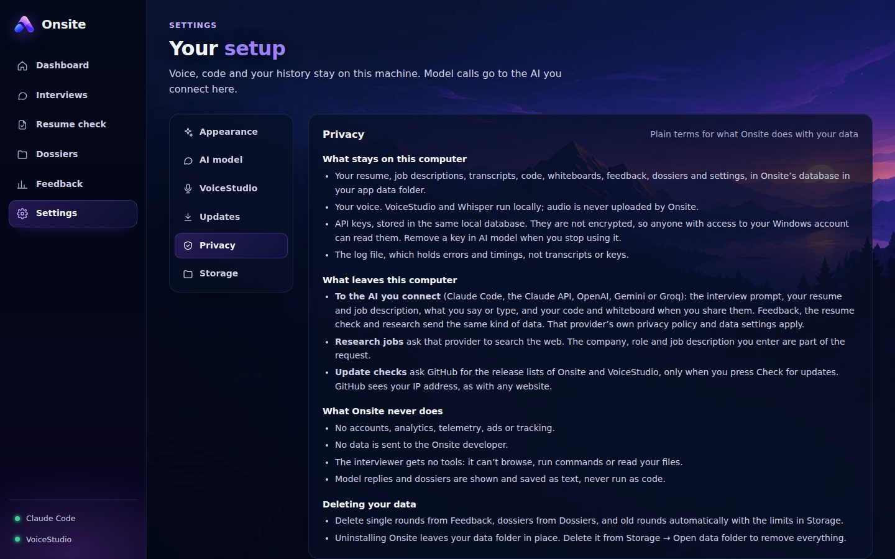 |

One view with a section nav: **Appearance** (theme cards showing light and dark side by side, mode, background image, dim) ·
**AI model** (provider cards, Claude Code path or API key, health check, two model pickers) · **VoiceStudio** (status,
version, start button, voice on/off, devices, voice, quality, speed, pause, test buttons, and the **interviewer cards** with
traits, strictness, backstory and *Play voice*) · **Updates** · **Privacy** (the plain-terms text) · **Storage**.
A `data-sec` attribute on any `data-nav="settings"` link opens a specific section, which is how the sidebar chips jump to
AI model or VoiceStudio.

---

## Part 4 · Rules for new UI

1. **Tokens only.** No colour literals. If a token is missing, add it to `:root` in `app.css` *and* derive it in
   `themes.css`.
2. **One primary action per area**, violet. Destructive actions are `.danger` and confirmed.
3. **Every value escaped** with `esc()` before `innerHTML`.
4. **Plain copy** with the fix in it; write the empty and error states first.
5. **No new frameworks.** If a feature needs a library, bundle it in `ui-vendor/` like the editor and whiteboard, and load
   it lazily if it's heavy.
6. **Keyboard and screen readers:** a role or label for anything that isn't a native control; keep `:focus-visible`.
7. **Check all four themes in light and dark** (Settings → Appearance), and the call room in each.
8. **Retake the screenshots** (`npm run shots` in `docs/engineering/tools`) when a screen changes visibly.
