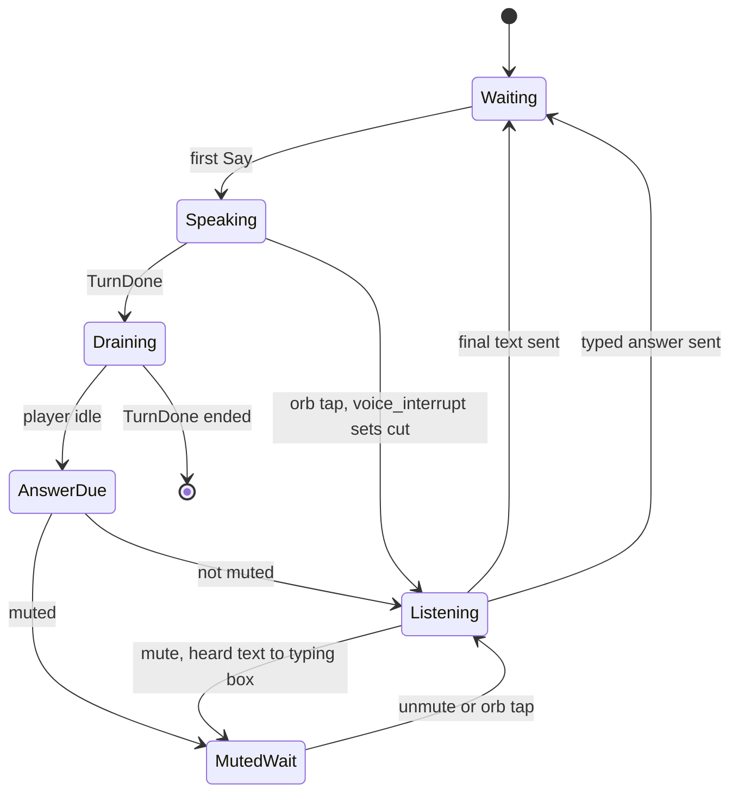

# VOICE: `src/voice/`

Spoken rounds: Supertonic 3 TTS + Parakeet TDT STT run inside Onsite via the `sherpa-onnx` crate. One engine only.
VoiceStudio (and the Whisper large-v3 sidecar that ran on its Python) was removed on 2026-11-11; history and the plan
that replaced it: `docs/plans/voice-without-voicestudio.md`.

## Engine (speech since 2026-11-02, built 2026-10-30)

Why the speech model changed (2026-11-02): Pocket TTS (int8) ran at RTF 0.3-0.45 on the owner's Ryzen 7 250 but sounded
muffled, and on a no-GPU laptop it ran at RTF ~0.9-1.0 with gaps. Measured the same day with `builtin_check` (debug build, 4 threads, the same CPU): Kokoro v1.0 int8 RTF ~1.0 and it drops every word it can't find in its lexicon
("OOV word skipped: 'Redis'"); Supertonic 3 int8 RTF 0.22-0.38 (5 steps 0.13), no phonemizer, round trip through Parakeet word-perfect.
Piper/VITS needs an espeak phonemizer that sherpa-onnx 2.0 no longer bundles, so it was not used. Kokoro's and Piper's
numbers were measured with throwaway probes that were deleted; the Supertonic numbers came from `builtin_check`.

| File | Contents |
|---|---|
| `engine.rs` | `PersonaVoice {name, clip}`, `Engine {tts, stt, lexicon}` (`load(state)` loads both models and `prompts/pronounce.json`, `voice(&settings)` -> `Tts`), `Tts` (`name`, `rate`, `speak(text, speed, steps, max_piece_words, health, on_piece)`: `to_speech` first, nothing said when empty) |
| `builtin.rs` | `Supertonic::{load, load_with, synth, speak_piece}` (`synth` = one raw sherpa call; `speak_piece` = guarded: `judge` length check, one retry at +2 steps when too short, cut + 30 ms fade when too long, `trim_silence`, 10 ms edge fades, `gap_ms` after), `Synth {sid, speed, steps}`, `Piece {pcm, ends_sentence}`, `pieces(text, max_words)` (sentences via `splitter::first_sentence_len`), `ParakeetStt::{load, load_with, transcribe, transcribe_f32, caption}`, `Cache`, `VOICES`, `speaker_id`, `clip_for_gender`, `known_clip` |
| `speech_text.rs` | `to_speech(text, &Lexicon)`: written -> spoken text for the voice only (markdown, links, long values, lexicon, big-O, brackets, operators, numbers/units/codes, identifiers). `Lexicon::load` reads `prompts/pronounce.json` (empty + warning on error) |
| `tier.rs` | `Tier {Fast, Ok, Slow}` from warm-up RTF (< 0.35, < 0.7): steps 8/6/5, piece words 40/24/14, captions 0.5 s/1 s/off, prebuffer 300/500/800 ms. Measured once per app run (`TIER_LINE` twice, second run timed; kept in `Cache`, cleared by Reload models). `Drift` lowers it mid-round when the median RTF of the last 5 calls is over the bound x 1.2. Settings > Voice shows "This laptop: ..." |
| `health.rs` | `Health` counters per round (replies, pieces, dry spells, cap hits, retries, RTF p50/p90); `Voice::end` logs one `voice health` line |
| `score.rs` | Bench scoring: `words`, `wer` (with missing words), `term_recall` |
| `audio.rs` | `Mic`, `Player` (lock-free `rtrb` ring, 30 s at the device rate; the callback owns the consumer + `Jitter` and reads atomics only; `push` waits up to 2 s for room then drops), `Jitter::next` over a `Source` (ring or `VecDeque`), `set_streaming`, `set_prebuffer_ms`, `take_underruns`; cpal `realtime` feature = audio-priority speaker thread, `Vad`, `LowPass` (windowed sinc), `Downsampler` (->16 kHz), `Resampler`, `on_audio_thread`, `set_devices`, `list_devices` |
| `models.rs` | pinned list `PINS` (id, url, bytes, sha256, unpacked), `install` (also deletes the retired Pocket folder), `delete`, `status`, `installed`, `allowed_host`, `Progress` (`voice_model` event) |
| `stt.rs` | `listen`/`listen_with`/`run`: mic -> VAD -> segments -> Parakeet -> `ListenEnd {Text{text,stt_ms}, Cancelled{heard}, NoSpeech}`; `spawn_decode` (finished segment), `spawn_caption` (every 500 ms); `SttState`; `clean_transcript` (`collapse_repeats`, `fix_vocab` Levenshtein); `domain_vocab` |
| `mod.rs` | `VoiceSettings`, `VoiceEvent`, `Voice` (player + current `RoundVoice`), `begin` (round loop task), `say`, `turn_done`, `answer_sent`, `end`, mute/listen/interrupt, `Batch`, `coalesce_wait`, `listen_once`, `speak_into` |

- Models (GitHub release assets of k2-fsa/sherpa-onnx; size / SHA-256 checked, see `models.rs`):
  `sherpa-onnx-supertonic-3-tts-int8-2026-05-11` (tag `tts-models`, 128.8 MB, 142 MB unpacked, MIT code and OpenRAIL-M weights: read the
  model licence before commercial use) and `sherpa-onnx-nemo-parakeet-tdt-0.6b-v2-int8` (tag `asr-models`, 482.5 MB, 631 MB unpacked, CC-BY-4.0).
  Installed = `<app data>/models/<id>/` with the files in `Pin.files`. Work dir `models/.partial/<id>/`, one rename at the end.
  The retired `sherpa-onnx-pocket-tts-int8-2026-01-26` folder is deleted when Supertonic finishes installing.
  Only github.com and `*.githubusercontent.com` (GitHub's release CDN redirect) over https; redirect policy enforces it.
  Disk check: (download + unpacked) x 1.1 free, else "Needs X GB free to install ...". Network error: "Couldn't reach GitHub. Check your connection and press Retry."
- TTS: Supertonic 3 int8, CPU, threads = logical CPUs / 2 clamped 1-4 (`threads()`, also Parakeet; all cores starved the audio threads),
  `lang: "en"` in `extra`, steps and piece size from the machine tier (`tier.rs`), `speed` = persona pace x user speed. No reference clip: the voice is a preset speaker id.
  Output 44.1 kHz (read from the model). Two voices: Ethan (`ethan_brooks`, speaker 5, male) and Charlotte (`priya_shah`, speaker 0, female).
  Speaker ids are inferred from median pitch of the model's own output (0-4 female, 5-9 male, 2026-11-02): not yet checked by ear.
  The model reads raw characters, so `Tts::speak` runs `speech_text::to_speech` first ("1.5 ms" -> "one point five milliseconds",
  "PostgreSQL" -> lexicon). The screen and transcript keep the original text. Panel persona -> `Persona.clip` via `voice.gender`.
  `Tts::speak` sends `builtin::pieces(text, 14)` one guarded call each (`speak_piece`): sentences > 14 words cut at a
  `, ; :` and the em dash character (U+2014) near the middle (parts >= 4 words), short ones packed to 14. Measured 2026-11-02 (`builtin_check`):
  six-sentence reply, first audio 1.7 s for the parts vs 4.1 s for the whole 18.5 s reply in one call.
- STT: Parakeet TDT v2 int8 (`nemo_transducer`, CPU, 4 threads), offline model, English only. Finished segment
  -> `spawn_blocking` decode -> a `final_kind: summary` message on the segment channel. Captions = re-decode of the open segment every 500 ms (`spawn_caption`;
  skipped while one runs, while a final decode holds the recognizer, when the audio hasn't grown, or during a rest as long as the last
  caption decode took (`CaptionGate`, <= 50% CPU; back-to-back decodes caused mic overruns on slow laptops)); text is a `partial`.
- Lifecycle: models load when a round starts (`live::start_voice` -> `Engine::load`), then stay in `AppState.builtin` for later
  rounds. Not installed -> loader step `models` fails, rest "off", round typed, message points to Settings > Voice.
  Loader steps: `models` = installed, `voice` = Supertonic loaded + "Okay, let's begin." warm-up (~1 s), `stt` = Parakeet loaded, `speaker`, `mic`.
- Commands: `voice_status` (`up` = every model installed, `models`, `voices`), `voice_model_download(id)`,
  `voice_model_delete(id)`, `voice_models_reload`, `voice_builtin_preview(voice)`, `voice_persona_preview`, `voice_test_speak`,
  `voice_test_listen`. `open_folder("models")`.
- First-run nudge (`voiceNudge`, app.js): opening Interviews with voice on and a model missing shows `#voiceDlg` once per
  app run. Download -> Settings > Voice, focus first Download button. Use typed interviews -> `enabled=false`.
- Answer mode (UI `talkMode()`: spoken | listen | typed) = `enabled` + `listen_only`; picker `.talk-seg` on Get ready and Settings > Voice.
  E2E-checked 2026-10-30 over WebView2 CDP (`WEBVIEW2_ADDITIONAL_BROWSER_ARGUMENTS=--remote-debugging-port=…`): typed and listen rounds
  ran 3 turns, mic never opened.
- Panels: with two voices there is no panel to pick; the setup screen's panel field and the Interviewers grid stay hidden ("Mixed").
- Check without the UI: `cargo run --release --example builtin_check -- [--download] [--models <root>] [--wav f.wav]`.
- TODO: resume (HTTP Range) and cancel for downloads; unload models after ~15 min idle (they stay loaded until app exit or Reload models);
  GPU providers (DirectML/CoreML/CUDA); preload at app start; checksum-failure retry hint is text only; macOS/Linux untested; the sherpa-onnx
  Supertonic: code MIT, weights OpenRAIL-M (use restrictions, commercial use allowed). Pocket's gate forbade cloning, which is why it was dropped.

## Settings (`VoiceSettings`, inside settings `app`)

`enabled=true (false = typed, chat only), listen_only=false (true = interviewer speaks, candidate types: round starts muted, loader marks
mic "off" and doesn't wait for it; unmute still opens the mic), builtin_voice="ethan_brooks", speed=1.0,
pause_ms=3000 (1800/3000/5000/0=tap), input_device="", output_device=""`; `persona` set per round, never saved.
Blobs saved by older versions also hold `engine`, `base_url`, `voice`, `steps`; they are ignored.

## Listening (`stt::run`)

- Mic at device rate → (callback only copies samples; thread `onsite-mic-dsp` does the low-pass, never filter inside the cpal callback: overruns drop audio = missing words) → low-pass → 16 kHz mono i16; 20 ms frames → RMS → `Vad` (noise floor learned pre-speech, start >
  3× floor, hold > 2× floor, mins/caps; answer ends after `pause_ms` quiet). Pre-roll 400 ms kept with each segment.
- Segment cut (decode while candidate talks): < 3 s never; 3-20 s at 700 ms pause; > 20 s at 300 ms.
- Segment text = Parakeet final ?? last caption. Answer = segments joined → `clean_transcript`.
- Health tick 500 ms: dead mic → `Voice("The microphone changed. Tap the mic to listen again.")`. `FINAL_WAIT` 15 s.

## Speaking (round loop in `Voice::begin`)

- One voice for the round (`Engine::voice`): the persona's clip, else `builtin_voice`.
- Warm-up: generate "Okay, let's begin." and discard; then `ready` → loader. Nothing plays until `go`.
- `Cmd::Say`: drop if `cut`. Short sentence (< 4 words or < 24 chars) waits for more: ≤ 150 ms if player idle, ≤ 300 ms if
  playing; merge ≤ 220 chars (`MAX_BATCH_CHARS`). Generate next batch while current plays.
- Playback smoothing (`audio.rs` `Jitter`): `Cmd::Say` sets `Player::set_streaming(true)` when a reply starts; the device waits for
  the prebuffer (300 ms by default) before it starts, and again after any dry spell while the reply is still generating. `TurnDone` clears the flag
  first, then waits for the queue to drain. A `reply playback ran dry` info line counts the dry spells per reply.
- `Cmd::TurnDone{ended}`: wait for player idle (or cut) → always emit `speaking false` → `awaiting_answer = !ended` →
  listen unless muted.

## Turn-taking state

Mic closed while interviewer speaks (no AEC). `voice_interrupt`: abandon in-flight TTS, `player.clear()`, drop rest of reply,
open mic (transcript still shows full text). Mute → `held{text}`. Fresh `ListenCtl` per answer. `end()` aborts task;
`alive=false` stops already-received audio.

## Failure → behaviour

Models missing or fail to load at prep → round typed · TTS error mid-round → text only, `speaking false` still sent ·
decode panic → segment closed with its caption text · mic lost → message.

## Requirements

VOICE-R1 local only · R2 pause/tap ends answer · R3 segmenting · R5 repeat collapse + term fix ·
R6 sentence-streamed TTS, batching ≤ 220 · R7 no code in speech · R8 tap barge-in · R9 mute keeps text · R10 fixed persona
voice · R11 typed fallback · R12 device switch + lost-mic message · R13 English only · R14 first audio < 2.5 s (**partial**).
(R4, the Whisper accuracy pass, went with VoiceStudio.)

## Change recipes

- Tune latency: `WAIT_IDLE/WAIT_BUSY/SHORT_*/MAX_BATCH_CHARS` (mod.rs), `Tier` settings (tier.rs), `SEG_*` (stt.rs).
  Measure via `voice latency` events and the `tts` log line (`audio_ms`, `rtf`; > 1 = pauses mid-reply). `builtin_check` compares whole vs pieces.
- New persona voice: set `voice.gender` in `panels.json`; the clip follows it.
- A term said wrong: add `{"term", "as"}` to `prompts/pronounce.json` and check with `voice_bench tts --set tech`.
- Measure a change: `cargo run --release --example voice_bench -- tts|sweep|stt|silence` (models in `D:\cargo-target\voice-bench\models`);
  results in `docs/plans/voice-bench-results.md`.

## Measured facts (2026-11-13, sherpa-onnx 2.0.1, owner's Ryzen 7 250)

- sherpa-onnx does not split Supertonic input: two sentences gave one callback.
- ONNX Runtime thread spinning can't be switched off through sherpa-onnx 2.0.1 (no `session_options`/spin field in `sherpa-onnx-sys`).
- After a synthesis the process uses 0% CPU while idle (sampled 5 s), so the threads don't spin between replies.
- Parakeet writes numbers as digits ("10,000", "99.9%", "P99"), so the bench scores both sides through `to_speech`.

## Gaps

- 2.5 s target unmet on Claude Code CLI. Ideas: clause-level TTS start, streaming TTS.
- Parakeet mishears some tech terms ("Postgres Creole", "reddish" for Redis); `fix_vocab` repairs some. A GPU Whisper pass is a possible optional download.
- No echo cancellation → no voice barge-in, only tap.
