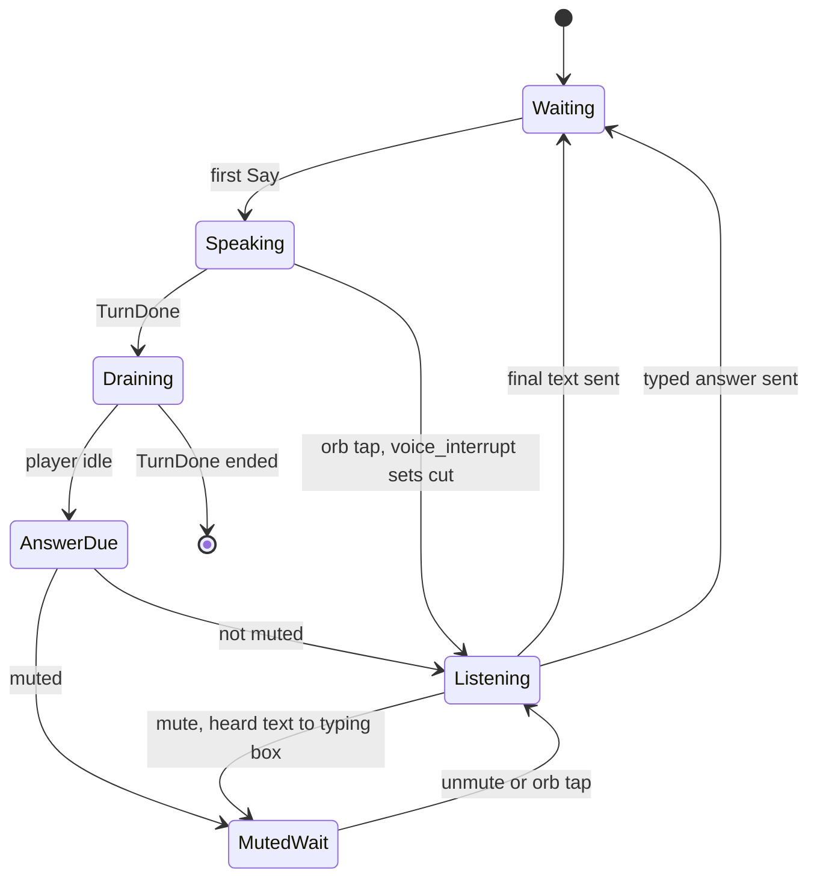

# VOICE: `src/voice/`, `sidecar/whisper_server.py`

Spoken rounds: local STT/TTS through one of two engines (`VoiceSettings.engine`), plus the Whisper large-v3 sidecar.
- **builtin** (default for fresh installs): Supertonic 3 TTS + Parakeet TDT run inside Onsite via the `sherpa-onnx` crate. See *Built-in engine*.
- **voicestudio** (kept by installs that predate the setting): VoiceStudio on `127.0.0.1:3900`. Verified endpoints,
  field names, quirks and timings: CLAUDE.md → *tts/*, *stt/*. Plan for dropping it: `docs/plans/voice-without-voicestudio.md`.

## Built-in engine (speech since 2026-11-02, built 2026-10-30)

Why the speech model changed (2026-11-02): Pocket TTS (int8) ran at RTF 0.3-0.45 on the owner's Ryzen 7 250 but sounded
muffled, and on a no-GPU laptop it ran at RTF ~0.9-1.0 with gaps. Measured the same day with `builtin_check` (debug build, 4 threads, the same CPU): Kokoro v1.0 int8 RTF ~1.0 and it drops every word it can't find in its lexicon
("OOV word skipped: 'Redis'"); Supertonic 3 int8 RTF 0.22-0.38 (5 steps 0.13), no phonemizer, round trip through Parakeet word-perfect.
Piper/VITS needs an espeak phonemizer that sherpa-onnx 2.0 no longer bundles, so it was not used. Kokoro's and Piper's
numbers were measured with throwaway probes that were deleted; the Supertonic numbers came from `builtin_check`.

| File | Contents |
|---|---|
| `engine.rs` | `VoiceEngine {Builtin, Voicestudio}`, `legacy_engine`, `Engine {Studio(VoiceStudio), Builtin(Arc<Builtin{tts,stt}>)}` (`from_settings` loads models, `voice(&settings)` -> `Tts`), `Tts {Studio{vs,profile}, Builtin{tts,clip}}` (`name`, `rate`, `speak(text, steps, speed, on_pcm)`) |
| `builtin.rs` | `Supertonic::{load, speak}` (one sherpa call per part, sentence callback -> mpsc, audio capped at 0.7 s/word + 2.5 s), `ParakeetStt::{load, transcribe, caption}`, `Cache` (models kept in `AppState.builtin`), `VOICES`, `speaker_id`, `clip_for_gender`, `known_clip` |
| `audio.rs` | `Player` (one lock over the sample queue + `Jitter` + `streaming` flag), `Jitter::next` (prebuffer and dry-spell rule, testable), `set_streaming`, `take_underruns` |
| `models.rs` | pinned list `PINS` (id, url, bytes, sha256, unpacked), `install` (also deletes the retired Pocket folder), `delete`, `status`, `installed`, `allowed_host`, `Progress` (`voice_model` event) |
| `stt.rs` | `Source {Ws(url), Local(ParakeetStt)}`; `spawn_decode` (finished segment), `spawn_caption` (every 500 ms), `end_segment` |

- Models (GitHub release assets of k2-fsa/sherpa-onnx; size / SHA-256 checked, see `models.rs`):
  `sherpa-onnx-supertonic-3-tts-int8-2026-05-11` (tag `tts-models`, 128.8 MB, 142 MB unpacked, MIT code and OpenRAIL-M weights: read the
  model licence before commercial use) and `sherpa-onnx-nemo-parakeet-tdt-0.6b-v2-int8` (tag `asr-models`, 482.5 MB, 631 MB unpacked, CC-BY-4.0).
  Installed = `<app data>/models/<id>/` with the files in `Pin.files`. Work dir `models/.partial/<id>/`, one rename at the end.
  The retired `sherpa-onnx-pocket-tts-int8-2026-01-26` folder is deleted when Supertonic finishes installing.
  Only github.com and `*.githubusercontent.com` (GitHub's release CDN redirect) over https; redirect policy enforces it.
  Disk check: (download + unpacked) x 1.1 free, else "Needs X GB free to install ...". Network error: "Couldn't reach GitHub. Check your connection and press Retry."
- TTS: Supertonic 3 int8, CPU, threads = logical CPUs / 2 clamped 1-4 (`threads()`, also Parakeet; all cores starved the audio threads),
  `lang: "en"` in `extra`, `num_steps` = `STEPS` (8), `speed` = persona pace x user speed. No reference clip: the voice is a preset speaker id.
  Output 44.1 kHz (read from the model). Two voices: Ethan (`ethan_brooks`, speaker 5, male) and Charlotte (`priya_shah`, speaker 0, female).
  Speaker ids are inferred from median pitch of the model's own output (0-4 female, 5-9 male, 2026-11-02): not yet checked by ear.
  The model reads text directly (no lexicon, no phonemes). Panel persona -> `Persona.clip` via `voice.gender`.
  The model calls back per finished part, so `Tts::speak` sends `builtin::pieces(text)` one call each: sentences > 14 words cut at a
  `, ; :` and the em dash character (U+2014) near the middle (parts >= 4 words), short ones packed to 14. Measured 2026-11-02 (`builtin_check`):
  six-sentence reply, first audio 1.7 s for the parts vs 4.1 s for the whole 18.5 s reply in one call.
- STT: Parakeet TDT v2 int8 (`nemo_transducer`, CPU, 4 threads), offline model. Same VAD/segment cuts as VoiceStudio. Finished segment
  -> `spawn_blocking` decode -> sent through the same channel as a VoiceStudio summary (`final_kind: summary`), so `Answer`,
  Whisper-first preference and `clean_transcript` are shared. Captions = re-decode of the open segment every 500 ms (`spawn_caption`;
  skipped while one runs, while a final decode holds the recognizer, when the audio hasn't grown, or during a rest as long as the last
  caption decode took (`CaptionGate`, <= 50% CPU; back-to-back decodes caused mic overruns on slow laptops)); text is a `partial`. Whisper
  sidecar is independent and still preferred when Ready.
- Settings: `VoiceSettings.engine` (`"builtin"` | `"voicestudio"`; a saved blob without it deserializes as voicestudio, no blob = builtin),
  `builtin_voice`. Switching in Settings applies at the next round start, no restart.
- Lifecycle: models load when a round starts (`live::start_voice` -> `Engine::from_settings`), then stay in `AppState.builtin` for later
  rounds. Not installed -> loader step `voicestudio` ("Voice models") fails, rest "off", round typed, message points to Settings > Voice.
  Loader steps: `voicestudio` = models installed, `voice` = Supertonic loaded + "Okay, let's begin." warm-up (~1 s), `stt` = Parakeet loaded,
  `whisper` unchanged. App start does no VoiceStudio warm-up/persona prebuild unless engine = voicestudio (still starts the Whisper sidecar).
- Commands: `voice_status` (adds `engine`, `models`, `voices`, `studio_up`; for builtin `up` = both models installed; `studio_up` =
  VoiceStudio answers `/health`, probed under builtin only while a model is missing), `voice_model_download(id)`,
  `voice_model_delete(id)`, `voice_models_reload`, `voice_builtin_preview(voice)`; `voice_persona_preview`, `voice_test_speak`,
  `voice_test_listen` work for both engines. `open_folder("models")`.
- First-run nudge (`voiceNudge`, app.js): opening Interviews with voice on, a model missing and `!studio_up` shows `#voiceDlg` once per
  app run. Download -> engine `builtin`, Settings > Voice, focus first Download button. Start VoiceStudio (only if installed) -> engine
  `voicestudio` + `voice_launch`. Use typed interviews -> `enabled=false`.
- Answer mode (UI `talkMode()`: spoken | listen | typed) = `enabled` + `listen_only`; picker `.talk-seg` on Get ready and Settings > Voice.
  E2E-checked 2026-10-30 over WebView2 CDP (`WEBVIEW2_ADDITIONAL_BROWSER_ARGUMENTS=--remote-debugging-port=…`): typed and listen rounds
  ran 3 turns, mic never opened.
- Check without the UI: `cargo run --release --example builtin_check -- [--download] [--models <root>] [--wav f.wav]`.
- TODO: resume (HTTP Range) and cancel for downloads; unload models after ~15 min idle (they stay loaded until app exit or Reload models);
  GPU providers (DirectML/CoreML/CUDA); preload at app start; checksum-failure retry hint is text only; macOS/Linux untested; the sherpa-onnx
  Supertonic: code MIT, weights OpenRAIL-M (use restrictions, commercial use allowed). Pocket's gate forbade cloning, which is why it was dropped.

## Map

| File | Contents |
|---|---|
| `mod.rs` | `VoiceSettings {engine, builtin_voice, ...}`, `VoiceEvent`, `Voice` (player + current `RoundVoice`), `begin` (round loop task), `say`, `turn_done`, `answer_sent`, `end`, mute/listen/interrupt, `Batch`, `coalesce_wait`, `listen_once`, `speak_into` |
| `stt.rs` | (VoiceStudio path; the built-in path is in the table above) `listen`/`listen_with`/`run`: mic → VAD → segments → WS per segment → Whisper → `ListenEnd {Text{text,stt_ms}, Cancelled{heard}, NoSpeech}`; `SttState`; `clean_transcript` (`collapse_repeats`, `fix_vocab` Levenshtein); `domain_vocab`; model choice (`english_model`, `prepare`, `undemote`, `reset_model_choice`) |
| `audio.rs` | `Mic`, `Player` (queue, `is_idle`, `clear`, level), `Vad`, `LowPass` (windowed sinc), `Downsampler` (→16 kHz), `Resampler`, `on_audio_thread`, `set_devices`, `list_devices` |
| `vs.rs` | `VoiceStudio` HTTP client: `health`, `ready`, `profiles`, `speak` (`/v1/audio/speech` pcm), `resolve_voice`, `persona_voice` (build/rebuild clone profile), `render_persona_sample` + `score_sample`/`sample_ok`/`sample_penalty`, `speech_body`, `spoke_within`, `bytes_to_i16`, `wav_bytes` |
| `whisper.rs` | sidecar lifecycle (`start`, `launch`, `status` → `WhisperStatus {Loading, Ready{model}, Off{reason}}`), `transcribe(pcm, prompt)`, `prompt_for(vocab)`, model dirs |

## Settings (`VoiceSettings`, inside settings `app`)

`enabled=true (false = typed, chat only), listen_only=false (true = interviewer speaks, candidate types: round starts muted, loader marks
whisper/mic "off" and doesn't wait for them; unmute still opens the mic), base_url=http://127.0.0.1:3900, voice=""(first profile; never "default"), steps=8 (8/16/32), speed=1.0,
pause_ms=3000 (1800/3000/5000/0=tap), input_device="", output_device=""`; `persona` set per round, never saved.

## Listening (`stt::run`)

- Mic at device rate → (callback only copies samples; thread `onsite-mic-dsp` does the low-pass, never filter inside the cpal callback: overruns drop audio = missing words) → low-pass → 16 kHz mono i16; 20 ms frames → RMS → `Vad` (noise floor learned pre-speech, start >
  3× floor, hold > 2× floor, mins/caps; answer ends after `pause_ms` quiet). Pre-roll 400 ms sent with each segment.
- Segment cut (decode while candidate talks): < 3 s never; 3-20 s at 700 ms pause; > 20 s at 300 ms.
- Each segment: new WS `…/v1/audio/transcriptions/stream?pcm=1&sr=16000&model=…`, PCM frames, end with
  `{"type":"input_audio.end"}`; `final_kind:"summary"` marks done. On close, segment PCM → `whisper::transcribe`.
- Segment text = Whisper ?? Parakeet summary ?? finals+partial. Answer = segments joined → `clean_transcript`.
- Health tick 500 ms: dead mic → `Voice("The microphone changed. Tap the mic to listen again.")`. `FINAL_WAIT` 15 s.
- Model: Parakeet TDT v2 (English); if missing install via `POST /models/install`, use v3 meanwhile; select through
  `POST /dictation/prefs` at round start (clears VoiceStudio's silent-model demotion); restore user's pick after.

Whisper sidecar: VoiceStudio's bundled Python + its HF cache weights (large-v3 → turbo → distil). Request line
`{"id","wav","prompt"}` (wav in `%TEMP%/onsite-stt`, deleted after), reply line by id; 12 s timeout; not Ready → fail fast
→ Parakeet text. Prompt = "Technical interview in English. <vocab…>." ≤ 600 chars.

## Speaking (round loop in `Voice::begin`)

- Resolve one voice for the round (`Engine::voice`): VoiceStudio: persona → `persona_voice`, else `resolve_voice(settings.voice)`; built-in: clip name.
- Warm-up: if VoiceStudio hasn't spoken in 5 min (built-in: always), generate "Okay, let's begin." and discard; then `ready` → loader.
  Nothing plays until `go`.
- `Cmd::Say`: drop if `cut`. Short sentence (< 4 words or < 24 chars) waits for more: ≤ 150 ms if player idle, ≤ 300 ms if
  playing; merge ≤ 220 chars (`MAX_BATCH_CHARS`). Generate next batch while current plays.
  Body: `{model:"omnivoice", input, voice:<profile id>, response_format:"pcm", stream_format:"audio", num_step, speed, language:"English"}` → PCM16 24 kHz.
- Playback smoothing (`audio.rs` `Jitter`): `Cmd::Say` sets `Player::set_streaming(true)` when a reply starts; the device waits for
  300 ms of audio before it starts, and again after any dry spell while the reply is still generating. `TurnDone` clears the flag
  first, then waits for the queue to drain. A `reply playback ran dry` info line counts the dry spells per reply.
- `Cmd::TurnDone{ended}`: wait for player idle (or cut) → always emit `speaking false` → `awaiting_answer = !ended` →
  listen unless muted.
- Persona voices: render fixed sample line with persona `instruct` over `SAMPLE_TRIES` (seed, steps); score voiced share,
  zero-crossing (hiss), median f0 vs instruction, noise floor; first passing take or lowest penalty → clone profile.
  Rebuilt when tag ≠ current instruction. Never lock profiles. All persona voices prebuilt at app start.

## Turn-taking state

Mic closed while interviewer speaks (no AEC). `voice_interrupt`: abandon in-flight TTS, `player.clear()`, drop rest of reply,
open mic (transcript still shows full text). Mute → `held{text}`. Fresh `ListenCtl` per answer. `end()` aborts task;
`alive=false` stops already-received audio.

## Failure → behaviour

VoiceStudio down at prep → round typed · persona voice fails → typed/default voice · TTS error mid-round → text only,
`speaking false` still sent · STT socket error → `voice error`, can type · Whisper slow/missing → Parakeet · mic lost → message.

## Requirements

VOICE-R1 local only · R2 pause/tap ends answer · R3 segmenting · R4 Whisper pass w/ vocab · R5 repeat collapse + term fix ·
R6 sentence-streamed TTS, batching ≤ 220 · R7 no code in speech · R8 tap barge-in · R9 mute keeps text · R10 fixed persona
voice · R11 typed fallback · R12 device switch + lost-mic message · R13 English only · R14 first audio < 2.5 s (**partial**).

## Change recipes

- Tune latency: `WAIT_IDLE/WAIT_BUSY/SHORT_*/MAX_BATCH_CHARS` (mod.rs), `MAX_PIECE_WORDS` (builtin.rs), `SEG_*` (stt.rs), `steps`.
  Measure via `voice latency` events and the `tts` log line (`audio_ms`, `rtf`; > 1 = pauses mid-reply). `builtin_check` compares whole vs pieces.
- New persona voice: edit `panels.json` voice fields; profile rebuilds automatically (tag mismatch).
- Any VoiceStudio API change: read `GET :3900/openapi.json` live first; update CLAUDE.md.

## Gaps

- 2.5 s target unmet on Claude Code CLI. Ideas: clause-level TTS start, streaming TTS, smaller Whisper on last segment.
- No echo cancellation → no voice barge-in, only tap.
