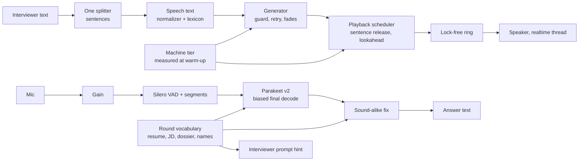

# Plan: voice pipeline rebuild

Status: built 2026-11-14 on `voice/rebuild` (Tasks 1-17; 18 skipped, the owner kept Parakeet). Gates, from
`voice-bench-results.md`: TTS round-trip WER ~25% -> ~5%; slow-laptop RTF p90 0.80; term recall on the owner's recordings
84% -> 88% after repair; the plan's zero-missing-word and 90% recall marks are not met (see the results doc for why).
Replaces the open voice items in `docs/engineering/VOICE.md` ("Gaps", "TODO"). Earlier work: `voice-without-voicestudio.md`,
`voice-spike-results.md`.

## Goal

A spoken round sounds clean and is heard correctly on every supported laptop, including an older one with no GPU.

Reported problems:

1. Interviewer voice: stutters, swallowed words ("gulps"), tech terms said wrong, decimals read as full stops,
   replies that stop mid-sentence. Seen even on the owner's Ryzen 7 250 + RTX 5050 laptop.
2. Recognition: names and tech terms come out wrong.

Non-goals: voice barge-in (needs echo cancellation), new languages, cloud speech, voice cloning.
Anti-goal: swapping models first and keeping the faults around them.

## What the code does today, and why it fails

The GPU is never used (`provider: "cpu"` for both models), so a fast GPU laptop behaves like any CPU laptop.
Most of the reported faults come from the code around the models, not from slow hardware.

### Speaking

| # | Cause | Where | Symptom |
|---|---|---|---|
| S1 | No text normalization. Only `*` and backticks are removed. The model reads "1.5", "p99", "v2.1", "gRPC", "O(n)" as raw characters. Supertonic's own tracker has "numbers are an afterthought, words are ignored" | `brain/splitter.rs` `speakable` | Decimal read as a stop, tech terms said wrong |
| S2 | Ethan runs at model speed 1.2 x the user's speed. Upstream reports word drops at 1.2 and above that go away at 1.0 | `builtin.rs` `tempo` | Swallowed words |
| S3 | Hard audio cap of 0.7 s per word + 2.5 s. It ignores speed (0.8x speech is 25% longer) and counts "getUserById" or "20022" as one word. At the cap the audio is cut with no fade | `builtin.rs` `Supertonic::speak` | Stops mid-sentence, click |
| S4 | Long sentences are cut into clause pieces and each is generated alone, so prosody restarts at every comma. Audio arrives one whole piece at a time, so when the queue runs dry the pause lands inside a sentence | `builtin.rs` `pieces`, `audio.rs` `Jitter` | Mid-sentence pauses |
| S5 | Two sentence splitters with different rules. The second one has no abbreviation rule | `splitter.rs`, `builtin.rs` `sentences` | Odd breaks ("e.g." ends a piece) |
| S6 | The device callback takes a mutex shared with the producer, and the audio thread has normal priority (cpal's `realtime` feature is off). ONNX Runtime worker threads spin by default | `audio.rs` `build_output`, `Cargo.toml` | Stutter when the CPU is busy |
| S7 | Linear resampling 44.1 kHz to the device rate with no filter, no fade at piece edges | `audio.rs` `Resampler` | Rough sound, clicks |
| S8 | One fixed setting for every machine: 8 steps, up to 4 threads, 300 ms prebuffer | `builtin.rs` | Slow laptops underrun, fast ones gain nothing |
| S9 | Supertonic itself sometimes skips words on short text (maintainers confirm; v3 reduced it, not removed) | model | Swallowed words |

### Listening

| # | Cause | Where | Symptom |
|---|---|---|---|
| L1 | The vocabulary is a fixed list of ~55 terms. `domain_vocab(extra)` exists, but `listen()` always passes the default, so the candidate's name, the company, resume and JD terms never reach it | `stt.rs` `listen` | Names wrong |
| L2 | `fix_vocab` compares spelling only, and terms of 7 letters or fewer must match exactly. "reddish" (Redis) and "Postgres Creole" can't be fixed | `stt.rs` `allowed_edits` | Tech terms wrong |
| L3 | Greedy decoding with no biasing toward known words | `builtin.rs` `ParakeetStt` | Same |
| L4 | The interviewer model is not told which words to expect, so it takes a misheard term at face value, and so does the report | `prompts/interviewer.md` | Wrong follow-ups, unfair report |
| L5 | Energy VAD. Typing in a coding round counts as speech, soft speech is dropped, no gain control | `audio.rs` `Vad` | Clipped or noisy segments |

## What others do (sources at the end)

| Topic | Finding | Use here |
|---|---|---|
| TTS front end | Voice-agent stacks (Pipecat, LiveKit) put a sentence aggregator and text normalization before any TTS. ElevenLabs' own guidance: expand numbers and abbreviations before synthesis | Phase 1 |
| Supertonic | Reads raw text by design, with fewer normalization rules. Known word skips at non-1.0 speeds and on short text | Phases 1, 2 |
| Other CPU voices | Kokoro: best quality per size, but needs a phonemizer; our 2026-11-02 test measured RTF ~1.0 and dropped words missing from its lexicon. Piper: fastest, more robotic, GPL code, needs espeak. Pocket: measured muffled here, RTF 0.9-1.0 on a no-GPU laptop. KittenTTS: tiny, English, untested here | Bake-off only if Phase 2 misses its gate |
| English STT | Parakeet TDT 0.6B v2 is still the best small English model on the Open ASR Leaderboard (6.05% vs 6.34% for v3, ~7.8% for Whisper large-v3-turbo) | Keep Parakeet v2 |
| Word biasing | sherpa-onnx supports hotwords for NeMo TDT with `modified_beam_search` (PR #3077), but that path drops or invents text ~20% of the time on Parakeet (issue #3267); the fix (PR #4084) is not in 2.0.1 | Phase 4d, gated |
| VAD | Silero VAD (2 MB, under 1 ms per 32 ms chunk on CPU) is the default in agent stacks. sherpa-onnx already wraps it (`vad.rs`) | Phase 4c |
| End of turn | A pause can't tell "thinking" from "done". Pipecat's smart-turn v3 (BSD-2, ~8-11 MB ONNX, 12-36 ms on CPU) does | Later, see Out of scope |
| CPU contention | ONNX Runtime threads spin by default: faster inference, more CPU. Docs say to turn it off when the CPU is already busy | Phase 3 |

## Approaches

| | Approach | Trade-off |
|---|---|---|
| A | **Rebuild the pipeline around the current models** (text front end, generation guard, playback scheduler, round vocabulary, hardware tiers), with a test bench first | Fixes the causes found above. No new download for users. Does not fix S9 fully |
| B | Swap the models (Kokoro/Piper/Pocket, Whisper) | Every candidate measured worse on this CPU or needs a phonemizer. S1, S3-S8 and L1-L5 would stay |
| C | Use the GPU or a cloud voice | Breaks "CPU is the baseline" and "speech is local". Helps only some users |

**Pick: A, with B as a gated bake-off** inside Phase 2 if Supertonic still drops words after the fixes. GPU stays an
optional speed-up, after this plan.

## Target design

Rules that hold for every phase:
- Measure before and after on the same fixed set. No change ships on "sounds better to me" alone.
- The screen and transcript keep the original text. Only the text sent to the voice is rewritten.
- Machine behaviour is chosen by measured speed, never by CPU name or GPU presence.

## Phase 0: bench and telemetry (first, small)

- `examples/voice_bench.rs` (grows out of `builtin_check`):
  - **TTS set:** the 25 lines in `tests/fixtures/voice/tts_lines.txt` plus ~40 new tech lines: decimals, versions,
    percentages, units, big-O, acronyms, product names, identifiers, short one-word lines.
  - **Round trip:** speak each line, transcribe it with Parakeet, compare with the expected spoken form. Reports word
    error rate, missing words, audio seconds per word (too low = swallowed words), cap hits, RTF, first audio.
  - **STT set:** the owner's recordings from `answers.json` (still pending from the last plan) with exact text and a
    list of the terms in each. Reports WER and term recall.
  - `--threads N` and a 2-core CPU affinity mode to stand in for an old laptop.
- **Round health line** in the log at the end of each round: replies, dry spells, cap hits, retries, RTF p50/p90,
  mic overruns, tier. Add it to the "Raise a bug" report so user reports carry numbers. No speech text.
- Check three facts and write them into `VOICE.md`: whether sherpa-onnx splits Supertonic input itself
  (`max_num_sentences`), whether ONNX Runtime spinning can be turned off through sherpa-onnx, and CPU use right after
  a reply ends.

Gate: baseline numbers for today's build are in this file. Every later gate is a comparison with them.

## Phase 1: speech text front end (S1, S5)

New pure module `voice/speech_text.rs`. Input: one sentence from the splitter. Output: the text to speak.

| Rule | Example | Spoken |
|---|---|---|
| Decimals | 1.5 ms, 99.9% | one point five milliseconds, ninety nine point nine percent |
| Versions | v2.1, Java 17, HTTP/2 | version two point one, Java seventeen, H T T P two |
| Counts and units | 10k QPS, 256 MB, 5xx | ten thousand Q P S, two fifty six megabytes, five hundred class errors |
| Percentiles | p99 | P ninety nine |
| Big-O | O(n log n), O(1) | O of n log n, O of one |
| Symbols | ->, >=, &&, ==, /, _ | to, at least, and, equals, slash, (space) |
| Identifiers | getUserById, order_id | get user by id, order id |
| Lexicon | PostgreSQL, gRPC, nginx, OAuth, k8s, SQL, JWT | Postgres Q L, G R P C, engine x, oh auth, kubernetes, sequel, J W T |
| Leftovers | markdown, brackets, URLs | removed, or "a link" |

- The lexicon is data: `prompts/pronounce.json` (term, spoken form). Round extras (company and persona names with odd
  spelling) can be added per round.
- One splitter: `builtin::sentences` goes away; clause cutting uses the same abbreviation and decimal rules as
  `splitter.rs`.
- `prompts/interviewer.md` keeps "write for the ear" and gains two examples. The normalizer is the guarantee; the
  prompt only reduces how often it is needed.
- Tests: a table test per rule, plus the bench round trip.

Gate: round-trip WER on the tech lines at or under 3%, and no decimal read as a sentence end.

## Phase 2: generation that doesn't drop or cut (S2, S3, S4, S9)

- **Speed:** the bench finds the speed range where each of the 10 Supertonic speakers drops no words. Pick the male
  and female voice that sound right at 1.0, so `tempo` 1.2 goes away. User speed is clamped to the safe range.
- **Cap:** replace the hard cut with a guard that scales with speed and counts words after normalization. If it ever
  triggers, fade out over 30 ms and log it.
- **Swallowed-word check:** audio shorter than a floor per word (set from the bench) means words were dropped:
  generate that piece once more, then accept. Costs nothing unless it triggers.
- **Pieces:** a whole sentence is one call when the machine is fast enough (tier, Phase 3). Clause cuts stay only
  for long sentences on slow machines. 10 ms fade at piece edges; edge silence trimmed to a fixed gap (clause 80 ms,
  sentence 250 ms).
- **Bake-off (only if the gate fails):** KittenTTS and Kokoro (current sherpa-onnx release) on the same bench.
  Where the choice stands (2026-11): Supertonic 3 is the usual speed pick for CPU and Kokoro the quality pick, but
  Kokoro is the slowest of the small models and measured RTF ~1.0 here. Chatterbox ranks highest among open models
  but is too heavy for a no-GPU laptop. So no clearly better CPU voice exists today; the bench decides, not rankings.

Gate: zero cap hits and zero swallowed-word retries left unresolved over the full TTS set, three runs, both voices.

## Phase 3: playback and compute (S4, S6, S7, S8)

- **Ring buffer:** the device callback reads from a lock-free single-producer ring. No mutex in the callback.
- **Realtime audio thread:** turn on cpal's `realtime` feature (MMCSS on Windows).
- **Resampling:** filtered conversion (reuse `LowPass`, or sherpa-onnx's resampler) for 44.1 kHz to the device rate.
- **Scheduler:** audio is released to the device a sentence at a time. A sentence starts only when it is fully
  generated, or when the measured RTF says the rest will be ready before it is needed. So a pause can only fall
  between sentences, where it sounds like a breath.
- **Machine tier**, measured from the warm-up line each round (already generated today), re-checked from the running
  RTF:

| Tier | Warm-up RTF | Steps | Pieces | Captions | Prebuffer |
|---|---|---|---|---|---|
| Fast | under 0.35 | 8 | whole sentences | every 0.5 s | 300 ms |
| OK | 0.35 to 0.7 | 6 | whole, long ones cut | every 1 s | 500 ms |
| Slow | over 0.7 | 5 | clause cuts | off (text appears at the end) | one full sentence |

- **Threads:** per tier, and never all cores. If spinning can be switched off (Phase 0 check), switch it off on OK and Slow.
- Settings > Voice shows the tier in one plain line ("This laptop: fast").

Gate: on the 2-core bench mode, no dry spell inside a sentence across the TTS set; on the owner's laptop, zero dry
spells and first audio at or under 1.5 s after the first sentence arrives.

## Phase 4: hearing names and terms (L1-L5)

In order of value for effort:

- **4a Round vocabulary.** Built at round start from: candidate name, resume (companies, tech), job description,
  dossier, persona names, the coding problem's title, and the static list. Passed through `Voice::begin` to
  `stt::listen_with`. Stays in memory, never logged.
- **4b Tell the interviewer.** A short block in the interviewer prompt and the report prompt: "The candidate's words
  come from speech recognition. Expected terms: ... Read a near-miss as the expected term." No latency, no tools.
- **4c Mic front end.** Silero VAD through sherpa-onnx (one more pinned model, ~2 MB) decides speech vs noise; the
  pause and segment rules stay. Slow gain control so quiet mics reach a normal level.
- **4d Sound-alike repair.** `fix_vocab` gains a sound key (Metaphone style) next to the spelling distance, and
  short terms may match by sound. A data file `prompts/stt_aliases.json` holds known mishearings ("reddish" to
  Redis, "postgres creole" to PostgreSQL). Each alias needs a test that ordinary English is left alone.
- **4e Biased decoding (gated).** Final segment decode with `modified_beam_search` and the round vocabulary as
  hotwords; captions stay greedy. Needs a sherpa-onnx release with PR #4084 and a `bpe.vocab` for Parakeet. Safety
  net: if the biased text is empty or much shorter than the greedy text, use the greedy text.
- **4f Model bake-off (run right after Phase 0, in parallel with 4a-4d).** Qwen3-ASR 0.6B int8 against Parakeet v2 on
  the STT set. Why it is the one real candidate: it is an LLM-style recognizer that takes the round vocabulary as
  context (the `hotwords` field of `OfflineQwen3ASRModelConfig`, already in our sherpa-onnx 2.0.1 crate), so it needs no
  beam-search path and avoids the bug behind 4e. Reported: ~990 MB, RTF ~0.2 on CPU, 4.42% WER vs 5.45% for Parakeet
  int8 on one 200-sample test (third-party numbers, different machines). To measure here: term recall with and without
  context, RTF on the 2-core mode, RAM, whether it invents words on silence, and the licence of the ONNX export.
  It wins only if term recall is clearly better and the last segment still decodes in under ~1.5 s on the Slow tier;
  it could also be the final-text model on Fast/OK machines with Parakeet kept for captions and Slow machines.
  Second, cheap entry: **Orukeet v0.1.0** (Oruk AI, built from Parakeet TDT 0.6B v3, trained on multi-accent data;
  sherpa-onnx int8 archive ~487 MB, CC BY-SA 4.0, to confirm). Same model type as Parakeet, so it is a drop-in pin.
  Publisher's numbers: 1.46% vs 1.53% on LibriSpeech test-clean against Parakeet v3. Things to check: accented English
  on our set, and that it writes numbers as words (one independent test: digits in 5 of 39 sentences where Parakeet
  gave 35), which would break `fix_vocab` terms like "MT103" and "ISO 20022" unless numbers are converted back.
  It has no vocabulary input, so it does not fix names by itself.
  Not candidates: Whisper large-v3-turbo and Parakeet v3 (both worse on English), Cohere Transcribe and Canary
  (2 GB+ and too heavy for the CPU baseline), Moonshine v2 (fast, but below Parakeet on accuracy).

Gate: term recall on the STT set at or above 90% (or +15 points over baseline, whichever is higher), WER no worse,
no new false corrections in the ordinary-English tests.

## Phase 5: release

- Each phase ships alone on the experimental channel (`m1`), in order 0, 1, 2, 3, 4.
- After each: the owner runs 3 spoken rounds; at least one friend on a no-GPU laptop runs one and sends the health line.
- Update `docs/engineering/VOICE.md`, `CLAUDE.md` (voice section), and the Privacy text if the round vocabulary
  changes what is kept (it should not: memory only).

## Files touched

| File | Change |
|---|---|
| `voice/speech_text.rs` (new), `prompts/pronounce.json` (new) | Phase 1 |
| `brain/splitter.rs`, `voice/builtin.rs` | one splitter, guard, retry, speed, tier settings |
| `voice/audio.rs` | ring buffer, resampler, fades, Silero VAD, gain |
| `voice/mod.rs` | scheduler, tier, vocabulary plumbing, health line |
| `voice/stt.rs`, `prompts/stt_aliases.json` (new) | round vocabulary, sound-alike fix, biased decode |
| `voice/models.rs` | Silero VAD pin |
| `interview/live.rs`, `prompts/interviewer.md`, `prompts/report.md` | vocabulary block, prompt examples |
| `examples/voice_bench.rs`, `tests/fixtures/voice/` | bench and sets |
| `Cargo.toml` | cpal `realtime`; later a sherpa-onnx bump for 4e |

## Risks

| Risk | What we do |
|---|---|
| Supertonic still drops words after Phase 2 | Bench shows it per line; retry covers most; bake-off is ready |
| Normalizer makes a wrong reading ("St." as "street") | Rules are narrow and tech-focused; table tests; the lexicon is data and easy to fix |
| Sentence-level release adds delay to the first audio | Tier rule lets fast machines start early; measured against the 1.5 s gate |
| Sound-alike repair changes correct words | Aliases need a negative test; only round-vocabulary terms are targets |
| Hotwords path is buggy upstream | Gated behind a release with the fix, the bench, and the greedy safety net |
| cpal `realtime` behaves differently on macOS/Linux | Feature is per platform; CI builds all three; friends test |

## Out of scope (later)

- GPU providers (the sherpa-onnx crate's prebuilt libraries are CPU only).
- Smart end-of-turn model (smart-turn v3). It needs a second ONNX runtime binding next to sherpa-onnx's.
- Voice barge-in and echo cancellation.

## Open questions for the owner

1. The STT bench needs your 12-15 recorded answers (pending since the last plan). Record them, or should Phase 4
   start with TTS-read answers and friends' recordings?
2. Ethan and Charlotte may map to different Supertonic speakers after the Phase 2 speed test. Fine if the voices change a little?
3. What is the weakest laptop we promise to support (for example 4 cores, 8 GB, 2018)? It sets the Slow tier gate.
4. Do you have logs from the users who reported cuts? One log would confirm which of S2-S6 hits them most.

## Sources

- sherpa-onnx hotwords: https://csukuangfj.github.io/sherpa/onnx/hotwords/index.html
- NeMo TDT hotwords support: https://github.com/k2-fsa/sherpa-onnx/pull/3077 ; bug: https://github.com/k2-fsa/sherpa-onnx/issues/3267 ; fix: https://github.com/k2-fsa/sherpa-onnx/pull/4084
- Supertonic word skips: https://huggingface.co/Supertone/supertonic/discussions/17 ; https://github.com/supertone-inc/supertonic/issues ; speed-related drops: https://github.com/DevGitPit/supertonic-android/issues/54
- Supertonic normalization stance: https://huggingface.co/Supertone/supertonic-3/discussions/13
- TTS normalization practice: https://www.dograh.com/feeds/blog/tts-number-formatting
- Voice agent pipeline patterns: https://arxiv.org/pdf/2603.05413 ; https://livekit.com/blog/voice-agent-architecture-stt-llm-tts-pipelines-explained
- ASR accuracy: https://github.com/huggingface/open_asr_leaderboard ; https://openwhispr.com/blog/parakeet-vs-whisper-vs-nemotron
- Smart Turn: https://docs.pipecat.ai/pipecat-cloud/guides/smart-turn ; https://huggingface.co/soniqo/Smart-Turn-v3.2-ONNX
- ONNX Runtime threading: https://onnxruntime.ai/docs/performance/tune-performance/threading.html
- Local TTS comparisons: https://www.codesota.com/text-to-speech/piper-vs-kokoro ; https://offlinetts.com/blog/browser-tts-showdown-kokoro-piper-kitten/
