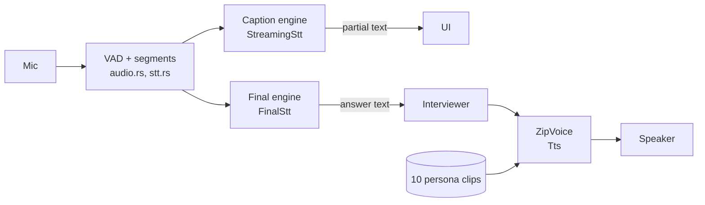

# Plan: voice without VoiceStudio

Status: draft v2 for review (2026-10-30). Phase 0 done; Phase 1 built 2026-10-30 (Pocket TTS + Parakeet, two voices), awaiting the owner's real-round testing. See `docs/engineering/VOICE.md`.
v2 adds the review feedback (`voice-without-voicestudio-review.md`): a gate for each phase, all 10 personas
tested, CPU as the baseline, live streaming checked, licensing made a release gate, model lifecycle and installer
rules, and a fixed test set.

## Goal

Spoken interviews work after installing **only Onsite**: no VoiceStudio, no Docker, no Python. Onsite runs its own
speech models and downloads them once, the first time someone turns voice on. Voice must work on a normal laptop
**without a GPU**. A GPU only makes it faster or more accurate.

## Decisions already made

| Decision | Choice | Why |
|---|---|---|
| VoiceStudio | Remove it from the voice path, in phases | A second ~22 GB app is too much to ask of friends |
| VoiceStudio Docker image | Not used | Needs Docker Desktop and the NVIDIA container toolkit, and is still the full PyTorch backend. VoiceStudio is AGPL-3.0, so a trimmed fork would also be AGPL |
| Interviewer voices | **Fixed voices.** Clone from 10 shipped reference clips | Same 10 people every time; no voice design at runtime |
| Hardware baseline | **CPU.** GPU is an optional speed-up | Friends' laptops; no dependence on a CUDA version or GPU vendor |
| Python for Run/Submit | **Tracked separately**, not part of this plan | It's a coding-runner question and doesn't block removing VoiceStudio |

## Today: what depends on VoiceStudio

| Job | How it works now | VoiceStudio part |
|---|---|---|
| Interviewer speaks | `POST :3900/v1/audio/speech`, OmniVoice cloning a persona profile | Server, model, profiles |
| Live captions | WebSocket `:3900/v1/audio/transcriptions/stream`, Parakeet TDT v2 partials | Server, model |
| Where an answer is cut | Onsite's own VAD in `stt.rs` (pause rules, 400 ms pre-roll, 3–20 s segments) | None |
| Accurate transcript | `sidecar/whisper_server.py`, Whisper large-v3 on GPU | Its Python runtime and downloaded weights |
| Persona voices | `vs.rs::persona_voice` designs, scores and saves clone profiles | Profiles API, voice design |
| Run/Submit in Python | `runner::python()` falls back to VoiceStudio's Python | Its Python runtime (separate decision) |

Disk use on the owner's machine (measured 2026-10-30):

| Folder | Size |
|---|---|
| `%LOCALAPPDATA%\Programs\VoiceStudio` (app) | 0.9 GB |
| `%APPDATA%\VoiceStudio\runtime` (Python, PyTorch 7 GB, uv cache 1.1 GB) | 10.8 GB |
| `%LOCALAPPDATA%\OmniVoice\hf_cache` (models) | 9.8 GB |
| **Total** | **~22 GB** |

Of this, Onsite uses ~7.3 GB of models.

Workarounds that go away with VoiceStudio:
- ~70 s cold start
- unloading after 15 minutes idle
- silent-model demotion
- the no-locking rule for profiles
- voice drift from designed voices

## Target

| Job | Engine (to confirm in Phase 0) | CPU baseline | GPU (optional) |
|---|---|---|---|
| Live captions | Option A: Parakeet v2, re-run on the open segment every ~0.5 s. Option B: a small true-streaming model (sherpa-onnx streaming zipformer) | Required | — |
| Final text per segment | Parakeet TDT 0.6B v2 int8 via `sherpa-onnx` | Required | — |
| Accurate transcript | Whisper large-v3-turbo, quantized, via `whisper-rs` (whisper.cpp) | Off (too slow on CPU) | Optional download |
| Interviewer voice | ZipVoice (zero-shot cloning) via `sherpa-onnx` | Required, must meet the CPU target | Faster |
| Persona identity | 10 reference clips (~10.5 s each) + their exact transcript | Shipped in the installer | — |

Why captions need their own design: as far as we know, sherpa-onnx runs Parakeet TDT as an **offline** model. It
transcribes a finished clip and doesn't stream partial words. VoiceStudio's live stream probably fakes partials by
re-decoding the audio so far. Onsite already decides where segments start and end, so captions only need partial
text for the open segment. Option A reuses one model; option B is closer to real streaming. Phase 0 picks one.

**Footprint: provisional.** We estimate 1–2 GB, but none of it is measured yet. Phase 0 measures the exact pinned
files and splits them into:

| Group | Contents | Needed for |
|---|---|---|
| Required | ONNX Runtime (in the installer), Parakeet v2, caption model if option B, ZipVoice + vocoder, persona clips | Any spoken round |
| Optional | Whisper turbo | Better tech-term accuracy on machines with a GPU |
| Platform-specific | GPU execution provider files (DirectML on Windows, CoreML/Metal on macOS, CUDA on Linux) | Speed-up only |
| Temporary | Partial downloads in `models/.partial/` | Removed after install or cancel |

Side benefit: the same code runs on macOS and Linux. Today voice is effectively Windows-only.

## Phase 0: spike

A standalone example, `src-tauri/examples/voice_spike.rs`. The app is not changed. Models go to a scratch folder.
The report goes to `docs/plans/voice-spike-results.md`.

### Step 0.1: fixed test set (before any engine is tried)

Earlier accuracy numbers came from 8 recordings that weren't saved, so there is nothing to compare against yet.

- **The owner records 12–15 spoken answers** on the real mic, at 16 kHz mono WAV:
  - tech terms (Kafka, PostgreSQL, Redis, idempotency key, Big-O)
  - numbers and units
  - names
  - short answers (~5 s) and long ones (60–90 s, with pauses)
  - one answer with the owner thinking out loud
- **Ground truth:** the owner writes out the exact text of each answer.
- **TTS set:** 25 lines covering:
  - short and long sentences
  - questions
  - code identifiers said aloud ("call `getUserById`")
  - numbers ("two to the power of thirty-two", "99.9 percent")
  - names
  - a natural filler line ("Okay, that makes sense. Let's go a bit deeper.")
- Store both in `src-tauri/tests/fixtures/voice/` (WAVs, `answers.json` with the text, `tts_lines.txt`).
  Recordings of the owner's voice: the owner decides whether they go into the public repo or stay local and
  gitignored.

### Step 0.2: baseline today's setup

Run the **current** stack on the same set, so the new one is compared with what is used now:
- VoiceStudio Parakeet, live caption and final text
- the Whisper large-v3 sidecar
- OmniVoice speaking the 25 lines in all 10 voices

Record word error rate (WER), latency and the audio files.

### Step 0.3: tests and gates

| Area | What to measure | Gate (must pass to go to Phase 1) |
|---|---|---|
| TTS identity, early check | Arjun, Neha, Ethan, Priya × 25 lines | The owner hears no identity drift; Indian and British accents survive. If this fails, stop and try the next cloning model before testing all 10 |
| TTS identity, full | **All 10 personas** × 25 lines, rendered twice | Per persona, rated by the owner against today's voice: identity, accent, pronunciation, prosody, clipping, same output on both runs. All 10 pass, or a failing persona gets a new clip |
| Personas distinct | Same line by all 10 | No two personas sound alike |
| TTS speed, CPU | Cold load, warm time to first audio, real-time factor | Warm first audio ≤ 1.5 s for a short sentence, and real-time factor < 1 (faster than speech) on the owner's laptop CPU with the GPU disabled |
| TTS speed, GPU | Same, on the RTX 5050 | Recorded only; no gate |
| Live captions (in the real loop) | Run with the live mic through `stt.rs` VAD + segmenting: first partial latency, update rate, whether text jumps around, pauses, speaking on after a pause, pre-roll | First partial ≤ 1 s after speech starts; updates at least every 1 s; captions don't flicker badly; segment cuts unchanged |
| Final text, CPU | Parakeet on each finished segment: WER on the test set, latency of the last segment | WER no worse than today's VoiceStudio Parakeet; last segment ≤ today's ~3.4 s |
| Accurate transcript, GPU | Whisper turbo WER + latency, measured separately | Recorded vs today's large-v3; decides whether Whisper is worth an optional download |
| Resources | Peak and steady RAM/VRAM, CPU %, load time per model, all three loaded together | Fits on a 16 GB RAM laptop with the app and a browser open |
| Build | `cargo build` on Windows (MSVC) locally; the CI dry run (`workflow_dispatch`) compiles on macOS and Linux | Compiles and links on all three; runs on Windows |
| Licensing | A licence record for every asset (table below) | No blocker for downloading the models; the persona clip question has an answer or a fallback |

Report format for each area:
- what was tested
- exact hardware and software versions
- measured numbers
- known limits
- pass/fail against the gate

The RTX 5050 numbers are one data point, not the bar.

If the TTS gates fail, try another zero-shot cloning model that runs on ONNX Runtime; everything else stays the
same. If none passes, stop and decide again. Don't fall back to VoiceStudio quietly.

**Phase 0 exit gate:** every row above passes, and the owner has listened to the 10-persona comparison.

## Phase 1: built-in engine next to VoiceStudio

### Interfaces (`src-tauri/src/voice/engine.rs`)

Three traits, one per job, so each part can change on its own:

| Trait | Methods | Built-in | VoiceStudio (today's code moved behind it) |
|---|---|---|---|
| `Tts` | `load(voice: VoiceRef)`, `speak(text, delivery) -> PCM`, `status()` | ZipVoice | `/v1/audio/speech` + profiles |
| `StreamingStt` | `begin_segment()`, `push(frames)`, `partial() -> text`, `end_segment() -> text` | Option A or B from Phase 0 | the WebSocket stream |
| `FinalStt` | `transcribe(pcm, prompt) -> text`, `status()` | Whisper turbo (GPU) or none | the Python sidecar |

- `VoiceRef` = **identity**: a persona clip + its transcript.
- `Delivery` = **how it's said**: speed (from persona pace × user speed) and step count.
- Changing delivery never changes identity.
- VAD, segment cutting, `clean_transcript` and the vocabulary fixes stay in `stt.rs` and are shared by both engines.

### Model lifecycle

| Model | Loaded | Between rounds | Unloaded | On load failure |
|---|---|---|---|---|
| ZipVoice | At round start (loader step "Interviewer's voice") | Stays loaded for 15 min after a round | After 15 min idle, on app exit, or on low memory | Round runs typed; message names the fix |
| Caption model | At round start | Stays with ZipVoice | Same | Answer is still transcribed at the end; no live caption |
| Parakeet (final) | At round start | Stays | Same | Round runs typed |
| Whisper | At round start, only if installed and a GPU is found | Stays | Same | Parakeet's text is used (today's fallback) |

- Every model can be reloaded without restarting Onsite: Settings › Voice › "Reload models".
- Phase 0 measures cold and warm start. If cold start is short enough, drop the 15-minute keep-alive.
- Low memory: if loading fails with out-of-memory, unload Whisper first, then retry.

### Model manager (`src-tauri/src/voice/models.rs`)

- **Pinned files.** A list in code: id, group (required/optional/platform), URL with an **exact revision**
  (a Hugging Face commit hash or a sherpa-onnx release tag, never `main`), size and SHA-256.
- **Download and install:**
  - Before starting, check free space ≥ size + 10 %.
  - Download into `<app data>/models/.partial/<id>`, resuming with HTTP Range when interrupted.
  - Verify size and SHA-256.
  - Then **rename atomically** into `<app data>/models/<id>/`. Only that folder counts as installed.
  - A failed checksum deletes the partial file and reports it.
- **One download per model at a time** (a lock per id). Pressing Download twice joins the running download.
- **Cancel:** stops the transfer and keeps the partial file for resume. "Delete" removes both.
- **Errors name the fix:**
  - network: "Couldn't reach Hugging Face. Check your connection and press Retry."
  - disk: "Needs 1.4 GB free on C:. You have 600 MB."
  - checksum: "The download was damaged. Press Retry."
- **Only fixed hosts:** huggingface.co and github.com, like the updater's github.com-only rule.

### First-run UI

Turning voice on with no models shows one card:
- each component with its size and whether it's required or optional
- the total
- where the files go (`<app data>/models`, with an Open folder link)
- Download, Cancel, Resume
- what happens on failure: "Rounds stay typed until voice models are installed."

Until the required models are ready, rounds run typed, which is the existing fallback.

### Persona voices

- Copy the 10 clips to `prompts/voices/<persona_id>.wav`. `PERSONA_SAMPLE` becomes `prompts/voices/sample.txt`.
- `panels.json`: each interviewer's `voice` gets `"clip": "voices/<id>.wav"`. Gender, age and accent stay as
  descriptions for the UI. Pace stays a delivery setting.
- Bundled with `prompts/`, which is already a bundled resource.

### Loader and settings

| Loader step (`PREP_STEPS`) | Built-in engine |
|---|---|
| VoiceStudio | becomes "Voice models": installed / downloading / missing |
| Interviewer's voice | ZipVoice loaded + warm-up line |
| Live captions | caption model loaded |
| Accurate transcript | Whisper loaded, or "Off: no GPU" / "Not installed" |

Settings › Voice:
- **Engine:** Built-in or VoiceStudio.
- **Voice models card:** components, sizes, status, Download/Cancel/Resume/Delete, Reload.
- **Voice list:** the 10 fixed voices with Play, plus a default voice for non-panel rounds.
- **Delivery:** speed and quality, kept separate from the voice choice.
- **VoiceStudio rows** (status, Start, version) are shown only when the VoiceStudio engine is chosen.

### Engine choice for existing users

- **New installs:** Built-in by default (from Phase 2).
- **Existing installs:** keep their current engine during Phases 1–2. If VoiceStudio is configured and was used,
  it stays selected. Settings shows a one-time note: "A built-in voice engine is available. Try it in
  Settings › Voice."

**Phase 1 exit gate:**
- 5 full spoken rounds on the built-in engine with no voice failure, CPU only; the owner also runs some with the GPU.
- Existing VoiceStudio users see no change unless they switch.
- Failure handling is tested by hand:
  - missing model
  - download killed half-way and resumed
  - corrupted file (bad checksum)
  - no GPU
  - mic or speaker unplugged mid-round
  - disk too full
- `cargo clippy -- -D warnings` and `cargo test` pass.
- `VOICE.md` is updated.

## Phase 2: built-in by default, wider testing

- The owner uses Built-in for a week of real rounds. Record time to first audio, caption lag and transcript errors
  in `docs/engineering/VOICE.md`.
- New installs default to Built-in. Existing VoiceStudio users keep it, with the switch offered.
- **Rollback:** Settings can switch back to VoiceStudio. Keep it for the whole of Phase 2.
- Friends test on at least one CPU-only Windows laptop, one Mac and one Linux machine. These are the first runs
  by a person on macOS/Linux.

**Phase 2 exit gate:** a week of the owner's rounds plus friends' reports show Built-in is at least as good as
VoiceStudio, with no blocking bug on any of the three systems.

## Phase 3: remove VoiceStudio

**Delete:**
- `vs.rs`: profiles, voice design, sample scoring
- the VoiceStudio side of `stt.rs` (WebSocket, `english_model`, `prepare`, `undemote`, model install)
- `sidecar/whisper_server.py` and the sidecar code in `whisper.rs`
- `voice_launch`
- VoiceStudio rows in `updates.rs` and `storage.rs`
- the VoiceStudio engine option

**Migration:** users still on VoiceStudio see "VoiceStudio is no longer used. Download the built-in voice models
(about X GB) to keep spoken rounds." Until then, rounds run typed.

**Update:**
- `voice_status` and `storage.rs` ("Voice models" in Onsite's own folder, with Delete)
- `CLAUDE.md`: Non-negotiable 3 becomes "Speech is local, run by Onsite's own models"; remove the VoiceStudio
  sections and keep only facts that still apply
- `VOICE.md`, `ARCHITECTURE.md`, `RELEASE.md`, `PRODUCT.md`
- the Privacy text in `index.html`
- `LICENSES/` and `THIRD_PARTY` notices
- a troubleshooting section for model downloads

The `runner::python()` VoiceStudio fallback is handled by the separate Python-runner decision. If that decision
isn't made yet, keep the fallback (it only reads a folder if one exists).

**Phase 3 exit gate:** a release with no VoiceStudio code, docs updated, and the licensing records complete.

## Licensing record (release gate)

One row per distributed or downloaded asset. Fill it in during Phase 0; nothing ships with an empty row.

| Asset | Part | Source + exact revision | Licence | Attribution needed | Redistribute? | Commercial use? |
|---|---|---|---|---|---|---|
| sherpa-onnx | library | crate version | Apache-2.0 (to confirm) | notice | yes | yes |
| ONNX Runtime | library | version | MIT (to confirm) | notice | yes | yes |
| whisper.cpp / `whisper-rs` | library | version | MIT (to confirm) | notice | yes | yes |
| Whisper large-v3-turbo | weights | HF commit | MIT (to confirm) | | | |
| Parakeet TDT 0.6B v2 | weights + tokenizer | HF commit | CC-BY-4.0 (to confirm) | yes | | |
| Caption model (option B) | weights | | to check | | | |
| ZipVoice | code | | to check | | | |
| ZipVoice | weights + vocoder | | to check (training data may restrict it) | | | |
| Persona clips ×10 | generated audio | made with OmniVoice (weights CC-BY-NC) | to check | | | |

Don't assume a code licence covers the weights or the assets.

**Persona clip fallback.** If the clips can't be redistributed, ZipVoice can't design new voices from a text
description, so new reference clips have to come from:
1. consented recordings of real people (best quality; needs a signed consent note per voice), or
2. a voice-design model whose weights allow redistribution of its output.

Pick one in Phase 0 if the licence check goes the wrong way.

## Files touched (overview)

| File | Phase 1 | Phase 3 |
|---|---|---|
| `voice/engine.rs` | new: `Tts`, `StreamingStt`, `FinalStt` | VoiceStudio implementations removed |
| `voice/builtin/{tts,stt,whisper}.rs`, `voice/models.rs` | new | — |
| `voice/mod.rs` | speaks through `Tts` | — |
| `voice/stt.rs` | segments go to `StreamingStt` / `FinalStt`; VAD and cleanup stay | WebSocket + model-choice code removed |
| `voice/vs.rs` | moved behind the traits | deleted |
| `voice/whisper.rs`, `sidecar/` | whisper.cpp added | Python sidecar deleted |
| `panels.rs`, `prompts/panels.json`, `prompts/voices/` | clip per persona | voice-design fields removed |
| `interview/live.rs` | new loader steps | VoiceStudio health check removed |
| `commands.rs`, `lib.rs` | model status/download/cancel/delete/reload commands | VoiceStudio warm-up, persona prebuild, `voice_launch` removed |
| `updates.rs`, `storage.rs` | — | VoiceStudio rows removed; voice models added |
| `ui/app.js`, `ui/index.html` | engine choice, models card, loader steps, voice list, delivery | VoiceStudio UI removed |
| `Cargo.toml` | `sherpa-onnx`, `whisper-rs` | `tokio-tungstenite` dropped if unused |
| `.github/workflows/release.yml` | build deps per OS | — |
| `src-tauri/tests/fixtures/voice/` | test set from Phase 0 | — |

## Risks

| Risk | Why it matters | What we do |
|---|---|---|
| Persona identity drift or lost accent | Interviewers sound wrong or inconsistent | 4-persona early check, then all 10 × 25 lines × 2 runs, rated by the owner |
| ZipVoice too slow on CPU | Voice unusable on friends' laptops | Hard CPU gate in Phase 0; try other models before integrating |
| Live captions regress (offline model) | Captions lag or jump | Test live in the real loop; option A vs B decided by measurement |
| GPU runtime packaging | Fragile setup, big installer | CPU baseline; GPU providers optional and per platform |
| Footprint bigger than estimated | Long first download | Measure pinned files; split required/optional; show sizes before downloading |
| Licensing | Can't ship clips or a model | Licence record as a release gate; persona clip fallback ready |
| macOS/Linux behave differently | Broken voice on those systems | CI compile in Phase 0; people run them in Phase 2 |
| RAM/VRAM pressure | Laptop slows or a model fails to load | Measure peak in Phase 0; lifecycle policy; unload Whisper first |
| First-run download fails | User stuck without voice | Atomic install, resume, cancel, disk check, clear errors; typed rounds meanwhile |

## Open questions for the owner

1. Do the test recordings of your voice go into the public repo, or stay local and gitignored?
2. Keep the VoiceStudio engine after Phase 3, or delete it? (The plan says delete.)
3. Whisper on GPU machines: an optional download the user chooses, or downloaded automatically when a GPU is
   found?
4. Default voice for non-panel rounds: which of the 10?

Tracked elsewhere: Python for Run/Submit (installed vs embedded).

## Out of scope

- Barge-in by voice (needs echo cancellation)
- New languages (Onsite stays English-only)
- New persona voices (can be added later as new clips)
